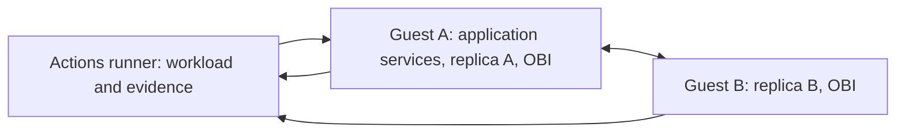

# Discovering operation models from eBPF observations in distributed applications

**Research status: implementation and technical qualification in progress. The 27-campaign measurement series has not started. No accuracy or enrichment result is claimed.** This README is the evolving research report. A green deployment job is not a successful research result.

## Abstract

Application traces can support discovery of execution dependencies and operation-success models, but many projects have no tracing or incomplete coverage. This empirical study tests whether eBPF observations can supply sufficiently useful evidence in those settings. Ten operations from DeathStarBench Social Network, OpenTelemetry Demo, and Spring Petclinic Microservices run across two Linux virtual machines with independent kernels. We compare absent, partial, and full application tracing; calibrate under four controlled replica states; and predict success under a new mixture of those states. Independent HTTP content and database checks evaluate the predictions. Additional controls examine operation classes, cross-machine execution links, database dependencies, and asynchronous checkout/accounting. Measurements are pending; this repository currently provides deployment adapters, acquisition code, and technical qualification workflows.

## Motivation and research questions

The contribution sought is empirical evidence about applying model discovery and simulation with missing instrumentation. We do not introduce a new discovery algorithm or assume that eBPF necessarily provides more information than native tracing.

1. Can evidence acquired without complete application tracing support useful predictions on an independent workload?
2. Which execution links remain identifiable across processes, replicas, and independent Linux kernels?
3. Can observed method/route signatures identify operation classes, and does downstream execution add useful separation?
4. Does eBPF recover database dependencies missing from the available native traces? Does an addition affect an independently validated prediction?
5. Can a synchronous checkout response be connected to its asynchronous accounting effect using actual order/message identity?

The practical forecast target is mean absolute error at most **5 percentage points per operation**, across three repeats of each tracing mode. This is an evaluation target, not a condition for publishing a run. Unknowns, wide intervals, and failures remain visible.

## Context and scope

Native traces can already include database client spans and database attributes. Adding a DB node is therefore not intrinsically an eBPF advantage. Full tracing retains all collected DB spans; traces, eBPF, and their combination are compared on actual evidence. See the [OpenTelemetry database conventions](https://opentelemetry.io/docs/specs/semconv/database/).

[OpenTelemetry eBPF Instrumentation (OBI)](https://opentelemetry.io/docs/zero-code/obi/) is the first acquisition path. We use release 0.15.2 and retain resolved image digests, configurations, and collector diagnostics. Documented [protocol instrumentation](https://opentelemetry.io/docs/zero-code/obi/configure/export-data/) motivates a test; it does not prove recovery of these application operations. One bounded [DeepFlow](https://github.com/deepflowio/deepflow) fallback is allowed for a system with missing necessary protocol evidence. This is not a collector benchmark.

The operation set and controlled-replica approach continue the [SIMPAT experiment repository](https://github.com/a-a-k/telemetry-availability-identification). This study does not reuse an unconditional forecast under a changed state distribution: conditional-state weighting makes the transfer explicit. The [protocol](docs/PROTOCOL.md) records the criterion, equivalent direct baseline, and prior independent skeptic GO.

## Applications and environment

| Application | Pinned source | Operations | Controlled replicas |
|---|---|---|---|
| DeathStarBench Social Network | [`6ecb097`](https://github.com/delimitrou/DeathStarBench/tree/6ecb09706140f8730b5385c08f1386c654c3c526) | Compose post; home timeline; user timeline | User-timeline A/B |
| OpenTelemetry Demo 3.0.0 | [`8c47d47`](https://github.com/open-telemetry/opentelemetry-demo/tree/8c47d47c9ac27710d2b2a153bcd53e483bffe66d) | Browse product; add to cart; checkout | Product-catalog A/B |
| Petclinic Microservices | [`3858f9c`](https://github.com/spring-petclinic/spring-petclinic-microservices/tree/3858f9c630cf989bb6809a86edf47c2be78dc9f1) | List owners; owner details with visits; create visit; list vets | Visits A/B |

Each campaign creates two Ubuntu guests using QEMU/KVM on one standard public GitHub Actions Linux runner. Each has its own kernel, boot ID, network stack, Docker daemon, and eBPF collector. Guest addresses are `192.168.76.11` and `.12`, with routed container subnets `172.28.11.0/24` and `172.28.12.0/24`. Replicas A/B reside on different guests. Routing remains fixed during replica failures.



The shared physical host is a limitation: these experiments exercise inter-kernel execution and networking, but not independent physical-machine failures. KVM and readable guest BTF are required. Infrastructure failures are recorded; two containers are not substituted for two machines, and paid runners are not connected automatically.

The default allocation is two vCPUs and 6 GiB per guest when runner memory permits. Host resources, guest allocation, kernel versions, boot IDs, cloud-image checksum, application image digests, and resolved Compose configurations are retained. The guest image is pinned to Ubuntu Noble's 2026-10-17 build, SHA-256 `04e8f2461a16a44e78a370284471f29616cdd9baf1893df25807b71f985b6c94`.

Deployment changes and manual knowledge are detailed in the [DeathStarBench](systems/deathstarbench/README.md), [OTel Demo](systems/otel_demo/README.md), and [Petclinic](systems/petclinic/README.md) notes. These are real pinned upstream systems, not replacement services producing synthetic spans.

## Method and information boundaries

### Acquisition

OBI runs on both guests in every tracing mode. Exclusion of already instrumented services is disabled. Automatic eBPF context propagation is enabled and recorded. OBI Java-agent and Node.js runtime injection are disabled in the current configuration; this may limit language-specific correlation and is part of the interpretation of coverage. The experiment also captures SQL query text and HTTP bodies on `/api/*` to inspect business-identity evidence. These are synthetic application fixtures. Oracle CLI processes, Jaeger, native collectors, and the fallback collector are excluded from OBI targeting.

Every workload HTTP step carries a unique opaque `X-Experiment-Request-Id`. Only this header is selected for OBI enrichment. It contains no operation name, dependency map, or outcome. It binds the request census to an observed entry span; it does not establish a downstream link. Native header capture is requested where supported, with support checked in actual spans. The generator does not inject sampled `traceparent` or Jaeger contexts.

eBPF and native raw records have separate provenance. The receiver records OTLP JSON versus protobuf encoding; normalized trace/span identifiers use hexadecimal. Native Jaeger exports are also supported. Missing or malformed observations are recorded rather than replaced.

### Discovery and evaluation

The learner receives observed spans and a restricted census: opaque attempt keys, ordered opaque step IDs, phase, and controlled state. It does not receive operation labels, response bodies, SQL oracle results, or expected dependency maps. Grouping HTTP steps into one attempt is supplied workload knowledge; this is not automatic business-process segmentation.

The evaluator separately receives labels, fixture expectations, request/response evidence, and SQL observations. Deployment manifests are references for placement and DB identity, not discovered topology. Both simulation and the direct weighted baseline receive the same permitted evidence and state weights.

The basic class representation uses observed method and normalized route; an augmentation uses confirmed downstream signatures. Healthy training and test segments are separate. Generator labels are evaluation-only. Missing anchors and ambiguous classes remain unknown. Unclassified calibration attempts must widen compatible classes' bounds rather than disappear from denominators. Class assignment rules are fixed before target acquisition.

Service instances and placement use available resource/process attributes and collector provenance. A cross-node link requires observed parent/child or message identity. A connection, common topic, or temporal proximity is insufficient. Observed link counts are distinct from an independently validated link-error rate; the latter is unknown without a reference.

Database analysis distinguishes logical address, concrete instance evidence, and dependencies shared by multiple services. Known database ports alone do not identify an operation's dependency.

### Conditional execution model and simulation

The four states `11`, `10`, `01`, and `00` indicate replica availability. Target weights are `(4,2,1,1)/8`. For class c, exact integration is `p(c) = sum_s w(s) p(c | s)`. Monte Carlo uses 100,000 draws from the same conditional model and is checked against exact integration.

Direct stratified estimation is algebraically equivalent and is the strongest simple baseline. Simulation is not claimed to improve it. Potential usefulness comes from acquiring evidence despite missing tracing and is judged against external outcomes. The current implementation design uses the joint observed entry-status/deadline event as a proxy; semantic mismatches must be measured independently. Products of independent per-step success rates are not substituted for joint outcomes.

Model and forecast files are saved before target acquisition. Unknown outcomes yield bounds, not fabricated point estimates. Adding graph structure that does not affect the calculation is not a forecast improvement. HTTP status/duration alone does not implement durable asynchronous completion.

## Experimental design

**27 campaigns:** three systems × three actual tracing modes × seeds `0`, `1`, `2`.

- `absent`: native tracing disabled; eBPF available.
- `partial`: native tracing disabled on both controlled replicas; other native traces and eBPF available.
- `full`: native tracing enabled throughout the deployed application; eBPF also recorded.

Suppression is checked through configuration and retained telemetry. A disconnected exporter alone does not prove disabled instrumentation.

| Segment per campaign | Blocks | Seconds/block | Operations/s | Attempts |
|---|---:|---:|---:|---:|
| Healthy class training | 1 | 30 | 4 | 120 |
| Calibration, one block per state | 4 | 60 | 4 | 960 |
| Independent target, state counts 4/2/1/1 | 8 | 30 | 4 | 960 |
| Healthy class test | 1 | 30 | 4 | 120 |
| **Primary total** | **14** | | | **2,160** |

The primary series contains **58,320 operation attempts**. Multi-step operations generate more HTTP requests; this is not a packet or span count. Each application's mixture is balanced. Reset, readiness, settling, and outstanding-work completion happen between blocks and count toward cost.

### Database controls

Each campaign performs 20 attempts with its selected DB available and 20 unavailable, on the same deployment: 1,080 additional attempts overall. Detected dependencies are checked against behavior. Caches can mask outages; that is a result, not permission to infer outcomes from topology. Structural additions and prediction changes are reported separately.

### Asynchronous controls

OTel Demo uses its existing `checkout → Kafka → accounting → PostgreSQL` chain through the full Compose configuration. Each OTel campaign adds 20 checkouts in normal operation, 20 with accounting stopped, and 20 after recovery: 540 additional attempts overall.

Immediate success requires the HTTP result within two seconds. Durable success requires the correct order and items to be observed in PostgreSQL within ten seconds of operation start. Producer API return, HTTP 200, topic name, and Kafka request correlation ID do not establish durable completion or identify the consumer's business event.

Accounting remains stopped until all deadlines expire; the queue is drained before the recovery block. A first positive DB observation after the deadline cannot prove timely success. These controls do not claim prediction of an uncalibrated consumer-failure regime.

## Outcomes, uncertainty, and cost

Evaluation retains every operation, tracing mode, and repeat. Outputs include signed/absolute forecast errors, uncertainty intervals, external success, unknown fractions, class ARI, supported cross-node links, database dependencies, and costs. Conservative interval error for `[L,U]` and external rate y is `max(|L-y|,|U-y|)`. Width above 10 percentage points is insufficiently informative. Per-attempt proxy-versus-business mismatches prevent compensating semantic errors from disappearing inside an aggregate.

Costs include preparation, downloads/builds, VM startup, acquisition, state changes, settling, queue draining, oracle queries, inference, simulation, analysis, and technical failures. Job duration and machine resources accompany measured process timings. Manual semantic declarations and engineering work are described separately, not treated as free automation.

## Results

**No primary measurements are available yet.** Tables, plots, example models, DB comparisons, and async evidence will be generated from retained campaign artifacts. The counts above are planned counts only.

| Stage | Evidence | Interpretation |
|---|---|---|
| Adapters | Three implementations and focused checks | Static preparation only |
| Two-kernel infrastructure | [Passed first technical run](https://github.com/a-a-k/ebpf-model-discovery-experiments/actions/runs/40324200754) | Two distinct boot IDs, kernel 6.8.0-147, BTF, 6 GiB per guest; infrastructure only |
| Protocol support | Application captures pending | No Thrift/Kafka recovery claim |
| 27 campaigns and final review | Not started | No accuracy or enrichment claim |

Technical reruns retain the failed attempt and its cause. The series is not expanded to obtain positive results.

## Discussion and limitations

Guests share physical resources. Four controlled states provide a restricted transfer test, not arbitrary failure extrapolation or failure-transition dynamics. Target mixture weights are supplied. Fixed application versions and three repeats limit generalization. Workload grouping and semantic rules include manual knowledge. Protocol/language coverage can leave links unknown. Context propagation changes metadata and affects interpretation of portability and cost. Full native tracing may already contain every database dependency eBPF recovers.

## Reproduction

Application execution and research computation run in GitHub Actions. Local activity is editing, static checks, and focused unit checks.

```bash
gh repo clone a-a-k/ebpf-model-discovery-experiments
cd ebpf-model-discovery-experiments
gh workflow run infrastructure.yml
gh workflow run qualification.yml -f system=all -f mode=absent
gh run list
gh run view RUN_ID
gh run download RUN_ID -D downloaded/RUN_ID
```

`qualification.yml` accepts `all`, `deathstarbench`, `otel_demo`, or `petclinic`, and `absent`, `partial`, or `full`. It creates two guests, starts collectors, exercises a small healthy census, exports observations/oracles, and tears down. This technical check does not replace a campaign. Runs and artifacts are linked from [Actions](https://github.com/a-a-k/ebpf-model-discovery-experiments/actions).

The fixed campaign interface and report regeneration are implemented:

```bash
gh workflow run campaigns.yml -f system=all -f mode=all -f seed=all
# A technical rerun can select one system, mode, and seed; preserve the prior run.
gh workflow run report.yml -f run_ids='CAMPAIGN_RUN_ID ANOTHER_RUN_ID'
```

Campaigns must follow successful deployment and observation qualification and implementation review. A campaign saves its forecast/hash before target traffic. The report requires all three distinct seeds for an aggregate and does not automatically select among duplicate runs. Missing files do not represent successful empty experiments. Artifacts expire after 90 days unless retained separately; key tables/models must be committed or archived before expiry.

```text
.github/workflows/       Infrastructure and application qualification
docs/PROTOCOL.md         Criterion, baseline, design, skeptic review
docs/ADAPTER_CONTRACT.md System interface and information boundaries
scripts/vms.sh          Independent guests and routed networking
src/ebpf_discovery/     Acquisition and observation normalization
systems/               Deployments, workloads, independent oracles
results/               Run artifacts (large files uploaded by Actions)
```

Artifacts include `qualification.json`, `deployment.json`, `commands.jsonl`, `external.json`, `observation-support.json`, separate `observations/` and `native/` directories, and diagnostics. Infrastructure uploads exclude SSH private keys and guest disks. Image/source provenance is retained; mutable references are not described as immutable.

## Conclusions and sources

The study is incomplete. Conclusions will identify operations/settings that did or did not meet the external criterion, with unknowns and costs. Collection, plausible graphs, and agreement with equivalent arithmetic alone do not establish useful discovery.

- [Existing SIMPAT experiments](https://github.com/a-a-k/telemetry-availability-identification).
- [DeathStarBench](https://github.com/delimitrou/DeathStarBench).
- [OpenTelemetry Demo](https://github.com/open-telemetry/opentelemetry-demo) and [accounting](https://opentelemetry.io/docs/demo/services/accounting/).
- [Petclinic Microservices](https://github.com/spring-petclinic/spring-petclinic-microservices).
- [OBI v0.15.2](https://github.com/open-telemetry/opentelemetry-ebpf-instrumentation/tree/v0.15.2), [discovery](https://opentelemetry.io/docs/zero-code/obi/configure/service-discovery/), and [enrichment](https://opentelemetry.io/docs/zero-code/obi/configure/metrics-traces-attributes/).
- [DeepFlow](https://github.com/deepflowio/deepflow).
- [QEMU system documentation](https://www.qemu.org/docs/master/system/index.html).
