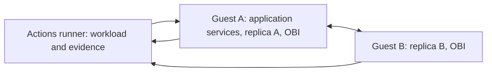
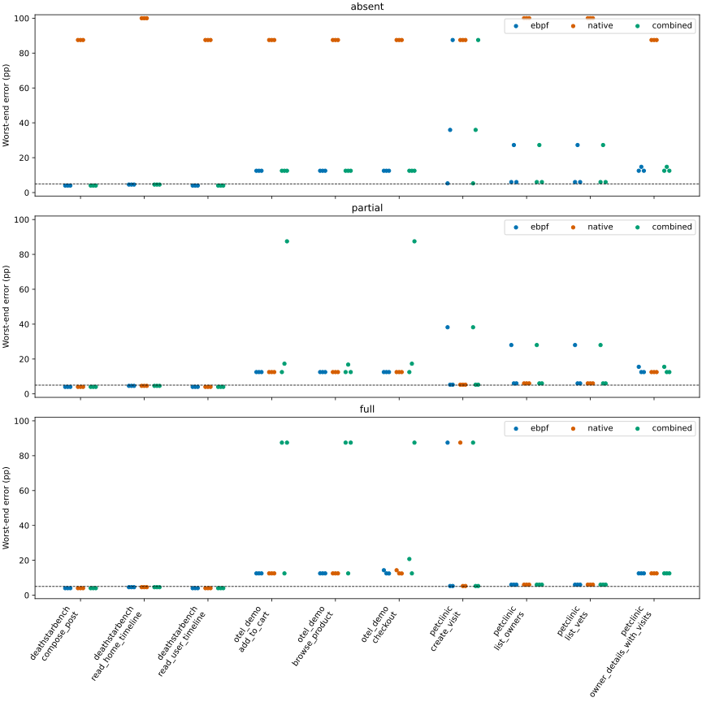

# Discovering operation models from eBPF observations in distributed applications

**Research status: the fixed 27-campaign series, final analysis and independent review are complete.** This README reports the measured positive, negative and unknown outcomes. The [final review](docs/PROTOCOL.md#final-result-review-2026-10-27) approves the report and does not endorse the full original usefulness claim. The [run history](docs/RUN_HISTORY.md) retains failed preparations, technical replacements and the superseded protocol pilot.

**Diagnostic iteration completed:** [retrospective controls](results/iteration-2/report.md) now distinguish classification, proxy semantics, Kafka export and nominal precision effects in the same 27 campaigns. The [refined design](docs/ITERATION_2.md#refined-minimum-design-for-the-next-implementation) follows those findings. Original results remain unchanged; oracle-assisted diagnostic improvements are not corrected eBPF forecasts.

**Fresh iteration 3 is in preparation:** the [updated protocol](docs/ITERATION_3.md)
uses explicit source-only completion contracts, a cheap HTTP/body comparator and
shared-database impact controls. Load increases to 20 operations/s, with four
300-second training blocks and eight 60-second target blocks: 34,800 primary
attempts per campaign, 939,600 across new seeds 3/4/5. Resource qualification
precedes acquisition. No fresh empirical result is claimed yet. The 5/10 pp
thresholds below describe the historical series only; new comparisons report
errors, uncertainty, unknowns and costs without an accuracy success gate.
The [timing amendment](docs/ITERATION_3.md#timing-amendment-no-imposed-application-deadline)
also removes the unjustified universal two-second business cutoff. A ten-second
engineering observation cap produces censoring, not an automatic failure.
Correctness, client-observed HTTP timing and SQL completion intervals are
reported separately; revised technical qualification precedes the fresh series.

## Abstract

Application traces can support discovery of execution dependencies and operation-success models, but many projects have no tracing or incomplete coverage. This empirical study tests eBPF observations on ten operations from DeathStarBench Social Network, OpenTelemetry Demo, and Spring Petclinic Microservices, using two Linux virtual machines with independent kernels. The [completed series](results/final/SOURCE.md) contains 27 campaigns and 58,320 primary attempts, plus database and asynchronous controls. Conditional models calibrated under four replica states predict outcomes under a new state mixture. DeathStarBench's three entry-event forecasts meet the conservative five-percentage-point target in all tracing modes; Petclinic retains semantic mismatches and unknowns, and OTel forecasts remain noninformative. Healthy operation grouping can succeed while failures make the intended class ambiguous. Native spans support checkout/accounting associations in enabled modes; the tested eBPF path confirms none. Database observations add structure but do not drive this predictor. Exact conditional-state weighting is equivalent to the Monte Carlo calculation, and superiority over simpler HTTP observation or direct estimation is not established. [Complete operation-level results](results/final/report.md) retain uncertainty and failed preparation costs.

## Motivation and research questions

The contribution sought is empirical evidence about applying model discovery and simulation with missing instrumentation. We do not introduce a new discovery algorithm or assume that eBPF necessarily provides more information than native tracing.

1. Can evidence acquired without complete application tracing support useful predictions on an independent workload?
2. Which execution links remain identifiable across processes, replicas, and independent Linux kernels?
3. Can observed method/route signatures identify operation classes, and does downstream execution add useful separation?
4. Does eBPF recover database dependencies missing from the available native traces? Does an addition affect an independently validated prediction?
5. Can a synchronous checkout response be connected to its asynchronous accounting effect using actual order/message identity?

The historical series used mean absolute error at most **5 percentage points per
operation** as a descriptive evaluation target. It has no application-loss or
power justification and is not retained as a success gate for the fresh series.
Unknowns, intervals, and failures remain visible.

## Context and scope

Native traces can already include database client spans and database attributes. Adding a DB node is therefore not intrinsically an eBPF advantage. Full tracing retains all collected DB spans; traces, eBPF, and their combination are compared on actual evidence. See the [OpenTelemetry database conventions](https://opentelemetry.io/docs/specs/semconv/database/).

[OpenTelemetry eBPF Instrumentation (OBI)](https://opentelemetry.io/docs/zero-code/obi/) is the first acquisition path. We use release 0.15.2 and retain resolved image digests, configurations, and collector diagnostics. Documented [protocol instrumentation](https://opentelemetry.io/docs/zero-code/obi/configure/export-data/) motivates a test; it does not prove recovery of these application operations. One bounded [DeepFlow](https://github.com/deepflowio/deepflow) fallback is allowed for a system with missing necessary protocol evidence. This is not a collector benchmark.

The operation set and controlled-replica approach continue the [SIMPAT experiment repository](https://github.com/a-a-k/telemetry-availability-identification). This study does not reuse an unconditional forecast under a changed state distribution: conditional-state weighting makes the transfer explicit. The [protocol](docs/PROTOCOL.md) records the criterion, equivalent direct baseline, and prior independent skeptic GO.

## Applications and environment

| Application | Pinned source | Operations | Controlled replicas |
|---|---|---|---|
| DeathStarBench Social Network | [`6ecb097`](https://github.com/delimitrou/DeathStarBench/tree/6ecb09706140f8730b5385c08f1386c654c3c526) | Compose post; home timeline; user timeline | User-timeline A/B |
| OpenTelemetry Demo 3.0.0 | [`8c47d47`](https://github.com/open-telemetry/opentelemetry-demo/tree/8c47d47c9ac27710d2b2a153bcd53e483bffe66d) | Browse product; add to cart; checkout | Product-catalog A/B |
| Petclinic Microservices | [`3858f9c`](https://github.com/spring-petclinic/spring-petclinic-microservices/tree/3858f9c630cf989bb6809a86edf47c2be78dc9f1) | List owners; owner details with visits; create visit; list vets | Visits A/B |

Each campaign creates two Ubuntu guests using QEMU/KVM on one standard public GitHub Actions Linux runner. Each has its own kernel, boot ID, network stack, Docker daemon, and eBPF collector. Guest addresses are `192.168.76.11` and `.12`; their separate Docker subnets are `172.28.11.0/24` and `172.28.12.0/24`. Cross-guest calls use published guest ports, because qualification did not establish direct Docker-subnet reachability. Replicas A/B reside on different guests. Routing remains fixed during replica failures.



The shared physical host is a limitation: these experiments exercise inter-kernel execution and networking, but not independent physical-machine failures. KVM and readable guest BTF are required. Infrastructure failures are recorded; two containers are not substituted for two machines, and paid runners are not connected automatically.

| System | Guest A | Guest B | Selected DB intervention | Required cross-guest transport |
|---|---|---|---|---|
| DeathStarBench | Frontend and ordinary services, user-timeline A, fixed HAProxy, MongoDB/Redis stores | User-timeline B | Stop/start `user-timeline-mongodb` on A | Proxy to B:19090; B to A's MongoDB:37020, Redis:16383 and post-storage:19092 |
| OTel Demo | Frontend and ordinary services, product-catalog A, fixed Envoy router, Kafka, accounting, PostgreSQL, Valkey | Product-catalog B | Stop/start `astronomy-db` on A | Router to B:13550; B to A's PostgreSQL:15432 and flagd:18013 |
| Petclinic | Gateway, customers, vets, Visits A, fixed HAProxy and MySQL | Visits B | Stop/start MySQL on A | Proxy to B:18081; B to A's MySQL:13306 |

Both guests run OBI, and enabled native observation is retained separately. The Kafka/accounting chain resides on guest A; it tests asynchronous identity, while the catalog calls and database accesses exercise guest boundaries. Kafka delivery is not presented as a separate-machine experiment. Placement is supplied deployment metadata; the tables above are not discovery input.

The default allocation is two vCPUs and 6 GiB per guest when runner memory permits. Host resources, guest allocation, kernel versions, boot IDs, cloud-image checksum, application image digests, and resolved Compose configurations are retained. The guest image is pinned to Ubuntu Noble's 2026-10-17 build, SHA-256 `04e8f2461a16a44e78a370284471f29616cdd9baf1893df25807b71f985b6c94`.

Deployment changes and manual knowledge are detailed in the [DeathStarBench](systems/deathstarbench/README.md), [OTel Demo](systems/otel_demo/README.md), and [Petclinic](systems/petclinic/README.md) notes. These are real pinned upstream systems, not replacement services producing synthetic spans.

## Method and information boundaries

### Acquisition

OBI runs on both guests in every tracing mode. Exclusion of already instrumented services is disabled. Automatic eBPF context propagation is enabled and recorded. OBI Java-agent and Node.js runtime injection are disabled in the current configuration; this may limit language-specific correlation and is part of the interpretation of coverage. The experiment also captures SQL query text and HTTP bodies on `/api/*` to inspect business-identity evidence. These are synthetic application fixtures. Explicit executable exclusions cover `psql`, `mysql`, `valkey-cli`, Jaeger and DeepFlow. The five final OTel technical replacements additionally exclude only the isolated `study-kafka-admin-*` container; qualification verified that the helper produced no instrumentation while broker/application observation remained enabled. The configuration otherwise targets container processes broadly; it does not guarantee exclusion of every administrative or observability process. Such process observations cannot automatically be interpreted as business dependencies.

Every workload HTTP step carries a unique opaque `X-Experiment-Request-Id`. Only this header is selected for OBI enrichment. It contains no operation name, dependency map, or outcome. It binds the request census to an observed entry span; it does not establish a downstream link. Native header capture is requested where supported, with support checked in actual spans. The generator does not inject sampled `traceparent` or Jaeger contexts.

eBPF and native raw records have separate provenance. The receiver records OTLP JSON versus protobuf encoding; normalized trace/span identifiers use hexadecimal. Native Jaeger exports are also supported. Missing or malformed observations are recorded rather than replaced.

### Discovery and evaluation

The learner receives observed spans and a restricted census: opaque attempt keys, ordered opaque step IDs, phase, and controlled state. It does not receive operation labels, response bodies, SQL oracle results, or expected dependency maps. Grouping HTTP steps into one attempt is supplied workload knowledge; this is not automatic business-process segmentation.

The evaluator separately receives labels, fixture expectations, request/response evidence, and SQL observations. Deployment manifests are references for placement and DB identity, not discovered topology. Both simulation and the direct weighted baseline receive the same permitted evidence and state weights.

The basic class representation uses observed method and normalized route; an augmentation uses confirmed downstream signatures. Healthy training and test segments are separate. Generator labels are evaluation-only. Missing anchors and ambiguous classes remain unknown. Unclassified calibration attempts must widen compatible classes' bounds rather than disappear from denominators. Class assignment rules are fixed before target acquisition.

The [adjusted Rand index (Hubert and Arabie, 1985)](https://doi.org/10.1007/BF01908075), abbreviated ARI, compares discovered grouping with the withheld operation labels on classified test attempts; 1 means identical grouping. Coverage and unknown fraction always use the complete test census. An augmented signature absent from healthy training remains unknown, so a high ARI on a small covered subset cannot be read as complete operation recognition. The learner does not generate business names; the separate training-label map is used only for per-operation evaluation and presentation.

The combined source is a deterministic union. Where several sources describe an HTTP step, projection selects the earliest observed server boundary, with an eBPF tie preference. This is not an optimized fusion method: differently normalized routes or incomplete observations can fragment classes, and adding a stream need not improve the result.

Service instances and placement use available resource/process attributes and collector provenance. A cross-node link requires observed parent/child or message identity. A connection, common topic, or temporal proximity is insufficient. Observed link counts are distinct from an independently validated link-error rate; the latter is unknown without a reference.

Petclinic deployment explicitly supplies service names and instance labels through `OTEL_SERVICE_NAME` and `OTEL_RESOURCE_ATTRIBUTES`, including when its native SDK is disabled. These are manual identity annotations available to observation tools; their presence in a recovered graph is not autonomous discovery of an otherwise unnamed instance. Guest identity comes from collector ingress, and no IP address alone establishes a concrete database instance.

Database analysis distinguishes logical address, concrete instance evidence, and dependencies shared by multiple services. Known database ports alone do not identify an operation's dependency.

Native database activity named in spans is retained even when endpoint attributes are absent. For example, a named Mongo client call is evidence of activity, not proof of a particular Mongo instance. Unknown endpoints are scoped to their callers and cannot establish a shared database. Observed protocol labels are never corrected using the deployment reference: endpoint agreement and protocol agreement are separate evaluation fields.

For asynchronous execution, the implemented message matcher requires a unique checkout producer, an accounting consumer's exact SpanLink to that producer, and a PostgreSQL write sharing the consumer's exact processing-root ancestry. All IDs must be unambiguous within one source. Combining streams does not lend native message identities to eBPF. The retained proof establishes association; the independent SQL oracle establishes whether the correct order arrived before its deadline.

### Conditional execution model and simulation

The four states `11`, `10`, `01`, and `00` indicate replica availability. Target weights are `(4,2,1,1)/8`. For class c, exact integration is `p(c) = sum_s w(s) p(c | s)`. Monte Carlo uses 100,000 draws from the same conditional model and is checked against exact integration.

Reported point estimates use exact integration when the identification bounds coincide; Monte Carlo endpoints and their deviations are retained separately. The simulation check rejects a deviation above one percentage point. Thus zero reported point error is not a claim that a finite random simulation produces exactly the same number. The final report exposes these saved values in `simulation.csv` and fitting/integration timers in `model-costs.csv`; each integration timer includes the exact calculation and simulation together.

Direct stratified estimation is algebraically equivalent and is the strongest simple baseline. Simulation is not claimed to improve it. Potential usefulness comes from acquiring evidence despite missing tracing and is judged against external outcomes. The current implementation design uses the joint observed entry-status/deadline event as a proxy; semantic mismatches must be measured independently. Products of independent per-step success rates are not substituted for joint outcomes.

Model and forecast files are saved before target acquisition. Unknown outcomes yield bounds, not fabricated point estimates. Adding graph structure that does not affect the calculation is not a forecast improvement. HTTP status/duration alone does not implement durable asynchronous completion.

Uncertainty uses weighted nominal pointwise 95% [Wilson (1927)](https://doi.org/10.1080/01621459.1927.10502953) envelopes under an iid Bernoulli assumption. Within-block temporal dependence is not estimated, so these are not validated 95% predictive intervals or simultaneous confidence bounds. Worst-end error and interval width are reported separately from point error.

## Experimental design

**27 campaigns:** three systems × three actual tracing modes × seeds `0`, `1`, `2`.

- `absent`: native tracing disabled; eBPF available.
- `partial`: native tracing disabled on both controlled replicas; other native traces and eBPF available.
- `full`: native tracing enabled throughout the deployed application; eBPF also recorded.

Suppression is checked through configuration and retained telemetry. A disconnected exporter alone does not prove disabled instrumentation.

| Segment per campaign | Blocks | Seconds/block | Operations/s | Attempts |
|---|---:|---:|---:|---:|
| Healthy class training | 1 | 30 | 4 | 120 |
| Calibration, one block per state | 4 | 60 | 4 | 960 |
| Independent target, state counts 4/2/1/1 | 8 | 30 | 4 | 960 |
| Healthy class test | 1 | 30 | 4 | 120 |
| **Primary total** | **14** | | | **2,160** |

The primary series contains **58,320 operation attempts**. Multi-step operations generate more HTTP requests; this is not a packet or span count. Each application's mixture is balanced. Reset, readiness, settling, and outstanding-work completion happen between blocks and count toward cost.

Every block uses the same fixed preparation: one unscored warmup per operation present in that block, a ten-second settling period, and a ten-second drain guard after scored futures and oracle checks complete. Warmups are recorded and never repeated until success. The guard is a bounded preparation rule, not proof that arbitrary background work has ended. A prior pilot using different preparation is retained separately and excluded by protocol version.

The external predicates are declared independently of the observation model. The primary HTTP deadline is two seconds for the complete operation, including all of its HTTP steps.

| Operation | External success predicate in addition to the deadline |
|---|---|
| Compose post | HTTP 2xx and the upstream upload acknowledgement; eventual fan-out is recorded separately |
| Home timeline | HTTP 2xx, well-formed posts, and the exact stable followed-user fixture |
| User timeline | HTTP 2xx, well-formed posts, and the exact stable owner fixture |
| Browse product | HTTP 200 and the requested fixture product ID |
| Add to cart | Product prerequisite succeeds; returned cart contains the fixture product with quantity one |
| Checkout | Product and cart prerequisites succeed; HTTP 200 returns an order ID; durable accounting is a separate outcome |
| List owners | HTTP result matches the pinned seed-data oracle |
| Owner details with visits | Owner/pet fields and all expected visits match the seed-data oracle; an HTTP 200 fallback without visits fails |
| Create visit | HTTP 201 plus exactly one independently queried MySQL row matching returned ID, pet, date, and unique description |
| List vets | HTTP result matches the pinned seed-data oracle |

### Database controls

Each campaign performs 20 attempts with its selected DB available and 20 unavailable, on the same deployment: 1,080 additional attempts overall. Detected dependencies are checked against behavior. Caches can mask outages; that is a result, not permission to infer outcomes from topology. Structural additions and prediction changes are reported separately.

### Asynchronous controls

OTel Demo uses its existing `checkout → Kafka → accounting → PostgreSQL` chain through the full Compose configuration. Each OTel campaign adds 20 checkouts in normal operation, 20 with accounting stopped, and 20 after recovery: 540 additional attempts overall.

Immediate success requires the HTTP result within two seconds. Durable success requires the correct order and items to be observed in PostgreSQL within ten seconds of operation start. Producer API return, HTTP 200, topic name, and Kafka request correlation ID do not establish durable completion or identify the consumer's business event.

Accounting remains stopped until all deadlines expire; the queue is drained before the recovery block. A first positive DB observation after the deadline cannot prove timely success. These controls do not claim prediction of an uncalibrated consumer-failure regime.

## Outcomes, uncertainty, and cost

Evaluation retains every operation, tracing mode, and repeat. Outputs include signed/absolute forecast errors, uncertainty intervals, external success, unknown fractions, class ARI, supported cross-node links, database dependencies, and costs. Conservative interval error for `[L,U]` and external rate y is `max(|L-y|,|U-y|)`. Width above 10 percentage points is insufficiently informative. Per-attempt proxy-versus-business mismatches prevent compensating semantic errors from disappearing inside an aggregate.

If the independent oracle has unknown outcomes, its rate is bounded by `y_lo = successes/n` and `y_hi = (successes + unknown)/n`. Scoring then uses `max(|L-y_hi|,|U-y_lo|)`; unknown oracle outcomes are not removed from the denominator. An unsupported forecast uses `[0,1]` and is marked explicitly.

Costs include preparation, downloads/builds, VM startup, acquisition, state changes, settling, queue draining, oracle queries, inference, simulation, analysis, and technical failures. Job duration and machine resources accompany measured process timings. Manual semantic declarations and engineering work are described separately, not treated as free automation.

## Results

**All 27 planned campaigns have valid results, covering 58,320 primary attempts.** The [complete tables](results/final/report.md), [per-repeat data](results/final/operations.csv), and [artifact provenance](results/final/SOURCE.md) come from [Actions report 40459487189](https://github.com/a-a-k/ebpf-model-discovery-experiments/actions/runs/40459487189). OTel full seed 2 was evaluated from its completed capture after an evaluation timeout, without new traffic or fitting. Technical replacements are identified independently of measured accuracy, and earlier partial reports remain retained.

The following table is copied from the [generated comparison](results/final/operation-comparison.md). Cells show mean absolute point error / mean worst-end error in percentage points across exactly three seeds. `unknown` is an unidentified point estimate, not zero error. The [full report](results/final/report.md) also records interval informativeness and the conservative target.

| System | Operation | Mode | eBPF | Native | Combined |
|---|---|---|---:|---:|---:|
| deathstarbench | compose_post | absent | 0.00 / 4.01 | unknown / 87.50 | 0.00 / 4.01 |
| deathstarbench | compose_post | full | 0.00 / 4.01 | 0.00 / 4.01 | 0.00 / 4.01 |
| deathstarbench | compose_post | partial | 0.00 / 4.01 | 0.00 / 4.01 | 0.00 / 4.01 |
| deathstarbench | read_home_timeline | absent | 0.00 / 4.58 | unknown / 100.00 | 0.00 / 4.58 |
| deathstarbench | read_home_timeline | full | 0.00 / 4.58 | 0.00 / 4.58 | 0.00 / 4.58 |
| deathstarbench | read_home_timeline | partial | 0.00 / 4.58 | 0.00 / 4.58 | 0.00 / 4.58 |
| deathstarbench | read_user_timeline | absent | 0.00 / 4.01 | unknown / 87.50 | 0.00 / 4.01 |
| deathstarbench | read_user_timeline | full | 0.00 / 4.01 | 0.00 / 4.01 | 0.00 / 4.01 |
| deathstarbench | read_user_timeline | partial | 0.00 / 4.01 | 0.00 / 4.01 | 0.00 / 4.01 |
| otel_demo | add_to_cart | absent | unknown / 12.50 | unknown / 87.50 | unknown / 12.50 |
| otel_demo | add_to_cart | full | unknown / 12.50 | unknown / 12.50 | unknown / 62.50 |
| otel_demo | add_to_cart | partial | unknown / 12.50 | unknown / 12.50 | unknown / 39.10 |
| otel_demo | browse_product | absent | unknown / 12.50 | unknown / 87.50 | unknown / 12.50 |
| otel_demo | browse_product | full | unknown / 12.50 | unknown / 12.50 | unknown / 62.50 |
| otel_demo | browse_product | partial | unknown / 12.50 | unknown / 12.50 | unknown / 13.93 |
| otel_demo | checkout | absent | unknown / 12.50 | unknown / 87.50 | unknown / 12.50 |
| otel_demo | checkout | full | unknown / 13.09 | unknown / 13.09 | unknown / 40.25 |
| otel_demo | checkout | partial | unknown / 12.50 | unknown / 12.50 | unknown / 39.10 |
| petclinic | create_visit | absent | unknown / 42.90 | unknown / 87.50 | unknown / 42.90 |
| petclinic | create_visit | full | unknown / 32.68 | unknown / 32.68 | unknown / 32.68 |
| petclinic | create_visit | partial | unknown / 16.25 | 0.00 / 5.27 | unknown / 16.25 |
| petclinic | list_owners | absent | unknown / 13.10 | unknown / 100.00 | unknown / 13.10 |
| petclinic | list_owners | full | 0.00 / 6.02 | 0.00 / 6.02 | 0.00 / 6.02 |
| petclinic | list_owners | partial | unknown / 13.35 | 0.00 / 6.02 | unknown / 13.35 |
| petclinic | list_vets | absent | unknown / 13.10 | unknown / 100.00 | unknown / 13.10 |
| petclinic | list_vets | full | 0.00 / 6.02 | 0.00 / 6.02 | 0.00 / 6.02 |
| petclinic | list_vets | partial | unknown / 13.35 | 0.00 / 6.02 | unknown / 13.35 |
| petclinic | owner_details_with_visits | absent | unknown / 13.25 | unknown / 87.50 | unknown / 13.25 |
| petclinic | owner_details_with_visits | full | 12.50 / 12.50 | 12.50 / 12.50 | 12.50 / 12.50 |
| petclinic | owner_details_with_visits | partial | unknown / 13.50 | 12.50 / 12.50 | unknown / 13.50 |

For DeathStarBench, all three eBPF entry-event forecasts have zero point error across the three repeats in each mode. Conservative mean worst-end error is 4.01 pp for compose/user timeline and 4.58 pp for home timeline, meeting the stated target. Native partial/full observations produce the same forecasts. This result concerns conditional entry outcomes: OBI does not reconstruct the internal Thrift execution topology in these captures.

Petclinic does not meet the conservative target for any operation/mode group. In full mode, list owners and list vets have zero point error but 6.02 pp worst-end error under the nominal interval construction. Owner details has 12.50 pp point error: HTTP 200 can omit required visits. Create-visit forecasts and several absent/partial forecasts retain unknowns. These are limitations of the tested observation/projection procedure and semantic proxy, not proof that all eBPF approaches fail.

OTel eBPF forecasts remain noninformative in every mode. Mean worst-end error is 12.50 pp for product browse and add-to-cart; checkout is 12.50 pp in absent/partial mode and 13.09 pp in full mode. Healthy eBPF route classification nevertheless has ARI 1.0 on all 120 held-out attempts in each of the nine campaigns. When both catalog replicas fail, operation sequences stop at their common product-read prefix, leaving their intended classes ambiguous under the fixed representation. The fixed estimator allows either outcome for every compatible unclassified attempt, even when its recorded HTTP proxy is false; the resulting bounds remain wide. This is a limitation of the implemented assignment and bounds policy, not an impossibility result for all observation-based methods. The simple combined-source procedure can also worsen results: full-mode browse/cart worst-end error is 62.50 pp, compared with 12.50 pp from either source separately.

The [asynchronous controls](results/final/async.csv) distinguish association from timely completion. No eBPF source confirms an identity chain in any of the nine OTel campaigns. In each partial/full block, native and combined evidence associate all 20 attempts with subsequent accounting write spans. An observed write attempt does not prove successful SQL execution or commit. The following example retains full seed 2, the first completed full-mode capture already reported in the 22-campaign snapshot; it is not a three-repeat aggregate.

| Full seed 2 control, 20 attempts each | HTTP success within 2 s | SQL success within 10 s | Confirmed SQL failure | SQL unknown | Native/combined associations | eBPF associations |
|---|---:|---:|---:|---:|---:|---:|
| Normal | 20 | 20 | 0 | 0 | 20 | 0 |
| Accounting stopped | 20 | 0 | 1 | 19 | 20 | 0 |
| After recovery | 13 | 13 | 0 | 7 | 20 | 0 |

Retained oracle evidence includes command/SSH failures and queries that cross a deadline; unknown is not counted as observed failure. Eventual trace association after consumer recovery does not establish persistence before the ten-second deadline. All repeats, including less successful HTTP and SQL controls, remain in the linked CSV and per-attempt evidence.

The [class results](results/final/classes.csv) preserve coverage alongside ARI. For example, Petclinic absent seed 0 has route ARI 1.0 on all 120 test attempts, while the downstream augmentation has ARI 0.5122 on 119 attempts. Additional downstream detail therefore did not automatically improve this representation. [DB activity](results/final/database-activity.csv) includes native Mongo calls even without endpoint attributes; [structure results](results/final/structure.csv) retain OBI's Mongo-to-MySQL misclassification. No DB-driven forecast improvement or independently validated cross-node error rate is established.

The [DB controls](results/final/database-controls.csv) also show why an observed database node does not alone determine operation success. In the fixed absent seed-0 illustration, all 20 DeathStarBench operations satisfy their declared immediate predicates with the selected MongoDB stopped. Petclinic's five vet-list operations still pass, while its other 15 operations fail. All 20 OTel operations fail with PostgreSQL stopped. These are bounded controls on prepared fixtures; cached responses and an immediate acknowledgement can mask effects beyond the declared outcome. They do not estimate dependency recall or establish that every observed DB edge is causally necessary.



Each marker is one repeat's worst-end error, including conservative bounds for unknown forecasts; it is not necessarily a point-estimate error. The dashed line is 5 pp. The [cost ledger](results/final/job-costs.csv) records 125,205 completed job-seconds through this report's snapshot, including preparation and failures. Ongoing work and unmetered engineering time are not included as zero.

| Stage | Evidence | Interpretation |
|---|---|---|
| Adapters | Three implementations and [focused checks](.github/workflows/checks.yml) | App-specific deployment, workload and independent outcome checks |
| Two-kernel infrastructure | [Passed first technical run](https://github.com/a-a-k/ebpf-model-discovery-experiments/actions/runs/40324200754) | Two distinct boot IDs, kernel 6.8.0-147, BTF, 6 GiB per guest; infrastructure only |
| Protocol support | [Technical attempts and repairs](docs/RUN_HISTORY.md) | DSB Mongo endpoints are mislabelled as MySQL by OBI; labels are retained. Exact native Kafka message chains passed qualification; eBPF-only recovery is not presumed |
| Petclinic series | [Initial jobs](https://github.com/a-a-k/ebpf-model-discovery-experiments/actions/runs/40335553492), [partial repairs](https://github.com/a-a-k/ebpf-model-discovery-experiments/actions/runs/40341237065), [full repairs](https://github.com/a-a-k/ebpf-model-discovery-experiments/actions/runs/40342667653) | All nine campaigns acquired and evaluated; failed exporter snapshots retained |
| DSB series | [Absent campaigns](https://github.com/a-a-k/ebpf-model-discovery-experiments/actions/runs/40336898753), [partial replacements](https://github.com/a-a-k/ebpf-model-discovery-experiments/actions/runs/40349570169), [full replacements](https://github.com/a-a-k/ebpf-model-discovery-experiments/actions/runs/40349582587) | All nine admitted campaigns acquired and evaluated; six invalid native-baseline campaigns explicitly excluded and retained |
| OTel series | [Absent](https://github.com/a-a-k/ebpf-model-discovery-experiments/actions/runs/40372011776), [partial](https://github.com/a-a-k/ebpf-model-discovery-experiments/actions/runs/40456045810), [full seed 0](https://github.com/a-a-k/ebpf-model-discovery-experiments/actions/runs/40456053398), [full seed 1](https://github.com/a-a-k/ebpf-model-discovery-experiments/actions/runs/40456061253), [retained full seed 2](https://github.com/a-a-k/ebpf-model-discovery-experiments/actions/runs/40372035878) | All nine campaigns completed; five technical replacements passed count/hash/mode/parse/admin-lifecycle audits, and full seed 2 used evaluation recovery. Incomplete originals remain retained |
| Final empirical review | [Completed 27-campaign report](https://github.com/a-a-k/ebpf-model-discovery-experiments/actions/runs/40459487189), [verdict](docs/PROTOCOL.md#final-result-review-2026-10-27) | Completed: complete seeds/counts, 243 core hashes and 81 assignment hashes match; README agrees with retained evidence. GO for the mixed/negative report, not the full original usefulness claim |

Technical reruns retain the failed attempt and its cause. The series is not expanded to obtain positive results.

The [first permanent data archive](https://github.com/a-a-k/ebpf-model-discovery-experiments/releases/tag/data-40362321620) retains initial acquisitions, failed preparations, the superseded pilot and intermediate reports. The [second archive](https://github.com/a-a-k/ebpf-model-discovery-experiments/releases/tag/data-40455065560) retains later OTel captures, failed recovery qualifications and the 18/22-campaign reports. The [final archive](https://github.com/a-a-k/ebpf-model-discovery-experiments/releases/tag/data-40460660847) retains the qualified helper, last five replacements and complete 27-campaign report. Together they preserve the full input series and technical history. Each release's `SHA256SUMS.txt` and `provenance.tar.gz` identify exact assets and source runs; the final report's archived digest matches its original Actions digest.

Example observed calibration graphs are available for [DeathStarBench](results/final/example-model-deathstarbench.md), [OTel Demo](results/final/example-model-otel_demo.md) and [Petclinic](results/final/example-model-petclinic.md). Selection is fixed to the first absent-mode seed-0 campaign. These graphs retain uncertain identities and observed protocol labels; they are not ground-truth architecture diagrams.

## Discussion and limitations

Guests share physical resources. Four controlled states provide a restricted transfer test, not arbitrary failure extrapolation or failure-transition dynamics. Target mixture weights are supplied. Fixed application versions and three repeats limit generalization. Workload grouping and semantic rules include manual knowledge. Protocol/language coverage can leave links unknown. Context propagation changes metadata and affects interpretation of portability and cost. Full native tracing may already contain every database dependency eBPF recovers.

All native observations here are collected while OBI is also running. They are a paired observation-source reference, not a separate native-only runtime experiment; automatic propagation can affect the parent contexts native spans observe. Collector overhead was not isolated experimentally. The conditional forecast uses entry events rather than the full dependency graph, so accurate forecasts do not establish recovery of an application's internal call topology. Equivalent direct estimation from sufficiently complete HTTP observations can produce the same forecast; the study makes no claim that eBPF is necessary or cheaper than that alternative.

The downstream class representation uses the observed service/route names. Replica-specific names and variable child calls can fragment one business operation into several observed classes; a lower augmented ARI is not proof that downstream information is inherently unhelpful. No extra representation search is performed after inspecting results. A DB endpoint match is evaluated separately from protocol correctness and concrete-instance identity. Native ancestry is an independent telemetry reference, not ground truth for every eBPF link. Order-chain matching supports declared current-order fields; unimplemented alternative message matchers remain a limitation.

The [Petclinic cross-node audit](docs/petclinic-cross-node-audit.md) identifies two distinct reference limitations. Native and eBPF server spans for the same request can have different span IDs, which the strict reference binder does not reconcile. Even after an exact opaque-request/method/path match, the native child points to an eBPF proxy parent that has no native counterpart. Matching requests therefore does not supply an independent native parent reference. Cross-node correctness remains unknown rather than being inferred from matching traces or deployment placement.

Database counts distinguish observed structure from validated dependencies. Endpoint/protocol agreement is checked against the selected intervention database; other endpoints are not all independently validated. An observed shared address is not automatically a confirmed dependency shared by application services: collectors may also describe database processes as clients. These counts must not be read as a count of correctly recovered business dependencies, and no concrete physical database-instance identity is established by address alone.

## Reproduction

Application execution and research computation run in GitHub Actions. Local activity is editing, static checks, and focused unit checks.

Dispatching the commands below requires GitHub CLI authentication and permission to run workflows in this repository. Each campaign requires a standard Ubuntu runner with usable KVM, sufficient memory for both guests, and network access for the pinned sources/images. Public releases can be downloaded for inspection without permission to dispatch workflows. The [final report provenance](results/final/SOURCE.md) provides the exact retained-data replay command, all 18 input run IDs and a pinned analysis reference.

```bash
gh repo clone a-a-k/ebpf-model-discovery-experiments
cd ebpf-model-discovery-experiments
gh workflow run infrastructure.yml
gh workflow run qualification.yml -f system=all -f mode=absent
gh run list
gh run view RUN_ID
gh run download RUN_ID -D downloaded/RUN_ID
```

`qualification.yml` accepts `all`, `deathstarbench`, `otel_demo`, or `petclinic`, and `absent`, `partial`, or `full`. It creates two guests, starts collectors, exercises a small healthy census, exports observations/oracles, and tears down. This technical check does not replace a campaign. Runs and artifacts are linked from [Actions](https://github.com/a-a-k/ebpf-model-discovery-experiments/actions).

The fixed campaign interface and report regeneration are implemented:

```bash
gh workflow run campaigns.yml -f system=all -f mode=all -f seed=all
# A technical rerun can select one system, mode, and seed; preserve the prior run.
gh workflow run report.yml -f run_ids='CAMPAIGN_RUN_ID ANOTHER_RUN_ID'
# Replay the same originals from permanent releases after Actions artifacts expire.
gh workflow run report.yml -f run_ids='40336898753' -f archive_tags='data-40362321620'
# Retain original artifact ZIPs beyond Actions expiry, including failed attempts.
gh workflow run archive.yml -f run_ids='CAMPAIGN_RUN_ID QUALIFICATION_RUN_ID PILOT_RUN_ID'
```

Campaigns must follow successful deployment and observation qualification and implementation review. A campaign saves its model, forecast, evaluation map and their hashes before target traffic. Report replay preserves the original target classifications and proxies byte-for-byte, and checks the saved model/forecast/map hashes. Independent database and message-chain audits can reparse the raw streams with recorded evaluation-code provenance; this never refits the predictor. Original metrics remain beside the regenerated metrics. The report requires all three distinct seeds for an aggregate and rejects duplicate admitted campaigns. Missing files do not represent successful empty experiments. Selector-only matrix jobs are not campaigns. Artifacts expire after 90 days; the archive workflow publishes original ZIPs, checksums and provenance in a GitHub release.

A completed acquisition whose first evaluation timed out can be recovered by the report workflow. Recovery requires the complete block/census counts and final parsed snapshot, byte-identical model/normalization/evaluation source files at the acquisition commit, and unchanged hashes of models, forecasts, evaluation maps and existing assignments. It creates only the missing evaluation outputs and records `evaluation-recovery.json`; no traffic, fitting or replacement forecasts are generated. An incomplete acquisition is never repaired this way.

Report outputs include `operations.csv`, `summary.json`, `classes.csv`, `structure.csv`, `database-controls.csv`, `async.csv`, error figures, example observed graphs, and per-campaign models/metrics under `evidence/`. `job-costs.csv` covers repository preparation, checks, failures and reruns, while `costs.csv` contains valid-campaign timings. Ongoing job time and unmetered engineering time are explicitly unknown. Nominal Wilson envelopes may exceed the conservative 5 pp target even when point error is zero; both measures remain visible.

`archive_tags` can name several space-separated data releases. Archived replay verifies original ZIP checksums before extraction and uses the same evaluation and exclusion rules. The job-cost ledger is a new repository-history snapshot when replay runs; use the archived report's ledger for the original cost snapshot. A missing release, asset, checksum, or campaign provenance stops replay instead of silently omitting a run.

The archived path passed [replay run 40365033726](https://github.com/a-a-k/ebpf-model-discovery-experiments/actions/runs/40365033726): the admitted DeathStarBench absent-mode summary groups exactly matched the earlier report, while the same six excluded campaigns remained excluded. This replay generated no application traffic.

```text
.github/workflows/       Infrastructure and application qualification
docs/PROTOCOL.md         Criterion, baseline, design, skeptic review
docs/ADAPTER_CONTRACT.md System interface and information boundaries
scripts/vms.sh          Independent guests and routed networking
src/ebpf_discovery/     Acquisition and observation normalization
systems/               Deployments, workloads, independent oracles
results/               Run artifacts (large files uploaded by Actions)
```

Artifacts include `qualification.json`, `deployment.json`, `commands.jsonl`, `external.json`, `observation-support.json`, separate `observations/` and `native/` directories, and diagnostics. Infrastructure uploads exclude SSH private keys and guest disks. Image/source provenance is retained; mutable references are not described as immutable.

## Conclusions and sources

The completed series provides a bounded positive case for forecasting entry outcomes without application tracing in DeathStarBench, alongside semantic and identification failures in the other systems. It does not establish the full original usefulness criterion against the strongest simple alternatives. Direct conditional-state estimation gives the same calculation; no advantage from Monte Carlo itself or lower complete preparation effort is demonstrated.

The tested grouping does not recover business intent when distinct workflows abort at a shared prefix. Native message context supports asynchronous association in these captures, while the tested eBPF procedure does not establish it. Database nodes can enrich an observed graph, but this predictor does not use them and therefore demonstrates no DB-driven prediction gain. Independent cross-node error rates and concrete database-instance identities remain unknown. These limits, oracle failures, manual identity labels, and all technical attempts are part of the result; the fixed series was not expanded to obtain a positive conclusion.

- [Existing SIMPAT experiments](https://github.com/a-a-k/telemetry-availability-identification).
- [DeathStarBench](https://github.com/delimitrou/DeathStarBench).
- [OpenTelemetry Demo](https://github.com/open-telemetry/opentelemetry-demo) and [accounting](https://opentelemetry.io/docs/demo/services/accounting/).
- [Petclinic Microservices](https://github.com/spring-petclinic/spring-petclinic-microservices).
- [OBI v0.15.2](https://github.com/open-telemetry/opentelemetry-ebpf-instrumentation/tree/v0.15.2), [discovery](https://opentelemetry.io/docs/zero-code/obi/configure/service-discovery/), and [enrichment](https://opentelemetry.io/docs/zero-code/obi/configure/metrics-traces-attributes/).
- [DeepFlow](https://github.com/deepflowio/deepflow).
- [QEMU system documentation](https://www.qemu.org/docs/master/system/index.html).
