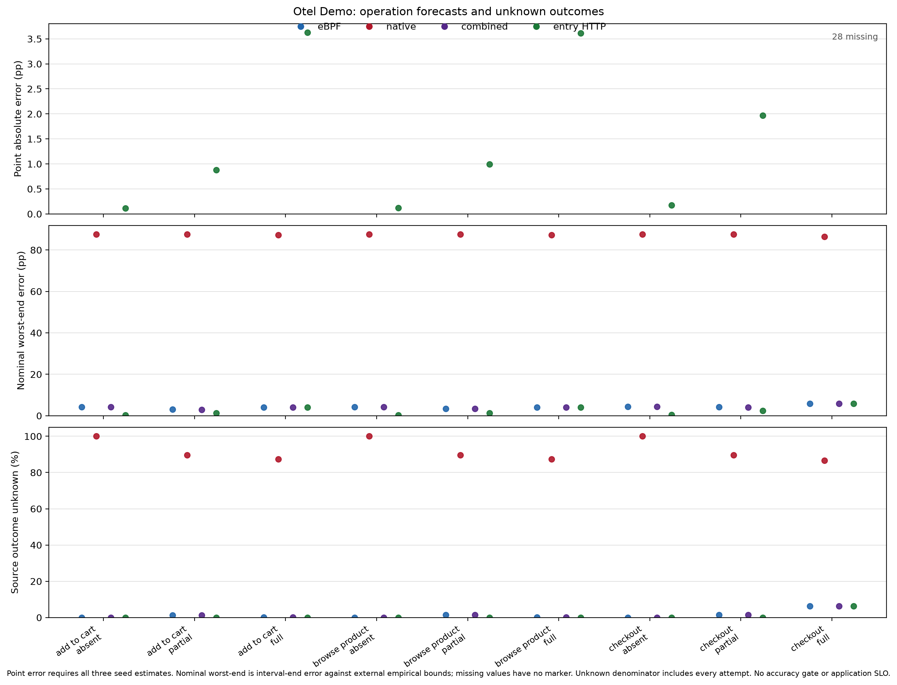

# Model discovery from eBPF observations without complete application tracing

**Fresh acquisition and primary analysis are complete:** [27 campaigns](https://github.com/a-a-k/ebpf-model-discovery-experiments/actions/runs/40502990432), **939,600 primary operation attempts**, ten operations and three tracing modes. All campaigns completed without technical replacement. [Generated results](results/iteration-3/report.md), [machine-readable evidence](results/iteration-3/results.json) and the [protocol](docs/ITERATION_3.md) are retained. Structural reporting and final publication review are in progress; pending findings are not assumed below.

This repository contains experiments and a research README, rather than a separate manuscript. The [original smaller series](results/final/SOURCE.md), [retrospective diagnostics](results/iteration-2/report.md) and [run history](docs/RUN_HISTORY.md) remain distinct populations.

## Abstract

Many applications have no distributed tracing or only partial coverage. We investigate whether eBPF observations can supply inputs for operation-model discovery and simulation in that setting, using DeathStarBench Social Network, OpenTelemetry Demo and Spring Petclinic Microservices on two Linux virtual machines with separate kernels. The fresh series records 939,600 primary attempts at a requested 20 operations/s, with independent training and target workloads. It reconstructs observed structure, studies automatic operation grouping, and estimates conditional operation outcomes under controlled replica states.

Individual absent-tracing eBPF models correctly predict held-out operation completion. All nine Petclinic eBPF graphs retain observed exact-parent structure across the two guests, including absent/partial tracing. A separate selected-database predictor, using observed ancestry and supplied endpoint/necessity information, predicts all 15 observed create-visit failures in each of Petclinic's absent- and partial-tracing database-down groups. These are positive examples of model discovery and use without complete instrumentation.

Other results delimit what this implementation establishes. The tested eBPF path does not recover exact checkout/accounting associations through Kafka, while native observations do in enabled modes. A retained-data audit identifies an avoidable timing gate in our own processing: all nine DeathStarBench eBPF captures contain unique request entries before that gate, despite sparse assigned coverage in several runs. Unknown calibration outcomes, unresolved persistence and incomplete automatic grouping must be reported alongside the demonstrated capabilities. They do not establish general limits of eBPF. [Primary results](results/iteration-3/report.md), [Petclinic structure](results/iteration-3/structural/petclinic/structural-v3.md) and the [coverage audit](results/iteration-3-diagnostics/dsb-coverage-40514548883/SOURCE.md) retain the evidence.

## Motivation and research questions

The main question is **whether a useful model can be recovered and used when complete application tracing is unavailable**. This is not a requirement to outperform HTTP response counting, and it is not a proposal for a new discovery algorithm.

1. Which operation classes, service dependencies, instances and placements can be recovered?
2. Can operation-outcome models predict an independently observed workload under a different mixture of replica states?
3. Which execution links remain identifiable across kernels and through asynchronous messaging?
4. Can database observations enrich a model in a way that supports an externally checked fault prediction, including a shared-database case?
5. When recovery is incomplete, is the limit in the acquired information, its interpretation, or the experimental measurement path?

Comparisons are scoped to their outputs. HTTP/body observations provide a simple comparator for scalar completion-rate prediction; they do not reconstruct an internal dependency graph. Native graphs, available datasource inventory, route grouping and native exact-message links are relevant comparisons for structure, database impact, classes and asynchronous association. Cheap combinations are also relevant. Evaluator deployment truth is not silently supplied as discovery input.

## Context and contribution boundaries

Native traces can already include database client spans and attributes; DB nodes are not intrinsically an eBPF-only capability. All collected native DB spans are retained. The question is what can actually be recovered with absent or incomplete instrumentation, with manual information and unknowns disclosed. See the [OpenTelemetry database conventions](https://opentelemetry.io/docs/specs/semconv/database/).

The main collector is [OpenTelemetry eBPF Instrumentation](https://opentelemetry.io/docs/zero-code/obi/), release 0.15.2. Configurations and resolved image digests are retained. Automatic context propagation is enabled; OBI Java-agent and Node.js runtime injection are disabled. HTTP body and SQL query capture are configured for synthetic fixtures. Documentation listing a supported protocol does not establish recovery of an operation in this deployment.

The original protocol permitted one bounded [DeepFlow](https://github.com/deepflowio/deepflow) fallback where required protocol evidence was missing. Its recorded OTel startup attempt did not establish usable protocol recovery. There is no broad collector benchmark. Thrift connectivity and Kafka topic co-occurrence are not counted as recovered operations.

The operation set and replica interventions continue the [SIMPAT experiment repository](https://github.com/a-a-k/telemetry-availability-identification). Monte Carlo simulation and direct weighted estimation implement the same conditional-state calculation. Simulation is not claimed to improve that arithmetic.

## Applications and environment

| System and pinned source | Operations | Controlled replicas |
|---|---|---|
| [DeathStarBench Social Network, 6ecb097](https://github.com/delimitrou/DeathStarBench/tree/6ecb09706140f8730b5385c08f1386c654c3c526) | Compose post; home timeline; user timeline | User-timeline A/B |
| [OpenTelemetry Demo 3.0.0, 8c47d47](https://github.com/open-telemetry/opentelemetry-demo/tree/8c47d47c9ac27710d2b2a153bcd53e483bffe66d) | Browse product; add to cart; checkout | Product-catalog A/B |
| [Petclinic Microservices, 3858f9c](https://github.com/spring-petclinic/spring-petclinic-microservices/tree/3858f9c630cf989bb6809a86edf47c2be78dc9f1) | List owners; owner details with visits; create visit; list vets | Visits A/B |

Each campaign creates two Ubuntu guests using QEMU/KVM inside one standard public GitHub Actions runner. Each guest has its own Linux kernel, boot ID, network stack, Docker daemon and eBPF collector. Controlled replicas are on different guests. Guest addresses are `192.168.76.11` and `.12`; Docker subnets are `172.28.11.0/24` and `172.28.12.0/24`. Cross-guest calls use published ports. Routing configuration is not rewritten for fault states.

| System | Guest A | Guest B | Selected database fault |
|---|---|---|---|
| DeathStarBench | Frontend, ordinary services, user-timeline A, fixed HAProxy, MongoDB/Redis | User-timeline B | Stop/start user-timeline MongoDB |
| OTel Demo | Frontend, ordinary services, catalog A, fixed Envoy, Kafka, accounting, PostgreSQL | Catalog B | Stop/start astronomy PostgreSQL |
| Petclinic | Gateway, customers, vets, visits A, fixed HAProxy, MySQL | Visits B | Stop/start shared MySQL container |

The Kafka/accounting chain is on guest A. Catalog and database calls exercise guest boundaries; Kafka is not presented as a separate-machine broker test. The shared physical runner is a limitation: this evaluates inter-kernel observation and networking, not independent physical-host failures.

Default allocation is two vCPUs and 6 GiB per guest when runner memory permits. KVM and readable guest BTF are required. The base image is Ubuntu Noble's 2026-10-17 build, SHA-256 `04e8f2461a16a44e78a370284471f29616cdd9baf1893df25807b71f985b6c94`. Actual resources, kernel/boot records, image digests and Compose configurations are retained. No paid runners were selected.

Deployment changes and manual annotations are documented for [DeathStarBench](systems/deathstarbench/README.md), [OTel Demo](systems/otel_demo/README.md) and [Petclinic](systems/petclinic/README.md). Petclinic service and instance names are supplied even with its SDK disabled; recovering those labels is not autonomous naming.

## Method

### Observations and information boundaries

Every HTTP step carries a unique opaque `X-Experiment-Request-Id`, containing no operation name, outcome or dependency map. The generator does not inject a sampled trace context. The header binds a request census to an observed entry; downstream attribution requires observed identities and unambiguous source-local ancestry.

eBPF and native records retain separate provenance. Raw OTLP/Jaeger exports are indexed without discarding conflicting same-ID observations. The combined arm merges compatible primitive evidence; it does not fabricate a trace spanning the sources.

The analysis has distinct arms:

- **Declared-operation completion:** operation intent, step grouping, response contracts, replica state and outcome-free timing/censoring facts are supplied equally. Source status/body evidence is interpreted using those contracts. Independent response/SQL outcomes are held out from fitting.
- **Automatic grouping:** method/normalized-route signatures are learned from a healthy segment and compared with signatures augmented by downstream execution. Generator labels are evaluation-only. This does not automatically invent business names or segment arbitrary production workflows.
- **Observed structure:** service/instance labels, logical DB endpoints and exact-parent edges are extracted. Deployment and boot records provide evaluation references for placement and identity; an address alone does not prove a shared physical database instance.
- **Selected-DB impact:** a separate Petclinic model uses mandatory-path ancestry together with supplied operation/service, necessity and endpoint-alias information. Predictions are checked against database intervention outcomes.

The primary conditional predictor does **not** consume the dependency graph. Its accuracy cannot validate graph-based simulation. The selected-DB control is the separate case in which a discovered dependency enters a fault prediction.

### Timing and unknown outcomes

There is no imposed application SLO or universal two-second business deadline. The original two-second cutoff was not justified for all primary operations and remains only in historical results.

The fresh client has a ten-second total attempt observation cap, covering every HTTP step and body transfer. This bounds resource occupancy, not acceptable application latency. Incomplete/censored attempts remain **unknown**, and later telemetry cannot promote their primary outcomes. Incorrect completed responses can establish failure. Client HTTP receipt curves and SQL completion intervals are separate.

Acquisition also imposed zero-tolerance containment of source timestamps inside the client journal window. This assumed comparable guest/host timestamps without an independently measured error bound. The [DSB audit](results/iteration-3-diagnostics/dsb-coverage-40514548883/SOURCE.md) demonstrates that the gate rejected available exact-ID entries. Original forecasts are preserved; no arbitrary tolerance or retrospective timestamp correction is applied.

### Conditional model and simulation

Training observes four replica states: `11`, `10`, `01`, `00`. For operation/class c, the target prediction is:

`p(c) = sum_s w(s) p(c | s)`, with weights `(0.5, 0.25, 0.125, 0.125)`.

Each operation forecast uses 100,000 Monte Carlo draws and retains the simulated bounds beside an exact weighted calculation. Individual draw arrays are not retained. Direct stratified estimation is algebraically equivalent and receives the same evidence. This transfers between already observed replica states; it does not predict an unseen failure mode from topology.

Unknown source outcomes produce identification bounds. A point estimate exists only when those bounds coincide. Weighted nominal pointwise 95% [Wilson](https://doi.org/10.1080/01621459.1927.10502953) envelopes assume iid Bernoulli outcomes. Within-block temporal dependence is not estimated, so these are not validated predictive coverage guarantees. Forecasts, class definitions and evaluation maps are saved before target acquisition and checked for later changes.

## Experimental design

The fixed population is three systems × three modes × seeds 3/4/5:

- `absent`: application tracing disabled; eBPF collected.
- `partial`: tracing disabled on both controlled replicas; available native traces and eBPF collected.
- `full`: native tracing enabled throughout the deployed application; eBPF also collected.

Suppression is checked through configuration and telemetry, not just exporter disconnection.

| Primary segment per campaign | Blocks | Seconds/block | Operations/s | Attempts |
|---|---:|---:|---:|---:|
| Healthy class training | 1 | 30 | 20 | 600 |
| Conditional training, one block per replica state | 4 | 300 | 20 | 24,000 |
| Independent target, state counts 4/2/1/1 | 8 | 60 | 20 | 9,600 |
| Healthy class test | 1 | 30 | 20 | 600 |
| **Primary total** | **14** | | | **34,800** |

Operations are balanced within each system. Reset, readiness, fixed warmup, settling, outstanding request completion and a bounded drain guard occur between blocks and count toward cost. The guards do not prove completion of arbitrary background activity.

Each campaign additionally executes 20 selected-DB-up and 20 selected-DB-down attempts. Each OTel campaign executes 20 checkout controls in each of normal, accounting-paused and recovered states. Accounting stays paused through every paused-control observation window; its queue is drained before the recovered block.

The complete series contains **939,600 primary attempts**, **941,220 recorded block attempts including controls**, and **1,467 preparation operations**, as recorded in the [generated data](results/iteration-3/results.json). Multi-step operations generate extra HTTP requests; these counts are not spans or packets. Achieved rates, scheduling delays and resource samples remain in campaign block/infrastructure records.

Evaluation reports operation-wise errors/bounds, unknowns, automatic coverage and [adjusted Rand index](https://doi.org/10.1007/BF01908075), observed structure, DB intervention outcomes, asynchronous identities and costs. Historical 5 pp error and 10 pp width thresholds have no application-derived justification and are not success gates.

## Results

All numbers below refer to the fresh series unless labelled historical. [Generated tables](results/iteration-3/report.md) retain every operation, mode, source and repeat. [JSON](results/iteration-3/results.json) and [CSV](results/iteration-3/metrics.csv) expose saved values.

### Conditional forecasts and missing information

There are positive absent-tracing examples: DSB seed 4's eBPF timeline models and OTel seed 5's three eBPF operation models have zero point error on their independent target workloads. Petclinic seed 3's eBPF read-operation models likewise have zero point error. These are conditional applicability examples, not substitutes for the other repeats. [Per-seed evidence](results/iteration-3/metrics.csv).

Every telemetry-source operation/mode summary has at least one seed whose point forecast is not identified; its three-seed mean point error remains unknown. This does not mean every individual model failed or that its known predictions were wrong. Correct forecasts in particular runs establish those examples; missing forecasts in other repeats leave the reliability of the complete procedure unresolved. The DSB diagnosis below attributes part of that missingness to our processing gate, not an established limitation of eBPF acquisition.

For a concrete example, the absent-tracing eBPF home-timeline forecast is exactly 100% in seed 4, matching the observed target. Seeds 3 and 5 retain empirical identification bounds of 72.74375–100% and 0.2–100%, respectively. These are different amounts of predictive information, not three incorrect predictions. An unidentified point alone is not a failure gate; bounds and the reason for missing evidence must be examined. [Saved per-seed values](results/iteration-3/metrics.csv).

For OTel Demo, the three-seed mean nominal worst-end distances to external empirical bounds are 4.24–4.31 pp in absent mode, 3.09–4.28 pp in partial mode and 4.07–5.89 pp in full mode, depending on operation. These describe interval-end distances, not point forecast errors or calibrated 95% coverage guarantees. No accuracy threshold determines success. Full-mode checkout has 603 unknown external target outcomes. DSB and Petclinic include much wider bounds; unresolved response semantics and timing rejection must be distinguished from wrong known predictions. [Operation-level evidence](results/iteration-3/report.md).



[DeathStarBench](results/iteration-3/operation-forecasts-deathstarbench.svg) and [Petclinic](results/iteration-3/operation-forecasts-petclinic.svg) figures use the same definitions. Figures are generated from saved report data. Missing point errors have no plotted point; they are not zero. “Source outcome unknown” includes our binding/semantic rules and does not mean that the underlying event was never collected.

The HTTP/body arm estimates the same scalar outcome from generator-visible responses. It helps separate observation/interpretation limitations from conditional arithmetic, but does not replace structural-discovery evaluation. A successful create-visit acknowledgement does not prove persistence; the HTTP-only arm also retains that unknown.

### How the timing gate removed available evidence

The [read-only DSB audit](results/iteration-3-diagnostics/dsb-coverage-40514548883/SOURCE.md) finds unique pre-window eBPF entries for all 34,800 primary attempts in each of nine cells, with three frozen route classes. Missing route assignments are timing rejections. For example, absent/3 accepts 19 of 9,600 target entries and rejects 9,581 by timing; absent/4 accepts all 9,600.

Selected rejected raw timestamps match their indexed values. This establishes an avoidable admission prerequisite, rather than demonstrated collector loss or inability to identify requests. It does not distinguish clock offset, drift or exporter timestamp semantics independently. Original models/forecasts remain unchanged; this diagnosis is not a corrected prospective forecast.

Automatic grouping has a separate limitation: healthy downstream signatures can become absent or novel under faults, and conservative agreement between differently detailed sources can make assignment ambiguous. ARI is reported on covered attempts alongside complete-population coverage. High subset ARI is not complete business-operation recognition, and poor combined assignment is not a general impossibility of evidence fusion. [Grouping tables](results/iteration-3/report.md#automatic-grouping).

### Shared-database intervention

Petclinic uses a MySQL container shared by several services. The source-based model requires observed ancestry to logical endpoints, with selected-fault aliases, operation/service mappings and necessity declarations supplied. Resolved Compose datasource edges form the static comparator. Neither procedure autonomously proves that differently addressed endpoints are one physical DB instance.

In absent mode, eBPF predicts all **15/15** create-visit failures under the selected DB intervention, with independent operation outcomes supporting them. The same holds in partial mode. In full mode, it predicts **5/15**, with ten predictions unknown. The static endpoint/necessity comparator predicts all fifteen in each mode. This supports a limited use of observed dependencies for selected-fault prediction, without establishing autonomous instance discovery or comparative superiority. [DB comparison](results/iteration-3/report.md#petclinic-selected-database-prediction).

For list owners, predictions cannot be confirmed where external outcomes are censored. Owner-details effects remain partly unknown. Vets can serve cached data, and a DB edge alone does not force a failure prediction. In the tables, `predicted_true` means “DB-caused failure predicted”; `predicted_false` means only “this DB cause is not predicted,” not business success.

### Distributed and asynchronous execution

Cross-guest structure uses source-local exact-parent identities and observed placement. Independent link-level truth is unavailable, so observed edge counts are not correctness rates. Native spans without guest identity remain unresolved rather than being placed by an IP heuristic. Frozen training graphs and parent links in the complete capture are reported separately; the latter also include preparation and controls.

**Petclinic demonstrates observed cross-guest structure without native tracing.** In all nine cells, the frozen eBPF graph contains the exact-parent edge `visits-proxy (guest A) → visits-b (guest B)`. Witnesses retain a client span on A whose span ID equals the server span's parent ID on B within the same source and trace. Native full tracing also observes a gateway-to-visits-B edge; native partial tracing does not. The eBPF graph contains seven service/instance nodes and two logical MySQL endpoints in every cell. Those nodes include proxy and database processes; their count is not a count of distinct application services. [All Petclinic cells and witnesses](results/iteration-3/structural/petclinic/structural-v3.md).

DeathStarBench has a different outcome: all nine cells report zero qualified cross-guest parent pairs. For example, absent seed 4 records twelve eBPF service/instance nodes with guest attribution and seven attribute-labelled DB endpoints, but this does not establish cross-guest request ancestry. Native guest placement remains unknown in this configuration. [All DSB cells and witnesses](results/iteration-3/structural/deathstarbench/structural-v3.md).

Endpoint enrichment also needs semantic checks. DSB retains observed `mysql` labels for a deployed MongoDB endpoint and `couchbase` labels for deployed memcached endpoints. Native zero DB-node counts mean no nodes met the graph's database-attribute requirements; they do not erase Mongo-named native client activity. Neither raw node counts nor a larger combined graph establish correctly recovered physical DB instances. Combined nodes retain source provenance rather than being counted as additional physical services.

The OTel structural report is still being processed; its findings are not assumed here.

For `checkout → Kafka → accounting → PostgreSQL`, association requires an exact producer/consumer SpanLink and a DB write under the consumer's processing-root ancestry. Common topic and temporal proximity are insufficient.

In each enabled mode and control phase, native observations link **60/60** attempts; the tested eBPF configuration links **0/60**. In absent mode, neither source has a confirmed association. All HTTP control outcomes are successful; durability is observed for normal/recovered controls and remains unknown during the paused observation window. Later association after recovery does not prove earlier durability. [Async table](results/iteration-3/report.md#otel-asynchronous-association).

### Costs

The [primary Actions snapshot](results/iteration-3/costs-v3.md) records 113,348 job-seconds for acquisition and 17,398,396,136 stored artifact bytes, plus separately reported qualification, replay and evidence costs. Jobs include setup/preparation; overlapping artifacts are charged repeatedly. The [ledger](results/iteration-3/costs-v3.json) retains provenance and metadata hashes.

This snapshot predates structural reporting and final archiving. A final cost refresh will include those completed jobs. Human/agent effort and local validation compute were not independently metered and remain unknown, not zero. Shared capture cost cannot be silently attributed to one source; short fitting timers are not complete experiment cost.

## Discussion and limitations

Three conclusions must be distinguished: observations can be acquired without native tracing; a model can be reconstructed; and a specific model use is externally supported. None follows automatically from graph size or protocol visibility.

The shared-DB control supplies a limited externally supported use. Conditional forecasts describe previously observed replica states and preserve unresolved completion as bounds. They do not validate arbitrary topology-driven or queueing simulation. Exact state weighting and Monte Carlo remain equivalent.

Material limits include configured native body absence, incomplete durable-write evidence, the cross-clock timing gate, brittle downstream signatures and unconfirmed eBPF Kafka identities. Missing bodies in our native projection are not an information-theoretic limitation of native tracing. Missing message identity here does not prove impossibility for every eBPF collector/configuration.

Manual help includes operation contracts/grouping, fixture semantics, controlled states, target weights, service/instance annotations and selected-DB inventory/necessity information. The study does not establish automatic recovery of business names, arbitrary workflow boundaries or shared physical DB identity.

Guests share one physical runner. Only three repeat seeds and small DB/async control groups are used. Temporal independence and predictive interval coverage are unvalidated. Changed rate, block lengths, observation policy and seeds prevent attributing old/new accuracy differences to one repair. Complete results, not favorable repeats alone, determine the reported scope.

## Reproduction and artifacts

Application execution, model fitting, simulation and research-data processing run in GitHub Actions. Local activity is limited to implementation checks, artifact inspection and byte/hash verification.

```sh
# Resource qualification; inspect it before a new acquisition.
gh workflow run qualification-v3.yml -f system=all
gh workflow run evidence-v3.yml -f run_id=QUALIFICATION_RUN

# Fixed population: three systems, three modes, seeds 3/4/5.
gh workflow run series-v3.yml -f system=all -f mode=all -f seed=all

# Reporting uses completed captures and saved forecasts.
gh workflow run report-v3.yml -f run_ids='[SERIES_RUN]'
gh workflow run structural-v3.yml -f report_run_id=REPORT_RUN

# Preserve original ZIPs, logs and checksums.
gh workflow run archive.yml -f run_ids='SERIES_RUN REPORT_RUN STRUCTURAL_RUN'
```

Replace symbolic run IDs with numeric values. Acquisition used `19eed302e4f7d1f56d64ba25a8b84c062349b922`; the primary report used `865aa8140ccb6967cf2e4d3a1f39ce98888191f7`. The [protocol](docs/ITERATION_3.md) documents observation policy, information boundaries and technical eligibility.

Full campaign artifacts contain raw sources, indexed evidence, external outcomes, blocks, projections, automatic classes, frozen models/forecasts, DB/async controls, deployment metadata and resource costs. Compact summaries retain evaluated metrics/supporting files; they do not replace full captures.

The [preparation archive](https://github.com/a-a-k/ebpf-model-discovery-experiments/releases/tag/data-40510390283) preserves original qualifications, audits and replays. The [run history](docs/RUN_HISTORY.md) records earlier technical failures, immutable replacements and this fresh run. Incomplete observation alone does not authorize rerunning for a better result.

## Conclusions

The fresh series demonstrates useful eBPF observations and correct conditional forecasts in individual runs without application tracing, observed cross-guest request structure in every Petclinic cell, and externally supported selected-DB fault predictions with disclosed manual inputs. It does not yet establish repeatable completion of the whole discovery-and-prediction procedure. This distinction concerns the evidence from our implementation: the DSB timing audit specifically identifies a processing prerequisite that rejected available observations, so those failures cannot be assigned to eBPF capability. Automatic shared-instance identification and exact asynchronous associations also remain unestablished in the tested eBPF path.

Structural conclusions and final publication review remain pending. Complete results and original observations are retained so that limits can be checked rather than hidden by a system-wide average.
