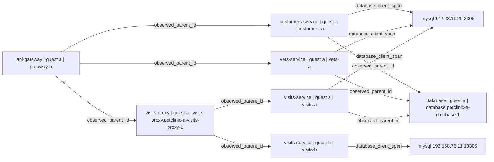

# Observed calibration graph: petclinic

Deterministically selected absent seed 0, [run 40335553492](https://github.com/a-a-k/ebpf-model-discovery-experiments/actions/runs/40335553492). This is the validated parsing view of retained eBPF calibration observations. Observed protocol labels are preserved; an edge is not independent proof of correctness. The original model and forecast remain unchanged.

