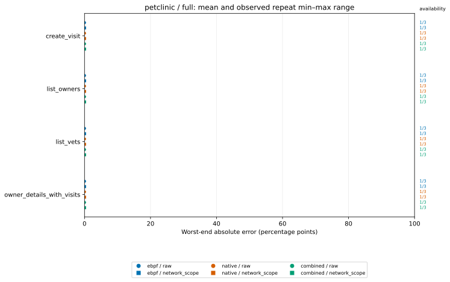

# Protocol-v4 stored aggregate figures

Input: [`evaluation-v4.json`](../evaluation-v4.json)

Values below are copied from the saved aggregate and converted from fractions to percentage points (pp).
Repeat ranges are observed min–max ranges, not confidence intervals. `k/3` is stored availability.

## petclinic / full

## Stored values

| System | Mode | Operation | Source | Variant | Mean (pp) | Repeat min–max (pp) | Availability |
|---|---|---|---|---|---:|---:|---:|
| petclinic | full | create_visit | combined | network_scope | 0.000 | 0.000–0.000 | 1/3 |
| petclinic | full | create_visit | combined | raw | 0.000 | 0.000–0.000 | 1/3 |
| petclinic | full | create_visit | ebpf | network_scope | 0.000 | 0.000–0.000 | 1/3 |
| petclinic | full | create_visit | ebpf | raw | 0.000 | 0.000–0.000 | 1/3 |
| petclinic | full | create_visit | native | network_scope | 0.000 | 0.000–0.000 | 1/3 |
| petclinic | full | create_visit | native | raw | 0.000 | 0.000–0.000 | 1/3 |
| petclinic | full | list_owners | combined | network_scope | 0.000 | 0.000–0.000 | 1/3 |
| petclinic | full | list_owners | combined | raw | 0.000 | 0.000–0.000 | 1/3 |
| petclinic | full | list_owners | ebpf | network_scope | 0.000 | 0.000–0.000 | 1/3 |
| petclinic | full | list_owners | ebpf | raw | 0.000 | 0.000–0.000 | 1/3 |
| petclinic | full | list_owners | native | network_scope | 0.000 | 0.000–0.000 | 1/3 |
| petclinic | full | list_owners | native | raw | 0.000 | 0.000–0.000 | 1/3 |
| petclinic | full | list_vets | combined | network_scope | 0.000 | 0.000–0.000 | 1/3 |
| petclinic | full | list_vets | combined | raw | 0.000 | 0.000–0.000 | 1/3 |
| petclinic | full | list_vets | ebpf | network_scope | 0.000 | 0.000–0.000 | 1/3 |
| petclinic | full | list_vets | ebpf | raw | 0.000 | 0.000–0.000 | 1/3 |
| petclinic | full | list_vets | native | network_scope | 0.000 | 0.000–0.000 | 1/3 |
| petclinic | full | list_vets | native | raw | 0.000 | 0.000–0.000 | 1/3 |
| petclinic | full | owner_details_with_visits | combined | network_scope | 0.000 | 0.000–0.000 | 1/3 |
| petclinic | full | owner_details_with_visits | combined | raw | 0.000 | 0.000–0.000 | 1/3 |
| petclinic | full | owner_details_with_visits | ebpf | network_scope | 0.000 | 0.000–0.000 | 1/3 |
| petclinic | full | owner_details_with_visits | ebpf | raw | 0.000 | 0.000–0.000 | 1/3 |
| petclinic | full | owner_details_with_visits | native | network_scope | 0.000 | 0.000–0.000 | 1/3 |
| petclinic | full | owner_details_with_visits | native | raw | 0.000 | 0.000–0.000 | 1/3 |
