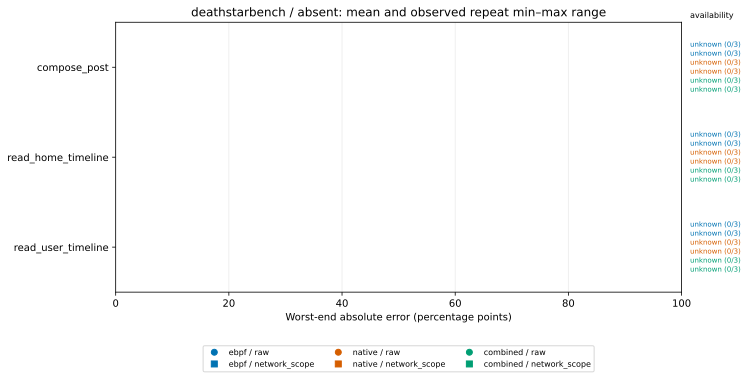
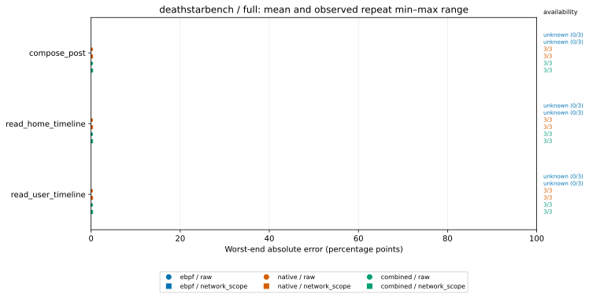
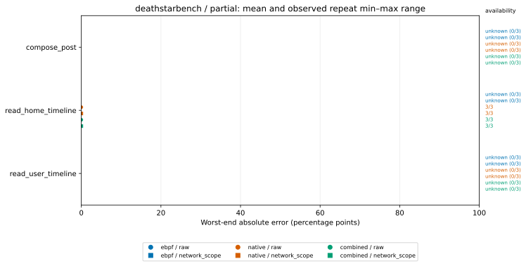
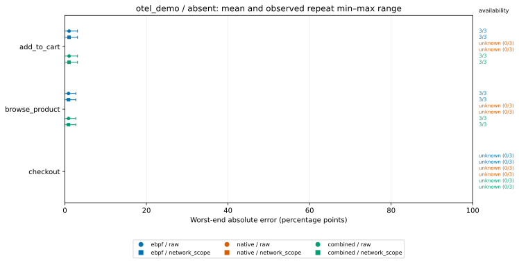
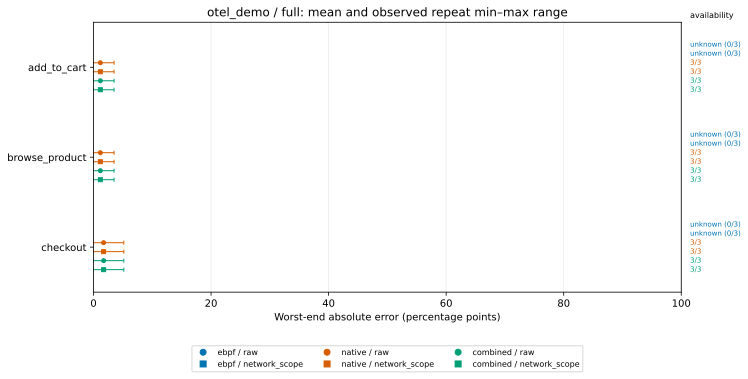
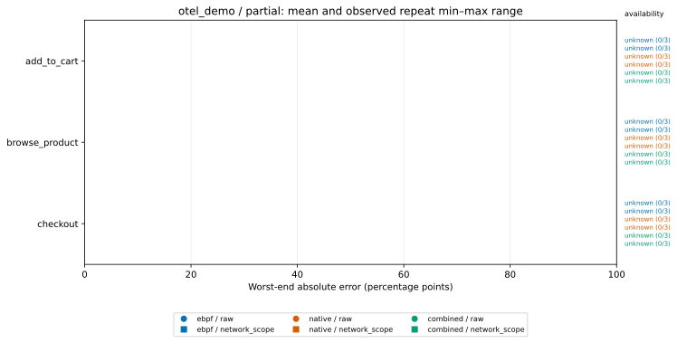
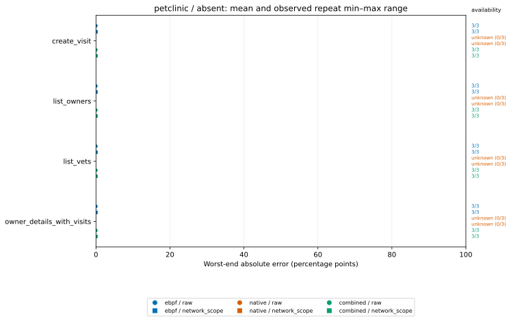
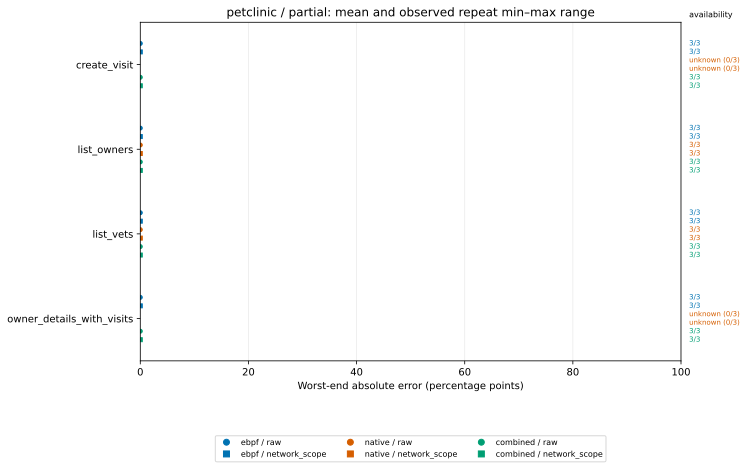

# Protocol-v4 stored aggregate figures

Input: [`evaluation-v4.json.gz`](../evaluation-v4.json.gz)

Values below are copied from the saved aggregate and converted from fractions to percentage points (pp).
Repeat ranges are observed min–max ranges, not confidence intervals. `k/3` is stored availability.

## deathstarbench / absent

## deathstarbench / full

## deathstarbench / partial

## otel_demo / absent

## otel_demo / full

## otel_demo / partial

## petclinic / absent

## petclinic / full

## petclinic / partial

## Stored values

| System | Mode | Operation | Source | Variant | Mean (pp) | Repeat min–max (pp) | Availability |
|---|---|---|---|---|---:|---:|---:|
| deathstarbench | absent | compose_post | combined | network_scope | unknown | unknown | 0/3 |
| deathstarbench | absent | compose_post | combined | raw | unknown | unknown | 0/3 |
| deathstarbench | absent | compose_post | ebpf | network_scope | unknown | unknown | 0/3 |
| deathstarbench | absent | compose_post | ebpf | raw | unknown | unknown | 0/3 |
| deathstarbench | absent | compose_post | native | network_scope | unknown | unknown | 0/3 |
| deathstarbench | absent | compose_post | native | raw | unknown | unknown | 0/3 |
| deathstarbench | absent | read_home_timeline | combined | network_scope | unknown | unknown | 0/3 |
| deathstarbench | absent | read_home_timeline | combined | raw | unknown | unknown | 0/3 |
| deathstarbench | absent | read_home_timeline | ebpf | network_scope | unknown | unknown | 0/3 |
| deathstarbench | absent | read_home_timeline | ebpf | raw | unknown | unknown | 0/3 |
| deathstarbench | absent | read_home_timeline | native | network_scope | unknown | unknown | 0/3 |
| deathstarbench | absent | read_home_timeline | native | raw | unknown | unknown | 0/3 |
| deathstarbench | absent | read_user_timeline | combined | network_scope | unknown | unknown | 0/3 |
| deathstarbench | absent | read_user_timeline | combined | raw | unknown | unknown | 0/3 |
| deathstarbench | absent | read_user_timeline | ebpf | network_scope | unknown | unknown | 0/3 |
| deathstarbench | absent | read_user_timeline | ebpf | raw | unknown | unknown | 0/3 |
| deathstarbench | absent | read_user_timeline | native | network_scope | unknown | unknown | 0/3 |
| deathstarbench | absent | read_user_timeline | native | raw | unknown | unknown | 0/3 |
| deathstarbench | full | compose_post | combined | network_scope | 0.010 | 0.000–0.031 | 3/3 |
| deathstarbench | full | compose_post | combined | raw | 0.010 | 0.000–0.031 | 3/3 |
| deathstarbench | full | compose_post | ebpf | network_scope | unknown | unknown | 0/3 |
| deathstarbench | full | compose_post | ebpf | raw | unknown | unknown | 0/3 |
| deathstarbench | full | compose_post | native | network_scope | 0.010 | 0.000–0.031 | 3/3 |
| deathstarbench | full | compose_post | native | raw | 0.010 | 0.000–0.031 | 3/3 |
| deathstarbench | full | read_home_timeline | combined | network_scope | 0.000 | 0.000–0.000 | 3/3 |
| deathstarbench | full | read_home_timeline | combined | raw | 0.000 | 0.000–0.000 | 3/3 |
| deathstarbench | full | read_home_timeline | ebpf | network_scope | unknown | unknown | 0/3 |
| deathstarbench | full | read_home_timeline | ebpf | raw | unknown | unknown | 0/3 |
| deathstarbench | full | read_home_timeline | native | network_scope | 0.000 | 0.000–0.000 | 3/3 |
| deathstarbench | full | read_home_timeline | native | raw | 0.000 | 0.000–0.000 | 3/3 |
| deathstarbench | full | read_user_timeline | combined | network_scope | 0.000 | 0.000–0.000 | 3/3 |
| deathstarbench | full | read_user_timeline | combined | raw | 0.000 | 0.000–0.000 | 3/3 |
| deathstarbench | full | read_user_timeline | ebpf | network_scope | unknown | unknown | 0/3 |
| deathstarbench | full | read_user_timeline | ebpf | raw | unknown | unknown | 0/3 |
| deathstarbench | full | read_user_timeline | native | network_scope | 0.000 | 0.000–0.000 | 3/3 |
| deathstarbench | full | read_user_timeline | native | raw | 0.000 | 0.000–0.000 | 3/3 |
| deathstarbench | partial | compose_post | combined | network_scope | unknown | unknown | 0/3 |
| deathstarbench | partial | compose_post | combined | raw | unknown | unknown | 0/3 |
| deathstarbench | partial | compose_post | ebpf | network_scope | unknown | unknown | 0/3 |
| deathstarbench | partial | compose_post | ebpf | raw | unknown | unknown | 0/3 |
| deathstarbench | partial | compose_post | native | network_scope | unknown | unknown | 0/3 |
| deathstarbench | partial | compose_post | native | raw | unknown | unknown | 0/3 |
| deathstarbench | partial | read_home_timeline | combined | network_scope | 0.000 | 0.000–0.000 | 3/3 |
| deathstarbench | partial | read_home_timeline | combined | raw | 0.000 | 0.000–0.000 | 3/3 |
| deathstarbench | partial | read_home_timeline | ebpf | network_scope | unknown | unknown | 0/3 |
| deathstarbench | partial | read_home_timeline | ebpf | raw | unknown | unknown | 0/3 |
| deathstarbench | partial | read_home_timeline | native | network_scope | 0.000 | 0.000–0.000 | 3/3 |
| deathstarbench | partial | read_home_timeline | native | raw | 0.000 | 0.000–0.000 | 3/3 |
| deathstarbench | partial | read_user_timeline | combined | network_scope | unknown | unknown | 0/3 |
| deathstarbench | partial | read_user_timeline | combined | raw | unknown | unknown | 0/3 |
| deathstarbench | partial | read_user_timeline | ebpf | network_scope | unknown | unknown | 0/3 |
| deathstarbench | partial | read_user_timeline | ebpf | raw | unknown | unknown | 0/3 |
| deathstarbench | partial | read_user_timeline | native | network_scope | unknown | unknown | 0/3 |
| deathstarbench | partial | read_user_timeline | native | raw | unknown | unknown | 0/3 |
| otel_demo | absent | add_to_cart | combined | network_scope | 1.031 | 0.000–3.094 | 3/3 |
| otel_demo | absent | add_to_cart | combined | raw | 1.031 | 0.000–3.094 | 3/3 |
| otel_demo | absent | add_to_cart | ebpf | network_scope | 1.031 | 0.000–3.094 | 3/3 |
| otel_demo | absent | add_to_cart | ebpf | raw | 1.031 | 0.000–3.094 | 3/3 |
| otel_demo | absent | add_to_cart | native | network_scope | unknown | unknown | 0/3 |
| otel_demo | absent | add_to_cart | native | raw | unknown | unknown | 0/3 |
| otel_demo | absent | browse_product | combined | network_scope | 0.896 | 0.000–2.687 | 3/3 |
| otel_demo | absent | browse_product | combined | raw | 0.896 | 0.000–2.687 | 3/3 |
| otel_demo | absent | browse_product | ebpf | network_scope | 0.896 | 0.000–2.687 | 3/3 |
| otel_demo | absent | browse_product | ebpf | raw | 0.896 | 0.000–2.687 | 3/3 |
| otel_demo | absent | browse_product | native | network_scope | unknown | unknown | 0/3 |
| otel_demo | absent | browse_product | native | raw | unknown | unknown | 0/3 |
| otel_demo | absent | checkout | combined | network_scope | unknown | unknown | 0/3 |
| otel_demo | absent | checkout | combined | raw | unknown | unknown | 0/3 |
| otel_demo | absent | checkout | ebpf | network_scope | unknown | unknown | 0/3 |
| otel_demo | absent | checkout | ebpf | raw | unknown | unknown | 0/3 |
| otel_demo | absent | checkout | native | network_scope | unknown | unknown | 0/3 |
| otel_demo | absent | checkout | native | raw | unknown | unknown | 0/3 |
| otel_demo | full | add_to_cart | combined | network_scope | 1.167 | 0.000–3.500 | 3/3 |
| otel_demo | full | add_to_cart | combined | raw | 1.167 | 0.000–3.500 | 3/3 |
| otel_demo | full | add_to_cart | ebpf | network_scope | unknown | unknown | 0/3 |
| otel_demo | full | add_to_cart | ebpf | raw | unknown | unknown | 0/3 |
| otel_demo | full | add_to_cart | native | network_scope | 1.167 | 0.000–3.500 | 3/3 |
| otel_demo | full | add_to_cart | native | raw | 1.167 | 0.000–3.500 | 3/3 |
| otel_demo | full | browse_product | combined | network_scope | 1.167 | 0.000–3.500 | 3/3 |
| otel_demo | full | browse_product | combined | raw | 1.167 | 0.000–3.500 | 3/3 |
| otel_demo | full | browse_product | ebpf | network_scope | unknown | unknown | 0/3 |
| otel_demo | full | browse_product | ebpf | raw | unknown | unknown | 0/3 |
| otel_demo | full | browse_product | native | network_scope | 1.167 | 0.000–3.500 | 3/3 |
| otel_demo | full | browse_product | native | raw | 1.167 | 0.000–3.500 | 3/3 |
| otel_demo | full | checkout | combined | network_scope | 1.719 | 0.000–5.156 | 3/3 |
| otel_demo | full | checkout | combined | raw | 1.719 | 0.000–5.156 | 3/3 |
| otel_demo | full | checkout | ebpf | network_scope | unknown | unknown | 0/3 |
| otel_demo | full | checkout | ebpf | raw | unknown | unknown | 0/3 |
| otel_demo | full | checkout | native | network_scope | 1.719 | 0.000–5.156 | 3/3 |
| otel_demo | full | checkout | native | raw | 1.719 | 0.000–5.156 | 3/3 |
| otel_demo | partial | add_to_cart | combined | network_scope | unknown | unknown | 0/3 |
| otel_demo | partial | add_to_cart | combined | raw | unknown | unknown | 0/3 |
| otel_demo | partial | add_to_cart | ebpf | network_scope | unknown | unknown | 0/3 |
| otel_demo | partial | add_to_cart | ebpf | raw | unknown | unknown | 0/3 |
| otel_demo | partial | add_to_cart | native | network_scope | unknown | unknown | 0/3 |
| otel_demo | partial | add_to_cart | native | raw | unknown | unknown | 0/3 |
| otel_demo | partial | browse_product | combined | network_scope | unknown | unknown | 0/3 |
| otel_demo | partial | browse_product | combined | raw | unknown | unknown | 0/3 |
| otel_demo | partial | browse_product | ebpf | network_scope | unknown | unknown | 0/3 |
| otel_demo | partial | browse_product | ebpf | raw | unknown | unknown | 0/3 |
| otel_demo | partial | browse_product | native | network_scope | unknown | unknown | 0/3 |
| otel_demo | partial | browse_product | native | raw | unknown | unknown | 0/3 |
| otel_demo | partial | checkout | combined | network_scope | unknown | unknown | 0/3 |
| otel_demo | partial | checkout | combined | raw | unknown | unknown | 0/3 |
| otel_demo | partial | checkout | ebpf | network_scope | unknown | unknown | 0/3 |
| otel_demo | partial | checkout | ebpf | raw | unknown | unknown | 0/3 |
| otel_demo | partial | checkout | native | network_scope | unknown | unknown | 0/3 |
| otel_demo | partial | checkout | native | raw | unknown | unknown | 0/3 |
| petclinic | absent | create_visit | combined | network_scope | 0.000 | 0.000–0.000 | 3/3 |
| petclinic | absent | create_visit | combined | raw | 0.000 | 0.000–0.000 | 3/3 |
| petclinic | absent | create_visit | ebpf | network_scope | 0.000 | 0.000–0.000 | 3/3 |
| petclinic | absent | create_visit | ebpf | raw | 0.000 | 0.000–0.000 | 3/3 |
| petclinic | absent | create_visit | native | network_scope | unknown | unknown | 0/3 |
| petclinic | absent | create_visit | native | raw | unknown | unknown | 0/3 |
| petclinic | absent | list_owners | combined | network_scope | 0.000 | 0.000–0.000 | 3/3 |
| petclinic | absent | list_owners | combined | raw | 0.000 | 0.000–0.000 | 3/3 |
| petclinic | absent | list_owners | ebpf | network_scope | 0.000 | 0.000–0.000 | 3/3 |
| petclinic | absent | list_owners | ebpf | raw | 0.000 | 0.000–0.000 | 3/3 |
| petclinic | absent | list_owners | native | network_scope | unknown | unknown | 0/3 |
| petclinic | absent | list_owners | native | raw | unknown | unknown | 0/3 |
| petclinic | absent | list_vets | combined | network_scope | 0.000 | 0.000–0.000 | 3/3 |
| petclinic | absent | list_vets | combined | raw | 0.000 | 0.000–0.000 | 3/3 |
| petclinic | absent | list_vets | ebpf | network_scope | 0.000 | 0.000–0.000 | 3/3 |
| petclinic | absent | list_vets | ebpf | raw | 0.000 | 0.000–0.000 | 3/3 |
| petclinic | absent | list_vets | native | network_scope | unknown | unknown | 0/3 |
| petclinic | absent | list_vets | native | raw | unknown | unknown | 0/3 |
| petclinic | absent | owner_details_with_visits | combined | network_scope | 0.000 | 0.000–0.000 | 3/3 |
| petclinic | absent | owner_details_with_visits | combined | raw | 0.000 | 0.000–0.000 | 3/3 |
| petclinic | absent | owner_details_with_visits | ebpf | network_scope | 0.000 | 0.000–0.000 | 3/3 |
| petclinic | absent | owner_details_with_visits | ebpf | raw | 0.000 | 0.000–0.000 | 3/3 |
| petclinic | absent | owner_details_with_visits | native | network_scope | unknown | unknown | 0/3 |
| petclinic | absent | owner_details_with_visits | native | raw | unknown | unknown | 0/3 |
| petclinic | full | create_visit | combined | network_scope | 0.000 | 0.000–0.000 | 3/3 |
| petclinic | full | create_visit | combined | raw | 0.000 | 0.000–0.000 | 3/3 |
| petclinic | full | create_visit | ebpf | network_scope | 0.000 | 0.000–0.000 | 3/3 |
| petclinic | full | create_visit | ebpf | raw | 0.000 | 0.000–0.000 | 3/3 |
| petclinic | full | create_visit | native | network_scope | 0.000 | 0.000–0.000 | 3/3 |
| petclinic | full | create_visit | native | raw | 0.000 | 0.000–0.000 | 3/3 |
| petclinic | full | list_owners | combined | network_scope | 0.000 | 0.000–0.000 | 3/3 |
| petclinic | full | list_owners | combined | raw | 0.000 | 0.000–0.000 | 3/3 |
| petclinic | full | list_owners | ebpf | network_scope | 0.000 | 0.000–0.000 | 3/3 |
| petclinic | full | list_owners | ebpf | raw | 0.000 | 0.000–0.000 | 3/3 |
| petclinic | full | list_owners | native | network_scope | 0.000 | 0.000–0.000 | 3/3 |
| petclinic | full | list_owners | native | raw | 0.000 | 0.000–0.000 | 3/3 |
| petclinic | full | list_vets | combined | network_scope | 0.000 | 0.000–0.000 | 3/3 |
| petclinic | full | list_vets | combined | raw | 0.000 | 0.000–0.000 | 3/3 |
| petclinic | full | list_vets | ebpf | network_scope | 0.000 | 0.000–0.000 | 3/3 |
| petclinic | full | list_vets | ebpf | raw | 0.000 | 0.000–0.000 | 3/3 |
| petclinic | full | list_vets | native | network_scope | 0.000 | 0.000–0.000 | 3/3 |
| petclinic | full | list_vets | native | raw | 0.000 | 0.000–0.000 | 3/3 |
| petclinic | full | owner_details_with_visits | combined | network_scope | 0.000 | 0.000–0.000 | 3/3 |
| petclinic | full | owner_details_with_visits | combined | raw | 0.000 | 0.000–0.000 | 3/3 |
| petclinic | full | owner_details_with_visits | ebpf | network_scope | 0.000 | 0.000–0.000 | 3/3 |
| petclinic | full | owner_details_with_visits | ebpf | raw | 0.000 | 0.000–0.000 | 3/3 |
| petclinic | full | owner_details_with_visits | native | network_scope | 0.000 | 0.000–0.000 | 3/3 |
| petclinic | full | owner_details_with_visits | native | raw | 0.000 | 0.000–0.000 | 3/3 |
| petclinic | partial | create_visit | combined | network_scope | 0.000 | 0.000–0.000 | 3/3 |
| petclinic | partial | create_visit | combined | raw | 0.000 | 0.000–0.000 | 3/3 |
| petclinic | partial | create_visit | ebpf | network_scope | 0.000 | 0.000–0.000 | 3/3 |
| petclinic | partial | create_visit | ebpf | raw | 0.000 | 0.000–0.000 | 3/3 |
| petclinic | partial | create_visit | native | network_scope | unknown | unknown | 0/3 |
| petclinic | partial | create_visit | native | raw | unknown | unknown | 0/3 |
| petclinic | partial | list_owners | combined | network_scope | 0.000 | 0.000–0.000 | 3/3 |
| petclinic | partial | list_owners | combined | raw | 0.000 | 0.000–0.000 | 3/3 |
| petclinic | partial | list_owners | ebpf | network_scope | 0.000 | 0.000–0.000 | 3/3 |
| petclinic | partial | list_owners | ebpf | raw | 0.000 | 0.000–0.000 | 3/3 |
| petclinic | partial | list_owners | native | network_scope | 0.000 | 0.000–0.000 | 3/3 |
| petclinic | partial | list_owners | native | raw | 0.000 | 0.000–0.000 | 3/3 |
| petclinic | partial | list_vets | combined | network_scope | 0.000 | 0.000–0.000 | 3/3 |
| petclinic | partial | list_vets | combined | raw | 0.000 | 0.000–0.000 | 3/3 |
| petclinic | partial | list_vets | ebpf | network_scope | 0.000 | 0.000–0.000 | 3/3 |
| petclinic | partial | list_vets | ebpf | raw | 0.000 | 0.000–0.000 | 3/3 |
| petclinic | partial | list_vets | native | network_scope | 0.000 | 0.000–0.000 | 3/3 |
| petclinic | partial | list_vets | native | raw | 0.000 | 0.000–0.000 | 3/3 |
| petclinic | partial | owner_details_with_visits | combined | network_scope | 0.000 | 0.000–0.000 | 3/3 |
| petclinic | partial | owner_details_with_visits | combined | raw | 0.000 | 0.000–0.000 | 3/3 |
| petclinic | partial | owner_details_with_visits | ebpf | network_scope | 0.000 | 0.000–0.000 | 3/3 |
| petclinic | partial | owner_details_with_visits | ebpf | raw | 0.000 | 0.000–0.000 | 3/3 |
| petclinic | partial | owner_details_with_visits | native | network_scope | unknown | unknown | 0/3 |
| petclinic | partial | owner_details_with_visits | native | raw | unknown | unknown | 0/3 |
