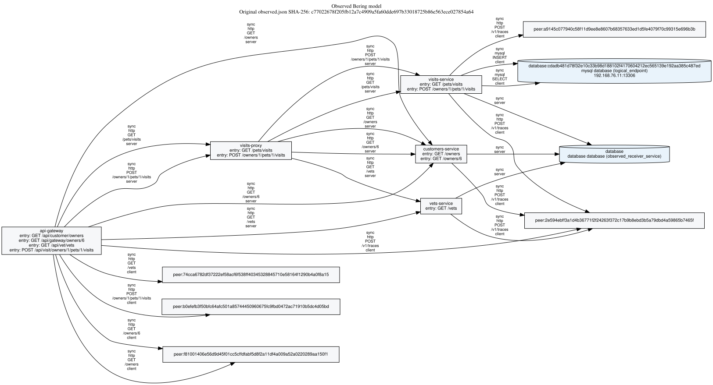

# Protocol-v4 saved evaluation report

Aggregate input: [`evaluation-v4.json.gz`](evaluation-v4.json.gz)

This report copies stored evaluation metrics and descriptively counts retained causal verdicts. It introduces no threshold, cross-campaign pooling, relinking, refit, or new forecast.
Every retained campaign is listed as an attempt; selection metadata determines evaluation inclusion.

Optional saved cost input: [`costs-v4.json`](costs-v4.json)

## Grid and retained attempts

| Stored field | Value |
|---|---|
| expected_cells | 27 |
| selected_unambiguous_cells | 9 |
| retained_campaign_attempts | 9 |
| expected_primary_total | 939600 |
| selected_primary_total | 313200 |
| retained_attempt_primary_total | 313200 |
| missing_cells | deathstarbench, absent, 6, deathstarbench, absent, 7, deathstarbench, absent, 8, deathstarbench, full, 6, deathstarbench, full, 7, deathstarbench, full, 8, deathstarbench, partial, 6, deathstarbench, partial, 7, deathstarbench, partial, 8, otel_demo, absent, 6, otel_demo, absent, 7, otel_demo, absent, 8, otel_demo, full, 6, otel_demo, full, 7, otel_demo, full, 8, otel_demo, partial, 6, otel_demo, partial, 7, otel_demo, partial, 8 |

All retained attempts (not all are necessarily selected):

| Run | System | Mode | Seed | Complete | Status | Retained root | Primary |
|---|---|---|---|---|---|---|---|
| 40718674400 | petclinic | full | 6 | true | acquisition_complete | /home/runner/work/ebpf-model-discovery-experiments/ebpf-model-discovery-experiments/work/v4-inputs/40718674400/v4-summary-petclinic-full-6-40718674400 | 34800 |
| 40733841068 | petclinic | absent | 6 | true | acquisition_complete | /home/runner/work/ebpf-model-discovery-experiments/ebpf-model-discovery-experiments/work/v4-inputs/40733841068/v4-summary-petclinic-absent-6-40733841068 | 34800 |
| 40733841068 | petclinic | absent | 7 | true | acquisition_complete | /home/runner/work/ebpf-model-discovery-experiments/ebpf-model-discovery-experiments/work/v4-inputs/40733841068/v4-summary-petclinic-absent-7-40733841068 | 34800 |
| 40733841068 | petclinic | absent | 8 | true | acquisition_complete | /home/runner/work/ebpf-model-discovery-experiments/ebpf-model-discovery-experiments/work/v4-inputs/40733841068/v4-summary-petclinic-absent-8-40733841068 | 34800 |
| 40733846961 | petclinic | partial | 6 | true | acquisition_complete | /home/runner/work/ebpf-model-discovery-experiments/ebpf-model-discovery-experiments/work/v4-inputs/40733846961/v4-summary-petclinic-partial-6-40733846961 | 34800 |
| 40733846961 | petclinic | partial | 7 | true | acquisition_complete | /home/runner/work/ebpf-model-discovery-experiments/ebpf-model-discovery-experiments/work/v4-inputs/40733846961/v4-summary-petclinic-partial-7-40733846961 | 34800 |
| 40733846961 | petclinic | partial | 8 | true | acquisition_complete | /home/runner/work/ebpf-model-discovery-experiments/ebpf-model-discovery-experiments/work/v4-inputs/40733846961/v4-summary-petclinic-partial-8-40733846961 | 34800 |
| 40733852492 | petclinic | full | 7 | true | acquisition_complete | /home/runner/work/ebpf-model-discovery-experiments/ebpf-model-discovery-experiments/work/v4-inputs/40733852492/v4-summary-petclinic-full-7-40733852492 | 34800 |
| 40733858113 | petclinic | full | 8 | true | acquisition_complete | /home/runner/work/ebpf-model-discovery-experiments/ebpf-model-discovery-experiments/work/v4-inputs/40733858113/v4-summary-petclinic-full-8-40733858113 | 34800 |

Saved artifact provenance:

| Run | System | Mode | Seed | Head SHA | Summary artifact ID | Summary artifact | Summary digest | Full artifact ID | Full artifact | Full digest | Evaluation SHA-256 | Manifest SHA-256 | Original campaign root | Retained compact root | Full originals reverified |
|---|---|---|---|---|---|---|---|---|---|---|---|---|---|---|---|
| 40718674400 | petclinic | full | 6 | ea2e278e50f64bd50597c243d84f834be1b92576 | 12834368897 | v4-summary-petclinic-full-6-40718674400 | sha256:27933333a58a1990652725c9bf6d0bd769e436799cf920b2bf8d9c5669261faf | 12834864581 | campaign-v4-petclinic-full-6-40718674400 | sha256:d94dbd5b37505d41e32e4cd0ff7545bfa08d581a6dc4a944f777b11540915bb6 | 8951d56bba5c424c9ae1184ca29e324e38a8d15c5380b4594b13c7895d1ad6ff | b9f75f032743cdfa1f4cd6339e6f027492d5a37be1a81637d725e0fbec7ae0e1 | /home/runner/work/ebpf-model-discovery-experiments/ebpf-model-discovery-experiments/work/campaign | /home/runner/work/ebpf-model-discovery-experiments/ebpf-model-discovery-experiments/work/v4-inputs/40718674400/v4-summary-petclinic-full-6-40718674400 | false |
| 40733841068 | petclinic | absent | 6 | 4276ea92c3eea897df27be7a65846238847bdfea | 12839653993 | v4-summary-petclinic-absent-6-40733841068 | sha256:39b9c3ece41d78e0099b039a910c092a060f202ea5daf04ef3534f55d15a3fad | 12840407519 | campaign-v4-petclinic-absent-6-40733841068 | sha256:d880359babf50fb9e04ec48b792a67bfb55c66a56a599ab7c0e540cb1ebfd63e | 07de8001f19d90829dc719084cab08b7672068d76e5aa1e4cdf9738b68127a85 | 0ad3716299c418c22cd73cf12ac2ebc5a91ead647c441a98d43ef74fb17436e3 | /home/runner/work/ebpf-model-discovery-experiments/ebpf-model-discovery-experiments/work/campaign | /home/runner/work/ebpf-model-discovery-experiments/ebpf-model-discovery-experiments/work/v4-inputs/40733841068/v4-summary-petclinic-absent-6-40733841068 | false |
| 40733841068 | petclinic | absent | 7 | 4276ea92c3eea897df27be7a65846238847bdfea | 12839863596 | v4-summary-petclinic-absent-7-40733841068 | sha256:7c29454e68ffe85a587d5f7ba1050a9cebec65796fa3f50080ef63aa1161f7ca | 12840946244 | campaign-v4-petclinic-absent-7-40733841068 | sha256:5c447df34e906765d3dd4cb643feb0f905f4cb5a543706185c531aeae62ed4fe | 8c430e6cc7fb2bb218fa2d16d4717b084c4684cdc74aea9dd2d3f9e115ddfdd7 | 03ebb6479937c17651470bbd43fb2aaebcf84d176b2b2d69f9e89cf99693a32a | /home/runner/work/ebpf-model-discovery-experiments/ebpf-model-discovery-experiments/work/campaign | /home/runner/work/ebpf-model-discovery-experiments/ebpf-model-discovery-experiments/work/v4-inputs/40733841068/v4-summary-petclinic-absent-7-40733841068 | false |
| 40733841068 | petclinic | absent | 8 | 4276ea92c3eea897df27be7a65846238847bdfea | 12840556183 | v4-summary-petclinic-absent-8-40733841068 | sha256:fee16fdb77443376e7568e5e34bfa2bb10a758ac32930ea39657829d04e91d70 | 12838779337 | campaign-v4-petclinic-absent-8-40733841068 | sha256:cd0c1b52915c3720ecb4ced9674c5313a0ad5ed840d3ff4e6da2be6fb8587d5d | a870041c52fe9e93d4ecb916b79223303f288f2677d07e6b6c0278336c9e4bff | 9b6bf6f6f632d3ef27e0da387334a741c5cfdb4576d068ae146cc6fc7f357390 | /home/runner/work/ebpf-model-discovery-experiments/ebpf-model-discovery-experiments/work/campaign | /home/runner/work/ebpf-model-discovery-experiments/ebpf-model-discovery-experiments/work/v4-inputs/40733841068/v4-summary-petclinic-absent-8-40733841068 | false |
| 40733846961 | petclinic | partial | 6 | 4276ea92c3eea897df27be7a65846238847bdfea | 12841233237 | v4-summary-petclinic-partial-6-40733846961 | sha256:3dbf4d435a6f745675ba37d18fa9e17e9378608a80b35c611757175258ee49b3 | 12842825515 | campaign-v4-petclinic-partial-6-40733846961 | sha256:c324cec5cf9f13a87ab8404f7b124134bb49bd3cf65001b994dbfcfb5edd2767 | a2028861e32a9b10f12551e978d62a85d2556c299f735e0245d55be87fb74fe4 | 3f506a24f248d4675ef6d0d504e7e519b001a83680035c4459564d6b26aaa020 | /home/runner/work/ebpf-model-discovery-experiments/ebpf-model-discovery-experiments/work/campaign | /home/runner/work/ebpf-model-discovery-experiments/ebpf-model-discovery-experiments/work/v4-inputs/40733846961/v4-summary-petclinic-partial-6-40733846961 | false |
| 40733846961 | petclinic | partial | 7 | 4276ea92c3eea897df27be7a65846238847bdfea | 12841251276 | v4-summary-petclinic-partial-7-40733846961 | sha256:8b67811e31e0647fecfbe00743c32517bb5d2936c32fe9c3692b2b78a3816ec4 | 12841920025 | campaign-v4-petclinic-partial-7-40733846961 | sha256:50a7481cac8360ad11af037905e8fa2736f07a123b9c9e38498b9560ccaf29c4 | 2d39d6ea03b2a69dfa4e06b60b1217474a8ac8a13f6eb9bab5c8820d96f3d972 | e1cc8c6361190cac6a3af816c1d691eedcbdde8cee26a9fe870cf3ae72dad32f | /home/runner/work/ebpf-model-discovery-experiments/ebpf-model-discovery-experiments/work/campaign | /home/runner/work/ebpf-model-discovery-experiments/ebpf-model-discovery-experiments/work/v4-inputs/40733846961/v4-summary-petclinic-partial-7-40733846961 | false |
| 40733846961 | petclinic | partial | 8 | 4276ea92c3eea897df27be7a65846238847bdfea | 12841825376 | v4-summary-petclinic-partial-8-40733846961 | sha256:41d45fb0afe503d65df6e35e33aa7ee2385d48cde44f64ed3948e84f957dd32b | 12840143004 | campaign-v4-petclinic-partial-8-40733846961 | sha256:36013a8bae4570aad67e6308f6be0587291f3cf05959c9ad2c265a76139b5212 | a7db48b9a93b98760a9a82e2b7ee15f8077af66b30f2f325e0059ff5902a918a | da766e77d4b835fb64ad4652149f00ccbd6eb0ad2486f13e3870aaad72345381 | /home/runner/work/ebpf-model-discovery-experiments/ebpf-model-discovery-experiments/work/campaign | /home/runner/work/ebpf-model-discovery-experiments/ebpf-model-discovery-experiments/work/v4-inputs/40733846961/v4-summary-petclinic-partial-8-40733846961 | false |
| 40733852492 | petclinic | full | 7 | 4276ea92c3eea897df27be7a65846238847bdfea | 12841168157 | v4-summary-petclinic-full-7-40733852492 | sha256:dbd4e402a801e61d1e89611bd31adcc73bcd2544bcf83a9ba9f7191cf48e0210 | 12842530993 | campaign-v4-petclinic-full-7-40733852492 | sha256:a8118d7807c7cc618be11770f4f98f7f43364ed9281a2651debc97950b3a1fb0 | 12b60b469db9695adb769632fec1d140eb2d7d14b21df5e5849552f7447768cd | 756949bd5e902dd25f0e0a5dca126a509bf70d77a91da906adfbedab7b250b9b | /home/runner/work/ebpf-model-discovery-experiments/ebpf-model-discovery-experiments/work/campaign | /home/runner/work/ebpf-model-discovery-experiments/ebpf-model-discovery-experiments/work/v4-inputs/40733852492/v4-summary-petclinic-full-7-40733852492 | false |
| 40733858113 | petclinic | full | 8 | 4276ea92c3eea897df27be7a65846238847bdfea | 12842832029 | v4-summary-petclinic-full-8-40733858113 | sha256:ebcf5681ea1b211845d3707bdb6cd8d444a2d6599988640ba15fcf67638fcfc2 | 12842727211 | campaign-v4-petclinic-full-8-40733858113 | sha256:2ded3d20fff16e9c660ee98b0f6c3dc360298ee3993e815c1ba987ba137fba2a | 1698aee7bff2d73a434d5a903e7f6e718dd71dfa1d388bba4610731aaa8e5496 | db3fceadc5bcc2cab75c6139452829a4dc6b52ed77e7d9511680ba1bd2a6fff0 | /home/runner/work/ebpf-model-discovery-experiments/ebpf-model-discovery-experiments/work/campaign | /home/runner/work/ebpf-model-discovery-experiments/ebpf-model-discovery-experiments/work/v4-inputs/40733858113/v4-summary-petclinic-full-8-40733858113 | false |

## Selection and technical replacements

| Stored field | Value |
|---|---|
| provided | false |

Technical replacements:

| Cell | Selected root | Excluded roots | Reason |
|---|---|---|---|
| unavailable | unknown | unknown | unknown |

Ambiguous duplicate cells (unscored unless explicitly selected):

| Cell | Candidate roots | Reason |
|---|---|---|
| unavailable | unknown | unknown |

## Per-attempt forecasts and external outcomes

| Run | System | Mode | Seed | Complete | Operation | Source | Variant | Available | Forecast | Forecast interval | Actual true | Actual false | Actual unknown | External bounds | Worst-end error | Unavailable reason | Graph SHA-256 |
|---|---|---|---|---|---|---|---|---|---|---|---|---|---|---|---|---|---|
| 40718674400 | petclinic | full | 6 | true | create_visit | ebpf | raw | true | 0.875 | 0.875, 0.875 | 2100 | 300 | 0 | 0.875, 0.875 | 0.0 | unknown | 6ce42fc4696e641d95c24d6c190227ce16f0b783fecefc46255941f6c3e0d854 |
| 40718674400 | petclinic | full | 6 | true | create_visit | ebpf | network_scope | true | 0.875 | 0.875, 0.875 | 2100 | 300 | 0 | 0.875, 0.875 | 0.0 | unknown | 3dd528d6044843e9cebd360bfda1a6d84ce57d0a363e013c45e8e90046121580 |
| 40718674400 | petclinic | full | 6 | true | create_visit | native | raw | true | 0.875 | 0.875, 0.875 | 2100 | 300 | 0 | 0.875, 0.875 | 0.0 | unknown | dc0753883eebb2d8e22e20615939a5463a6ee2c00e9b5eda18163ee6603a6426 |
| 40718674400 | petclinic | full | 6 | true | create_visit | native | network_scope | true | 0.875 | 0.875, 0.875 | 2100 | 300 | 0 | 0.875, 0.875 | 0.0 | unknown | 979d9b3e4b7ba7f63eb1657be64220c11fde5c1d0e34ff77532165f9dbafebda |
| 40718674400 | petclinic | full | 6 | true | create_visit | combined | raw | true | 0.875 | 0.875, 0.875 | 2100 | 300 | 0 | 0.875, 0.875 | 0.0 | unknown | 32f336ddf257fa741939899c7b929633cee1d148460f8ff38dec2ca53276138f |
| 40718674400 | petclinic | full | 6 | true | create_visit | combined | network_scope | true | 0.875 | 0.875, 0.875 | 2100 | 300 | 0 | 0.875, 0.875 | 0.0 | unknown | 3d04df7446e8adf05fab36594add4af378899d35819f14149c983cdc2d8a5adb |
| 40718674400 | petclinic | full | 6 | true | list_owners | ebpf | raw | true | 1.0 | 1.0, 1.0 | 2400 | 0 | 0 | 1.0, 1.0 | 0.0 | unknown | 2132a67933c6cbf1bbd7d125afaed7690f46ff11e3e78f42a74938cbe208683d |
| 40718674400 | petclinic | full | 6 | true | list_owners | ebpf | network_scope | true | 1.0 | 1.0, 1.0 | 2400 | 0 | 0 | 1.0, 1.0 | 0.0 | unknown | c69df99714122691e44882de5757919d1eb4e0d80c860ddc30d71e0d3040e406 |
| 40718674400 | petclinic | full | 6 | true | list_owners | native | raw | true | 1.0 | 1.0, 1.0 | 2400 | 0 | 0 | 1.0, 1.0 | 0.0 | unknown | 14b31ec24df704e5e0da070762954400a227c14be6635d3bca607e96b82145f2 |
| 40718674400 | petclinic | full | 6 | true | list_owners | native | network_scope | true | 1.0 | 1.0, 1.0 | 2400 | 0 | 0 | 1.0, 1.0 | 0.0 | unknown | e368fb6b2f4343b384f0421f768611d0b693bb5b570ee31924ba17060bf7e60c |
| 40718674400 | petclinic | full | 6 | true | list_owners | combined | raw | true | 1.0 | 1.0, 1.0 | 2400 | 0 | 0 | 1.0, 1.0 | 0.0 | unknown | 21c42b941fc39fc302da9e58b05d638b97224292399c53bd880dc0ce06e1af34 |
| 40718674400 | petclinic | full | 6 | true | list_owners | combined | network_scope | true | 1.0 | 1.0, 1.0 | 2400 | 0 | 0 | 1.0, 1.0 | 0.0 | unknown | 05bf7aa8250b735892dc0846c28d91287a1f49864e9b190a95ce872de5a9ee9a |
| 40718674400 | petclinic | full | 6 | true | list_vets | ebpf | raw | true | 1.0 | 1.0, 1.0 | 2400 | 0 | 0 | 1.0, 1.0 | 0.0 | unknown | 80e1da5b9c6f511b93d4d5d4cc7e9678927682328cef7bb347dfc3357f02c239 |
| 40718674400 | petclinic | full | 6 | true | list_vets | ebpf | network_scope | true | 1.0 | 1.0, 1.0 | 2400 | 0 | 0 | 1.0, 1.0 | 0.0 | unknown | 0172d1a10a4e4d59f70351722a5b999f0bb65b318d0eae4323d8df5c3ef34dea |
| 40718674400 | petclinic | full | 6 | true | list_vets | native | raw | true | 1.0 | 1.0, 1.0 | 2400 | 0 | 0 | 1.0, 1.0 | 0.0 | unknown | 6b97acfdd4eb92dec9ba3a6007dabf1b500ad341579e94b6df3c2656777b269c |
| 40718674400 | petclinic | full | 6 | true | list_vets | native | network_scope | true | 1.0 | 1.0, 1.0 | 2400 | 0 | 0 | 1.0, 1.0 | 0.0 | unknown | 9bae759599c1027b6fcfef63721e7f74bf531051223db724ed72fb523f12ffe4 |
| 40718674400 | petclinic | full | 6 | true | list_vets | combined | raw | true | 1.0 | 1.0, 1.0 | 2400 | 0 | 0 | 1.0, 1.0 | 0.0 | unknown | c1ff308a7d0c1139174af7b55989a34fe058419448a34b7acc01d48adcd0d77a |
| 40718674400 | petclinic | full | 6 | true | list_vets | combined | network_scope | true | 1.0 | 1.0, 1.0 | 2400 | 0 | 0 | 1.0, 1.0 | 0.0 | unknown | a3def3945d88d25903a230204cf369ad5cd8fb8e9159cf256ffdebb5308849d7 |
| 40718674400 | petclinic | full | 6 | true | owner_details_with_visits | ebpf | raw | true | 0.875 | 0.875, 0.875 | 2100 | 300 | 0 | 0.875, 0.875 | 0.0 | unknown | e9ae8b6fee4a747162b5917f4e7c89bdd732192763b509c8489fa3e84299375b |
| 40718674400 | petclinic | full | 6 | true | owner_details_with_visits | ebpf | network_scope | true | 0.875 | 0.875, 0.875 | 2100 | 300 | 0 | 0.875, 0.875 | 0.0 | unknown | a6e7ccc9468ff2c847a4feb6bc0b010d6df6f9173b7fa6d460d9394141da186e |
| 40718674400 | petclinic | full | 6 | true | owner_details_with_visits | native | raw | true | 0.875 | 0.875, 0.875 | 2100 | 300 | 0 | 0.875, 0.875 | 0.0 | unknown | f2f3a2cc470bb3b4240af457110a6107f74cec1cb1ddb809ee266b83da2eacc5 |
| 40718674400 | petclinic | full | 6 | true | owner_details_with_visits | native | network_scope | true | 0.875 | 0.875, 0.875 | 2100 | 300 | 0 | 0.875, 0.875 | 0.0 | unknown | 20e88aae5f0a508fa97cb2c4c627e71bc34b45844a68578f81a84d1003ef240f |
| 40718674400 | petclinic | full | 6 | true | owner_details_with_visits | combined | raw | true | 0.875 | 0.875, 0.875 | 2100 | 300 | 0 | 0.875, 0.875 | 0.0 | unknown | 27899edf15cc089bb71b2b2492db75e41a5cf06a682fa212da744e6d7c391f06 |
| 40718674400 | petclinic | full | 6 | true | owner_details_with_visits | combined | network_scope | true | 0.875 | 0.875, 0.875 | 2100 | 300 | 0 | 0.875, 0.875 | 0.0 | unknown | d4b93229caf81d1acd7d66fe6a762c1890ded8d8c428a68212eb8e5d8e6fd3b9 |
| 40733841068 | petclinic | absent | 6 | true | create_visit | ebpf | raw | true | 0.875 | 0.875, 0.875 | 2100 | 300 | 0 | 0.875, 0.875 | 0.0 | unknown | 106c8bfa528970a45130a32f9deb65dbdf0f7bc6cba40b29fca83a9b7090a4de |
| 40733841068 | petclinic | absent | 6 | true | create_visit | ebpf | network_scope | true | 0.875 | 0.875, 0.875 | 2100 | 300 | 0 | 0.875, 0.875 | 0.0 | unknown | 2dbd6c6487755396394a6c24497899fbb092e04aee11260a38d11b94743f4fe7 |
| 40733841068 | petclinic | absent | 6 | true | create_visit | native | raw | false | unknown | 0, 1 | 2100 | 300 | 0 | 0.875, 0.875 | unknown | no_frozen_source_observations | unknown |
| 40733841068 | petclinic | absent | 6 | true | create_visit | native | network_scope | false | unknown | 0, 1 | 2100 | 300 | 0 | 0.875, 0.875 | unknown | no_frozen_source_observations | unknown |
| 40733841068 | petclinic | absent | 6 | true | create_visit | combined | raw | true | 0.875 | 0.875, 0.875 | 2100 | 300 | 0 | 0.875, 0.875 | 0.0 | unknown | c44652d120b4ec39bf76ee8c5a48654d56cc8e6f1b65d0d980abf0b095d8f152 |
| 40733841068 | petclinic | absent | 6 | true | create_visit | combined | network_scope | true | 0.875 | 0.875, 0.875 | 2100 | 300 | 0 | 0.875, 0.875 | 0.0 | unknown | d69df17ac9063067d4d79dfd1ab499bf7d07e5a3c352ff122cd28cef2de23b41 |
| 40733841068 | petclinic | absent | 6 | true | list_owners | ebpf | raw | true | 1.0 | 1.0, 1.0 | 2400 | 0 | 0 | 1.0, 1.0 | 0.0 | unknown | 3cf762b3ad4496fd89686f2355657b6dad418821679a40268b3fb9ec584dd138 |
| 40733841068 | petclinic | absent | 6 | true | list_owners | ebpf | network_scope | true | 1.0 | 1.0, 1.0 | 2400 | 0 | 0 | 1.0, 1.0 | 0.0 | unknown | a610b5f5852f46734422752a33657acce54cc7864572092a12205623ec572eea |
| 40733841068 | petclinic | absent | 6 | true | list_owners | native | raw | false | unknown | 0, 1 | 2400 | 0 | 0 | 1.0, 1.0 | unknown | no_frozen_source_observations | unknown |
| 40733841068 | petclinic | absent | 6 | true | list_owners | native | network_scope | false | unknown | 0, 1 | 2400 | 0 | 0 | 1.0, 1.0 | unknown | no_frozen_source_observations | unknown |
| 40733841068 | petclinic | absent | 6 | true | list_owners | combined | raw | true | 1.0 | 1.0, 1.0 | 2400 | 0 | 0 | 1.0, 1.0 | 0.0 | unknown | 67ebc50424d02791aa033a5d2d6a42ecde58c7a53eb7f305ef959ba25ad900a7 |
| 40733841068 | petclinic | absent | 6 | true | list_owners | combined | network_scope | true | 1.0 | 1.0, 1.0 | 2400 | 0 | 0 | 1.0, 1.0 | 0.0 | unknown | 9e50f68fa7e655f79fc467b2a0d02a8cc5604775944bfe0e87382db6f48ec7e5 |
| 40733841068 | petclinic | absent | 6 | true | list_vets | ebpf | raw | true | 1.0 | 1.0, 1.0 | 2400 | 0 | 0 | 1.0, 1.0 | 0.0 | unknown | 5ba70e9f58568b89f4a196a2931d77b688cbdb55f1f988f3906cda99a1ec25d4 |
| 40733841068 | petclinic | absent | 6 | true | list_vets | ebpf | network_scope | true | 1.0 | 1.0, 1.0 | 2400 | 0 | 0 | 1.0, 1.0 | 0.0 | unknown | 3e5483f64e63cfec541d751ef352c9b006690dcf3cd78db0ab930e24d486aa01 |
| 40733841068 | petclinic | absent | 6 | true | list_vets | native | raw | false | unknown | 0, 1 | 2400 | 0 | 0 | 1.0, 1.0 | unknown | no_frozen_source_observations | unknown |
| 40733841068 | petclinic | absent | 6 | true | list_vets | native | network_scope | false | unknown | 0, 1 | 2400 | 0 | 0 | 1.0, 1.0 | unknown | no_frozen_source_observations | unknown |
| 40733841068 | petclinic | absent | 6 | true | list_vets | combined | raw | true | 1.0 | 1.0, 1.0 | 2400 | 0 | 0 | 1.0, 1.0 | 0.0 | unknown | a71701e8dce61e12207a6bf76f5f9b371973171993b95f620ffb8ee7244f38ab |
| 40733841068 | petclinic | absent | 6 | true | list_vets | combined | network_scope | true | 1.0 | 1.0, 1.0 | 2400 | 0 | 0 | 1.0, 1.0 | 0.0 | unknown | fd4f46b4aa5c513c458157c93b5a630802d0ebe6884b2402b10d949d4a567b82 |
| 40733841068 | petclinic | absent | 6 | true | owner_details_with_visits | ebpf | raw | true | 0.875 | 0.875, 0.875 | 2100 | 300 | 0 | 0.875, 0.875 | 0.0 | unknown | 5aa5e129f52bd9434e1d7945dbfe3f44f4f2e472472c7af3cce884d3f1f9dc21 |
| 40733841068 | petclinic | absent | 6 | true | owner_details_with_visits | ebpf | network_scope | true | 0.875 | 0.875, 0.875 | 2100 | 300 | 0 | 0.875, 0.875 | 0.0 | unknown | c3056b92f971a0a6a51547f7763a475728651de2653ae97a9798ccab0509866f |
| 40733841068 | petclinic | absent | 6 | true | owner_details_with_visits | native | raw | false | unknown | 0, 1 | 2100 | 300 | 0 | 0.875, 0.875 | unknown | no_frozen_source_observations | unknown |
| 40733841068 | petclinic | absent | 6 | true | owner_details_with_visits | native | network_scope | false | unknown | 0, 1 | 2100 | 300 | 0 | 0.875, 0.875 | unknown | no_frozen_source_observations | unknown |
| 40733841068 | petclinic | absent | 6 | true | owner_details_with_visits | combined | raw | true | 0.875 | 0.875, 0.875 | 2100 | 300 | 0 | 0.875, 0.875 | 0.0 | unknown | 509df32a119295a9b6aed34a3b727510fc8dca2b4c6af9f048db340b82c2f1fc |
| 40733841068 | petclinic | absent | 6 | true | owner_details_with_visits | combined | network_scope | true | 0.875 | 0.875, 0.875 | 2100 | 300 | 0 | 0.875, 0.875 | 0.0 | unknown | 9c794ed18cbf640221f7591126ea965b41e7ef644e1465d2b39608bd20129ccb |
| 40733841068 | petclinic | absent | 7 | true | create_visit | ebpf | raw | true | 0.875 | 0.875, 0.875 | 2100 | 300 | 0 | 0.875, 0.875 | 0.0 | unknown | e7b08d3b207e4f12f9b2b7c08ca9079768a65ef3ef9ac2f82a990908a087fd1d |
| 40733841068 | petclinic | absent | 7 | true | create_visit | ebpf | network_scope | true | 0.875 | 0.875, 0.875 | 2100 | 300 | 0 | 0.875, 0.875 | 0.0 | unknown | fb9a1c48c568f1f8559cd687c2be9e4ee867876c95cabd4a46adc2d9e6739a4c |
| 40733841068 | petclinic | absent | 7 | true | create_visit | native | raw | false | unknown | 0, 1 | 2100 | 300 | 0 | 0.875, 0.875 | unknown | no_frozen_source_observations | unknown |
| 40733841068 | petclinic | absent | 7 | true | create_visit | native | network_scope | false | unknown | 0, 1 | 2100 | 300 | 0 | 0.875, 0.875 | unknown | no_frozen_source_observations | unknown |
| 40733841068 | petclinic | absent | 7 | true | create_visit | combined | raw | true | 0.875 | 0.875, 0.875 | 2100 | 300 | 0 | 0.875, 0.875 | 0.0 | unknown | d018f184355bd5bb019646accd20ff1564b11e396bbb818e7bebc1b38dd0c13f |
| 40733841068 | petclinic | absent | 7 | true | create_visit | combined | network_scope | true | 0.875 | 0.875, 0.875 | 2100 | 300 | 0 | 0.875, 0.875 | 0.0 | unknown | c4d92e1ae7d37d37b92621c9201e2304abe7f859a29dd84a435f6ac23e1c54d2 |
| 40733841068 | petclinic | absent | 7 | true | list_owners | ebpf | raw | true | 1.0 | 1.0, 1.0 | 2400 | 0 | 0 | 1.0, 1.0 | 0.0 | unknown | 2ed617196d8e4af5ed2c94c60927eae72f40648db248a96d985339f27aa7de5d |
| 40733841068 | petclinic | absent | 7 | true | list_owners | ebpf | network_scope | true | 1.0 | 1.0, 1.0 | 2400 | 0 | 0 | 1.0, 1.0 | 0.0 | unknown | fac0916b498121f82edb02506d7699138c2a1adee1e079b3f0db0615d519dcb2 |
| 40733841068 | petclinic | absent | 7 | true | list_owners | native | raw | false | unknown | 0, 1 | 2400 | 0 | 0 | 1.0, 1.0 | unknown | no_frozen_source_observations | unknown |
| 40733841068 | petclinic | absent | 7 | true | list_owners | native | network_scope | false | unknown | 0, 1 | 2400 | 0 | 0 | 1.0, 1.0 | unknown | no_frozen_source_observations | unknown |
| 40733841068 | petclinic | absent | 7 | true | list_owners | combined | raw | true | 1.0 | 1.0, 1.0 | 2400 | 0 | 0 | 1.0, 1.0 | 0.0 | unknown | 932fb53085be3d116f6a3cc460c41b55d75dd61ad3c3d91f80170c6452fdf369 |
| 40733841068 | petclinic | absent | 7 | true | list_owners | combined | network_scope | true | 1.0 | 1.0, 1.0 | 2400 | 0 | 0 | 1.0, 1.0 | 0.0 | unknown | 7803d54c714437ae7efb8863b70ec6eaa4feda2b54d7db41e1fb053ff85f86ce |
| 40733841068 | petclinic | absent | 7 | true | list_vets | ebpf | raw | true | 1.0 | 1.0, 1.0 | 2400 | 0 | 0 | 1.0, 1.0 | 0.0 | unknown | 57303cf1269af39cb40c908b4e409086b1646d509b752616e26dfa67ac52d9fd |
| 40733841068 | petclinic | absent | 7 | true | list_vets | ebpf | network_scope | true | 1.0 | 1.0, 1.0 | 2400 | 0 | 0 | 1.0, 1.0 | 0.0 | unknown | c6a10c8eae11f1ddb02c9c8c4dc42fa471bd4567074ac4f6de91aa65a046170e |
| 40733841068 | petclinic | absent | 7 | true | list_vets | native | raw | false | unknown | 0, 1 | 2400 | 0 | 0 | 1.0, 1.0 | unknown | no_frozen_source_observations | unknown |
| 40733841068 | petclinic | absent | 7 | true | list_vets | native | network_scope | false | unknown | 0, 1 | 2400 | 0 | 0 | 1.0, 1.0 | unknown | no_frozen_source_observations | unknown |
| 40733841068 | petclinic | absent | 7 | true | list_vets | combined | raw | true | 1.0 | 1.0, 1.0 | 2400 | 0 | 0 | 1.0, 1.0 | 0.0 | unknown | 7982732ab7ef3234edd8c23494a2e6525bce458fe2a7f52d5f2d5260c4d57ea1 |
| 40733841068 | petclinic | absent | 7 | true | list_vets | combined | network_scope | true | 1.0 | 1.0, 1.0 | 2400 | 0 | 0 | 1.0, 1.0 | 0.0 | unknown | 30b0c655877f810eb430f1cd289d9816846fefdea2c3af111f050bb1e6613742 |
| 40733841068 | petclinic | absent | 7 | true | owner_details_with_visits | ebpf | raw | true | 0.875 | 0.875, 0.875 | 2100 | 300 | 0 | 0.875, 0.875 | 0.0 | unknown | 6c322a80ef9f652ca35d4a29c50513a7403225e2ffaee8c016fd7ab7f8f179bf |
| 40733841068 | petclinic | absent | 7 | true | owner_details_with_visits | ebpf | network_scope | true | 0.875 | 0.875, 0.875 | 2100 | 300 | 0 | 0.875, 0.875 | 0.0 | unknown | e518eb4ea85103f892d21fb1a0fd253cc6855a2132c345e778bd1709b4b9fb87 |
| 40733841068 | petclinic | absent | 7 | true | owner_details_with_visits | native | raw | false | unknown | 0, 1 | 2100 | 300 | 0 | 0.875, 0.875 | unknown | no_frozen_source_observations | unknown |
| 40733841068 | petclinic | absent | 7 | true | owner_details_with_visits | native | network_scope | false | unknown | 0, 1 | 2100 | 300 | 0 | 0.875, 0.875 | unknown | no_frozen_source_observations | unknown |
| 40733841068 | petclinic | absent | 7 | true | owner_details_with_visits | combined | raw | true | 0.875 | 0.875, 0.875 | 2100 | 300 | 0 | 0.875, 0.875 | 0.0 | unknown | 4c7a23ad7ec048570df89504498f813e52797ec208128f09502799477e68609a |
| 40733841068 | petclinic | absent | 7 | true | owner_details_with_visits | combined | network_scope | true | 0.875 | 0.875, 0.875 | 2100 | 300 | 0 | 0.875, 0.875 | 0.0 | unknown | bf1814848e2e03f19db5c646c3e67fe2363e583876a76eeedb8372788c060546 |
| 40733841068 | petclinic | absent | 8 | true | create_visit | ebpf | raw | true | 0.875 | 0.875, 0.875 | 2100 | 300 | 0 | 0.875, 0.875 | 0.0 | unknown | f0da85a9c3b832a4abe787c99cddce54a95abfd509de836ed0ab7e9fe67e1106 |
| 40733841068 | petclinic | absent | 8 | true | create_visit | ebpf | network_scope | true | 0.875 | 0.875, 0.875 | 2100 | 300 | 0 | 0.875, 0.875 | 0.0 | unknown | 5628e7349c04825a6fed2f3402da68613111829fd60134040f9d3d82e04d941e |
| 40733841068 | petclinic | absent | 8 | true | create_visit | native | raw | false | unknown | 0, 1 | 2100 | 300 | 0 | 0.875, 0.875 | unknown | no_frozen_source_observations | unknown |
| 40733841068 | petclinic | absent | 8 | true | create_visit | native | network_scope | false | unknown | 0, 1 | 2100 | 300 | 0 | 0.875, 0.875 | unknown | no_frozen_source_observations | unknown |
| 40733841068 | petclinic | absent | 8 | true | create_visit | combined | raw | true | 0.875 | 0.875, 0.875 | 2100 | 300 | 0 | 0.875, 0.875 | 0.0 | unknown | aa8f961bacf1888e182dc3773172c41540c3aad59b40b7dc345f31e138ca129e |
| 40733841068 | petclinic | absent | 8 | true | create_visit | combined | network_scope | true | 0.875 | 0.875, 0.875 | 2100 | 300 | 0 | 0.875, 0.875 | 0.0 | unknown | 87a8fcf9670dcbdcf370e29ead86cabb5c3ddcc4dbc848c9eb085279a99682f9 |
| 40733841068 | petclinic | absent | 8 | true | list_owners | ebpf | raw | true | 1.0 | 1.0, 1.0 | 2400 | 0 | 0 | 1.0, 1.0 | 0.0 | unknown | e4c640a6d0a8a2b5beb8c4af2009377fdc9d52af5d4aaf478bcef397ffb97c83 |
| 40733841068 | petclinic | absent | 8 | true | list_owners | ebpf | network_scope | true | 1.0 | 1.0, 1.0 | 2400 | 0 | 0 | 1.0, 1.0 | 0.0 | unknown | 6ebeca42bb8e4607d9448b8f94d9c7ad65dc38a20673ba3378278a3d3a7f9a79 |
| 40733841068 | petclinic | absent | 8 | true | list_owners | native | raw | false | unknown | 0, 1 | 2400 | 0 | 0 | 1.0, 1.0 | unknown | no_frozen_source_observations | unknown |
| 40733841068 | petclinic | absent | 8 | true | list_owners | native | network_scope | false | unknown | 0, 1 | 2400 | 0 | 0 | 1.0, 1.0 | unknown | no_frozen_source_observations | unknown |
| 40733841068 | petclinic | absent | 8 | true | list_owners | combined | raw | true | 1.0 | 1.0, 1.0 | 2400 | 0 | 0 | 1.0, 1.0 | 0.0 | unknown | 4ecd2ceb633c5e4082f069ea595a62de0182e99eea4626320c9402d3865bd9e0 |
| 40733841068 | petclinic | absent | 8 | true | list_owners | combined | network_scope | true | 1.0 | 1.0, 1.0 | 2400 | 0 | 0 | 1.0, 1.0 | 0.0 | unknown | 3075da2b79596aa7c1d24122a19a984a2a825013f8f05c5997296924b20836fd |
| 40733841068 | petclinic | absent | 8 | true | list_vets | ebpf | raw | true | 1.0 | 1.0, 1.0 | 2400 | 0 | 0 | 1.0, 1.0 | 0.0 | unknown | f74471fe066e0bc6734dcb3ffa499c3d00de452815bc9556be98d2ae781111f4 |
| 40733841068 | petclinic | absent | 8 | true | list_vets | ebpf | network_scope | true | 1.0 | 1.0, 1.0 | 2400 | 0 | 0 | 1.0, 1.0 | 0.0 | unknown | f05a5b6e12a78b9ac7e6f948d99213f84bad423eca19e19b6443848fe1fd2674 |
| 40733841068 | petclinic | absent | 8 | true | list_vets | native | raw | false | unknown | 0, 1 | 2400 | 0 | 0 | 1.0, 1.0 | unknown | no_frozen_source_observations | unknown |
| 40733841068 | petclinic | absent | 8 | true | list_vets | native | network_scope | false | unknown | 0, 1 | 2400 | 0 | 0 | 1.0, 1.0 | unknown | no_frozen_source_observations | unknown |
| 40733841068 | petclinic | absent | 8 | true | list_vets | combined | raw | true | 1.0 | 1.0, 1.0 | 2400 | 0 | 0 | 1.0, 1.0 | 0.0 | unknown | 8d6aa814a647db06add572f14fe39f279a28bab1b40aece54da6731d42c0c6f0 |
| 40733841068 | petclinic | absent | 8 | true | list_vets | combined | network_scope | true | 1.0 | 1.0, 1.0 | 2400 | 0 | 0 | 1.0, 1.0 | 0.0 | unknown | edbb3da7f5fd4f020aa0c5f89e46b0eed251e3af246113f208e1d5ab0c6b3096 |
| 40733841068 | petclinic | absent | 8 | true | owner_details_with_visits | ebpf | raw | true | 0.875 | 0.875, 0.875 | 2100 | 300 | 0 | 0.875, 0.875 | 0.0 | unknown | 81ee262d6cee771607bc1178c5ccc93ed0880c4973b8ca92abea64f7e5ff5283 |
| 40733841068 | petclinic | absent | 8 | true | owner_details_with_visits | ebpf | network_scope | true | 0.875 | 0.875, 0.875 | 2100 | 300 | 0 | 0.875, 0.875 | 0.0 | unknown | 760d61fa92e2e8b0c6f4c353d2b58138838db86f2e21eb360e397c84f7a00d59 |
| 40733841068 | petclinic | absent | 8 | true | owner_details_with_visits | native | raw | false | unknown | 0, 1 | 2100 | 300 | 0 | 0.875, 0.875 | unknown | no_frozen_source_observations | unknown |
| 40733841068 | petclinic | absent | 8 | true | owner_details_with_visits | native | network_scope | false | unknown | 0, 1 | 2100 | 300 | 0 | 0.875, 0.875 | unknown | no_frozen_source_observations | unknown |
| 40733841068 | petclinic | absent | 8 | true | owner_details_with_visits | combined | raw | true | 0.875 | 0.875, 0.875 | 2100 | 300 | 0 | 0.875, 0.875 | 0.0 | unknown | c5615b90ecaaa5658f5b29ea418bc08f3170749e9cfaa1100b2b912011124fdd |
| 40733841068 | petclinic | absent | 8 | true | owner_details_with_visits | combined | network_scope | true | 0.875 | 0.875, 0.875 | 2100 | 300 | 0 | 0.875, 0.875 | 0.0 | unknown | c04ce893887f7faa9a5b58641be7b5761ed638d0e6920d3c7411bbf73ab8b7f5 |
| 40733846961 | petclinic | partial | 6 | true | create_visit | ebpf | raw | true | 0.875 | 0.875, 0.875 | 2100 | 300 | 0 | 0.875, 0.875 | 0.0 | unknown | 61b341e4379dfae4f3b1336f905a2b57bfe2c0f7338e0bd05a176040f0e74f24 |
| 40733846961 | petclinic | partial | 6 | true | create_visit | ebpf | network_scope | true | 0.875 | 0.875, 0.875 | 2100 | 300 | 0 | 0.875, 0.875 | 0.0 | unknown | f0e04112c5a4ff933575cff381638cc06e6bb21561ef7d757c4b1e8ce6e59cf0 |
| 40733846961 | petclinic | partial | 6 | true | create_visit | native | raw | false | unknown | 0, 1 | 2100 | 300 | 0 | 0.875, 0.875 | unknown | required_graph_evidence_unavailable | unknown |
| 40733846961 | petclinic | partial | 6 | true | create_visit | native | network_scope | false | unknown | 0, 1 | 2100 | 300 | 0 | 0.875, 0.875 | unknown | required_graph_evidence_unavailable | unknown |
| 40733846961 | petclinic | partial | 6 | true | create_visit | combined | raw | true | 0.875 | 0.875, 0.875 | 2100 | 300 | 0 | 0.875, 0.875 | 0.0 | unknown | 195586279bbafb52d95a430ef48c6feafaf9ce85d6b6dfbeb834f3befa9a95b0 |
| 40733846961 | petclinic | partial | 6 | true | create_visit | combined | network_scope | true | 0.875 | 0.875, 0.875 | 2100 | 300 | 0 | 0.875, 0.875 | 0.0 | unknown | 64ea12aef399e8397e292f96f82d2afc2fee9efa2b60d2a258ce3f5fa95f0a22 |
| 40733846961 | petclinic | partial | 6 | true | list_owners | ebpf | raw | true | 1.0 | 1.0, 1.0 | 2400 | 0 | 0 | 1.0, 1.0 | 0.0 | unknown | 69dd9337a3ca428b34698797c8d3d9cca30ca48683f6802edfa03bd0a7671f4b |
| 40733846961 | petclinic | partial | 6 | true | list_owners | ebpf | network_scope | true | 1.0 | 1.0, 1.0 | 2400 | 0 | 0 | 1.0, 1.0 | 0.0 | unknown | c8d33b73b1ea40e40508890f8b1989197dea2912c5f3365cca9642cce86a50ff |
| 40733846961 | petclinic | partial | 6 | true | list_owners | native | raw | true | 1.0 | 1.0, 1.0 | 2400 | 0 | 0 | 1.0, 1.0 | 0.0 | unknown | b10d1fc4029bf1247644bb9d241f4551ccf2eb4f9926419d70fc981f869bc8b3 |
| 40733846961 | petclinic | partial | 6 | true | list_owners | native | network_scope | true | 1.0 | 1.0, 1.0 | 2400 | 0 | 0 | 1.0, 1.0 | 0.0 | unknown | 0e8999cff6fd944cf6f9221df756c93db6c07752b74476376ed9ad0516ccd6d6 |
| 40733846961 | petclinic | partial | 6 | true | list_owners | combined | raw | true | 1.0 | 1.0, 1.0 | 2400 | 0 | 0 | 1.0, 1.0 | 0.0 | unknown | 715b9261b39c738b5d84d033701714c950204b5e9bc62b4e1fe944499bf3daf5 |
| 40733846961 | petclinic | partial | 6 | true | list_owners | combined | network_scope | true | 1.0 | 1.0, 1.0 | 2400 | 0 | 0 | 1.0, 1.0 | 0.0 | unknown | 6f81fc81fb28a7ca49e3e5062b74c9c8c48ee1316b16e3c5b587c63e5970f44a |
| 40733846961 | petclinic | partial | 6 | true | list_vets | ebpf | raw | true | 1.0 | 1.0, 1.0 | 2400 | 0 | 0 | 1.0, 1.0 | 0.0 | unknown | 2183e6156bb46cae6bfddc41f9709b7ad0bf8a9fabaf1b14c01c83b6bcc986a4 |
| 40733846961 | petclinic | partial | 6 | true | list_vets | ebpf | network_scope | true | 1.0 | 1.0, 1.0 | 2400 | 0 | 0 | 1.0, 1.0 | 0.0 | unknown | b98af58a777ff06358f346e6ff1ff5da3c2fbe63763974f74444eb5c06b6e18c |
| 40733846961 | petclinic | partial | 6 | true | list_vets | native | raw | true | 1.0 | 1.0, 1.0 | 2400 | 0 | 0 | 1.0, 1.0 | 0.0 | unknown | 8cfa954c252136caad56c78eac5da3031ea6b07ae0aed88679c09f76202e0832 |
| 40733846961 | petclinic | partial | 6 | true | list_vets | native | network_scope | true | 1.0 | 1.0, 1.0 | 2400 | 0 | 0 | 1.0, 1.0 | 0.0 | unknown | 1c7228a3f91389bb4d81044a6141a7dd5f6e076d1232d4dddc9477987abb2e77 |
| 40733846961 | petclinic | partial | 6 | true | list_vets | combined | raw | true | 1.0 | 1.0, 1.0 | 2400 | 0 | 0 | 1.0, 1.0 | 0.0 | unknown | 1dd0544eda7d1ba0c70941624b6fe2df65799a52be1290ada437c23ccb00e6bb |
| 40733846961 | petclinic | partial | 6 | true | list_vets | combined | network_scope | true | 1.0 | 1.0, 1.0 | 2400 | 0 | 0 | 1.0, 1.0 | 0.0 | unknown | 8e60e24fcf81efc02623ffdc590a7b0dc849b643b82dc8ec3345e41725edd7ea |
| 40733846961 | petclinic | partial | 6 | true | owner_details_with_visits | ebpf | raw | true | 0.875 | 0.875, 0.875 | 2100 | 300 | 0 | 0.875, 0.875 | 0.0 | unknown | 8466503ea147e037f7a222ceb676bf63acc1f0c5cfd5f27154d95a5af80b9eed |
| 40733846961 | petclinic | partial | 6 | true | owner_details_with_visits | ebpf | network_scope | true | 0.875 | 0.875, 0.875 | 2100 | 300 | 0 | 0.875, 0.875 | 0.0 | unknown | f60f26883c7901d9487ce7b60f27dfcfc4ddbf0dca44e5533dd37183ba233da1 |
| 40733846961 | petclinic | partial | 6 | true | owner_details_with_visits | native | raw | false | unknown | 0, 1 | 2100 | 300 | 0 | 0.875, 0.875 | unknown | required_graph_evidence_unavailable | unknown |
| 40733846961 | petclinic | partial | 6 | true | owner_details_with_visits | native | network_scope | false | unknown | 0, 1 | 2100 | 300 | 0 | 0.875, 0.875 | unknown | required_graph_evidence_unavailable | unknown |
| 40733846961 | petclinic | partial | 6 | true | owner_details_with_visits | combined | raw | true | 0.875 | 0.875, 0.875 | 2100 | 300 | 0 | 0.875, 0.875 | 0.0 | unknown | 6439f5e14acac8e10f1c157884b7e72506adc67c5530388424df549e20849d0f |
| 40733846961 | petclinic | partial | 6 | true | owner_details_with_visits | combined | network_scope | true | 0.875 | 0.875, 0.875 | 2100 | 300 | 0 | 0.875, 0.875 | 0.0 | unknown | 23668ee6e0f14a0cab1c873976bc575a54949be6ca49a1a5041a48a4d2a70128 |
| 40733846961 | petclinic | partial | 7 | true | create_visit | ebpf | raw | true | 0.875 | 0.875, 0.875 | 2100 | 300 | 0 | 0.875, 0.875 | 0.0 | unknown | 3a33183c8f0f8b3c43b0ae097d9426d05d2e5d51c3eadab267d69a050777e476 |
| 40733846961 | petclinic | partial | 7 | true | create_visit | ebpf | network_scope | true | 0.875 | 0.875, 0.875 | 2100 | 300 | 0 | 0.875, 0.875 | 0.0 | unknown | 1f2ddda292e01ccc7e289d115c67b8afc321702e4ea8a1d156d7f0f67c7ba885 |
| 40733846961 | petclinic | partial | 7 | true | create_visit | native | raw | false | unknown | 0, 1 | 2100 | 300 | 0 | 0.875, 0.875 | unknown | required_graph_evidence_unavailable | unknown |
| 40733846961 | petclinic | partial | 7 | true | create_visit | native | network_scope | false | unknown | 0, 1 | 2100 | 300 | 0 | 0.875, 0.875 | unknown | required_graph_evidence_unavailable | unknown |
| 40733846961 | petclinic | partial | 7 | true | create_visit | combined | raw | true | 0.875 | 0.875, 0.875 | 2100 | 300 | 0 | 0.875, 0.875 | 0.0 | unknown | 9c311a7f7a290e49b77a6fbff5d52709a1a7940e837fbde2c04161a8c66fe93d |
| 40733846961 | petclinic | partial | 7 | true | create_visit | combined | network_scope | true | 0.875 | 0.875, 0.875 | 2100 | 300 | 0 | 0.875, 0.875 | 0.0 | unknown | 27acc2f155fb9e6ab3dc0873a40991be8a34c29ce383b8ae70e543f66bf6e32b |
| 40733846961 | petclinic | partial | 7 | true | list_owners | ebpf | raw | true | 1.0 | 1.0, 1.0 | 2400 | 0 | 0 | 1.0, 1.0 | 0.0 | unknown | c5654ba08087fb3dde74262857dacc97f8c3ca83b446c4c955800e8cefedf3ad |
| 40733846961 | petclinic | partial | 7 | true | list_owners | ebpf | network_scope | true | 1.0 | 1.0, 1.0 | 2400 | 0 | 0 | 1.0, 1.0 | 0.0 | unknown | 9c89e785bd063dd9d9806119e8950bf3ba14a8d54f810c7fe07ba461cf3127fa |
| 40733846961 | petclinic | partial | 7 | true | list_owners | native | raw | true | 1.0 | 1.0, 1.0 | 2400 | 0 | 0 | 1.0, 1.0 | 0.0 | unknown | 3fe8fb05fc89a77adcd65e98484f5cf638c00d7659fed18393eb71059fb25544 |
| 40733846961 | petclinic | partial | 7 | true | list_owners | native | network_scope | true | 1.0 | 1.0, 1.0 | 2400 | 0 | 0 | 1.0, 1.0 | 0.0 | unknown | cd2c754cb3e5adeda3255377737b5a29aff39e6bbfdedd73abb5351e9a6ffdb0 |
| 40733846961 | petclinic | partial | 7 | true | list_owners | combined | raw | true | 1.0 | 1.0, 1.0 | 2400 | 0 | 0 | 1.0, 1.0 | 0.0 | unknown | 9ff4361ba67c6395db499ca21b52d22b82ec2c94fcd0b97aaedd638ce3e777e4 |
| 40733846961 | petclinic | partial | 7 | true | list_owners | combined | network_scope | true | 1.0 | 1.0, 1.0 | 2400 | 0 | 0 | 1.0, 1.0 | 0.0 | unknown | e362139a72dcfbf613e849f3f0493574daa8be85075d81b801d0225557eafef3 |
| 40733846961 | petclinic | partial | 7 | true | list_vets | ebpf | raw | true | 1.0 | 1.0, 1.0 | 2400 | 0 | 0 | 1.0, 1.0 | 0.0 | unknown | 663da053c8f4b4f1e57a013952fe48326814014c505b44b02d85421413144403 |
| 40733846961 | petclinic | partial | 7 | true | list_vets | ebpf | network_scope | true | 1.0 | 1.0, 1.0 | 2400 | 0 | 0 | 1.0, 1.0 | 0.0 | unknown | 6f391681fb8880839c398a416a6fdcb2b2dd61b331f6e436712cc63983092fc1 |
| 40733846961 | petclinic | partial | 7 | true | list_vets | native | raw | true | 1.0 | 1.0, 1.0 | 2400 | 0 | 0 | 1.0, 1.0 | 0.0 | unknown | fa8aea879b201cb440adb83e93d132508a8f357fc787da73de3710fedf43d186 |
| 40733846961 | petclinic | partial | 7 | true | list_vets | native | network_scope | true | 1.0 | 1.0, 1.0 | 2400 | 0 | 0 | 1.0, 1.0 | 0.0 | unknown | 72e81d53e1b0ad1cf2e4c6067388855f070d82c6d7425163705cb8a908236ea6 |
| 40733846961 | petclinic | partial | 7 | true | list_vets | combined | raw | true | 1.0 | 1.0, 1.0 | 2400 | 0 | 0 | 1.0, 1.0 | 0.0 | unknown | 97ebb88e56e5eec8187c3c7e85de0e9e9a7f49aa861a39009a4ffcb4b1b325fa |
| 40733846961 | petclinic | partial | 7 | true | list_vets | combined | network_scope | true | 1.0 | 1.0, 1.0 | 2400 | 0 | 0 | 1.0, 1.0 | 0.0 | unknown | c781980d013b46033b01231efed360b008aacd68f6e06b7dc8c7c0f3d3504185 |
| 40733846961 | petclinic | partial | 7 | true | owner_details_with_visits | ebpf | raw | true | 0.875 | 0.875, 0.875 | 2100 | 300 | 0 | 0.875, 0.875 | 0.0 | unknown | f9f6f868b5131c108416000d122a6d0dcfa3e0ef3350ab46c0e196061ab4f04a |
| 40733846961 | petclinic | partial | 7 | true | owner_details_with_visits | ebpf | network_scope | true | 0.875 | 0.875, 0.875 | 2100 | 300 | 0 | 0.875, 0.875 | 0.0 | unknown | 13de617fb4b66feebd7a278369d3c31f9a2536d5107ee86ffc8e55e7b44a2d6c |
| 40733846961 | petclinic | partial | 7 | true | owner_details_with_visits | native | raw | false | unknown | 0, 1 | 2100 | 300 | 0 | 0.875, 0.875 | unknown | required_graph_evidence_unavailable | unknown |
| 40733846961 | petclinic | partial | 7 | true | owner_details_with_visits | native | network_scope | false | unknown | 0, 1 | 2100 | 300 | 0 | 0.875, 0.875 | unknown | required_graph_evidence_unavailable | unknown |
| 40733846961 | petclinic | partial | 7 | true | owner_details_with_visits | combined | raw | true | 0.875 | 0.875, 0.875 | 2100 | 300 | 0 | 0.875, 0.875 | 0.0 | unknown | cfde9b2e2f24c858888d5026defd8f047594ed0de2a10259cfa08852798c8e65 |
| 40733846961 | petclinic | partial | 7 | true | owner_details_with_visits | combined | network_scope | true | 0.875 | 0.875, 0.875 | 2100 | 300 | 0 | 0.875, 0.875 | 0.0 | unknown | c05f1be8ae0aec4a87b691ba7e0e0113c83e1159ce0fdc1c19d7c8721475636a |
| 40733846961 | petclinic | partial | 8 | true | create_visit | ebpf | raw | true | 0.875 | 0.875, 0.875 | 2100 | 300 | 0 | 0.875, 0.875 | 0.0 | unknown | 9f8e0ada9800e9cb2f9f46cf6f3ba572892411c156216d869e1367278b22c645 |
| 40733846961 | petclinic | partial | 8 | true | create_visit | ebpf | network_scope | true | 0.875 | 0.875, 0.875 | 2100 | 300 | 0 | 0.875, 0.875 | 0.0 | unknown | f7f279852dcb039a2c18bf44b590c0bcb27383ad59a766309accca325ed825f1 |
| 40733846961 | petclinic | partial | 8 | true | create_visit | native | raw | false | unknown | 0, 1 | 2100 | 300 | 0 | 0.875, 0.875 | unknown | required_graph_evidence_unavailable | unknown |
| 40733846961 | petclinic | partial | 8 | true | create_visit | native | network_scope | false | unknown | 0, 1 | 2100 | 300 | 0 | 0.875, 0.875 | unknown | required_graph_evidence_unavailable | unknown |
| 40733846961 | petclinic | partial | 8 | true | create_visit | combined | raw | true | 0.875 | 0.875, 0.875 | 2100 | 300 | 0 | 0.875, 0.875 | 0.0 | unknown | 442a897c89bab184c120666f7782bcf2fe71d10a9dba3be52e0a878077af1de2 |
| 40733846961 | petclinic | partial | 8 | true | create_visit | combined | network_scope | true | 0.875 | 0.875, 0.875 | 2100 | 300 | 0 | 0.875, 0.875 | 0.0 | unknown | 91e1d1fe26e3078e0eaf9e225371fd3d8bf3d825a0dbfa404e73588e38c5687e |
| 40733846961 | petclinic | partial | 8 | true | list_owners | ebpf | raw | true | 1.0 | 1.0, 1.0 | 2400 | 0 | 0 | 1.0, 1.0 | 0.0 | unknown | 8b60cd8a995aea563e5e213ef552ef149173e23e72ea62a46b456c8efc6b0f39 |
| 40733846961 | petclinic | partial | 8 | true | list_owners | ebpf | network_scope | true | 1.0 | 1.0, 1.0 | 2400 | 0 | 0 | 1.0, 1.0 | 0.0 | unknown | f8339e4df43195a0e1068cdb07a47ca5474ad587c23ee27c0782230f60991836 |
| 40733846961 | petclinic | partial | 8 | true | list_owners | native | raw | true | 1.0 | 1.0, 1.0 | 2400 | 0 | 0 | 1.0, 1.0 | 0.0 | unknown | 8a88598ec4361c20b97bbe0c9cd72855fec566e2c29ebe03ca259170dff82cb4 |
| 40733846961 | petclinic | partial | 8 | true | list_owners | native | network_scope | true | 1.0 | 1.0, 1.0 | 2400 | 0 | 0 | 1.0, 1.0 | 0.0 | unknown | f6edd1bbd5dfb780424300c4230020330f2fc46a2020415b21d0e965e07696fe |
| 40733846961 | petclinic | partial | 8 | true | list_owners | combined | raw | true | 1.0 | 1.0, 1.0 | 2400 | 0 | 0 | 1.0, 1.0 | 0.0 | unknown | 45a4b5409389b7599f86a572cecf212149afba565d295d31b98b2ac527fd4390 |
| 40733846961 | petclinic | partial | 8 | true | list_owners | combined | network_scope | true | 1.0 | 1.0, 1.0 | 2400 | 0 | 0 | 1.0, 1.0 | 0.0 | unknown | 0e72de03d180163c42607552264ee24214d249ef68ef347059dd910292084bb2 |
| 40733846961 | petclinic | partial | 8 | true | list_vets | ebpf | raw | true | 1.0 | 1.0, 1.0 | 2400 | 0 | 0 | 1.0, 1.0 | 0.0 | unknown | a43d73ab7a86034261267214bb0f4aff12deffc7b4c23ad70ba94dee66bfda2d |
| 40733846961 | petclinic | partial | 8 | true | list_vets | ebpf | network_scope | true | 1.0 | 1.0, 1.0 | 2400 | 0 | 0 | 1.0, 1.0 | 0.0 | unknown | 8b97268409a6e2c3fefad44ae487edc8cf035165dd32b71131356261d6b5bd65 |
| 40733846961 | petclinic | partial | 8 | true | list_vets | native | raw | true | 1.0 | 1.0, 1.0 | 2400 | 0 | 0 | 1.0, 1.0 | 0.0 | unknown | efd284c4656171b1f1c29b4ac691623547a29f5fa77436c813f7b854b94e145c |
| 40733846961 | petclinic | partial | 8 | true | list_vets | native | network_scope | true | 1.0 | 1.0, 1.0 | 2400 | 0 | 0 | 1.0, 1.0 | 0.0 | unknown | 93746c187d22e6f113e4bde89d4f74ecaa47b283583a15db0b09d9e6a790729a |
| 40733846961 | petclinic | partial | 8 | true | list_vets | combined | raw | true | 1.0 | 1.0, 1.0 | 2400 | 0 | 0 | 1.0, 1.0 | 0.0 | unknown | 8992e2b453aa5a9fcadb1b087f8586dc15644059c2e1d81997df2a7b1f81fac4 |
| 40733846961 | petclinic | partial | 8 | true | list_vets | combined | network_scope | true | 1.0 | 1.0, 1.0 | 2400 | 0 | 0 | 1.0, 1.0 | 0.0 | unknown | 713bf26015a1832f48a8ae6e1be7d9d08e1b10821516342747593496502c7a8a |
| 40733846961 | petclinic | partial | 8 | true | owner_details_with_visits | ebpf | raw | true | 0.875 | 0.875, 0.875 | 2100 | 300 | 0 | 0.875, 0.875 | 0.0 | unknown | 874c4bfe45771bc7500ce33395eb59dcda3c1b3e2f5c71665b4b20f8d52202f2 |
| 40733846961 | petclinic | partial | 8 | true | owner_details_with_visits | ebpf | network_scope | true | 0.875 | 0.875, 0.875 | 2100 | 300 | 0 | 0.875, 0.875 | 0.0 | unknown | d7ecdf1d6d0134fe6606bbc328d954af9f6815e0246ae454ed69f0f7a9a02c47 |
| 40733846961 | petclinic | partial | 8 | true | owner_details_with_visits | native | raw | false | unknown | 0, 1 | 2100 | 300 | 0 | 0.875, 0.875 | unknown | required_graph_evidence_unavailable | unknown |
| 40733846961 | petclinic | partial | 8 | true | owner_details_with_visits | native | network_scope | false | unknown | 0, 1 | 2100 | 300 | 0 | 0.875, 0.875 | unknown | required_graph_evidence_unavailable | unknown |
| 40733846961 | petclinic | partial | 8 | true | owner_details_with_visits | combined | raw | true | 0.875 | 0.875, 0.875 | 2100 | 300 | 0 | 0.875, 0.875 | 0.0 | unknown | 66e1c6e7116b03f3bd4a12f44b5ca0ea10425043f85d73a0c51cdd07fd1df253 |
| 40733846961 | petclinic | partial | 8 | true | owner_details_with_visits | combined | network_scope | true | 0.875 | 0.875, 0.875 | 2100 | 300 | 0 | 0.875, 0.875 | 0.0 | unknown | 3d0740f3c40b69028701f3138f5410186d7f31e50b601a08220da178bd1ce60d |
| 40733852492 | petclinic | full | 7 | true | create_visit | ebpf | raw | true | 0.875 | 0.875, 0.875 | 2100 | 300 | 0 | 0.875, 0.875 | 0.0 | unknown | fc7ae0144a692ae30e9bc1e32c91ae0bfa10f0daa3302961a3589b68fb56e003 |
| 40733852492 | petclinic | full | 7 | true | create_visit | ebpf | network_scope | true | 0.875 | 0.875, 0.875 | 2100 | 300 | 0 | 0.875, 0.875 | 0.0 | unknown | dc083be2ffd866919fa14469a271408abd3b9b33c750b5fe5f459b89bd654b2e |
| 40733852492 | petclinic | full | 7 | true | create_visit | native | raw | true | 0.875 | 0.875, 0.875 | 2100 | 300 | 0 | 0.875, 0.875 | 0.0 | unknown | 5fa307b34aba14893e9338ee21d67065919b39b501ad834c7e6597ed39e3b3fe |
| 40733852492 | petclinic | full | 7 | true | create_visit | native | network_scope | true | 0.875 | 0.875, 0.875 | 2100 | 300 | 0 | 0.875, 0.875 | 0.0 | unknown | d921e96c15fae57768987f3a957860b353ac5e94f7683e58701fca79ef970b1b |
| 40733852492 | petclinic | full | 7 | true | create_visit | combined | raw | true | 0.875 | 0.875, 0.875 | 2100 | 300 | 0 | 0.875, 0.875 | 0.0 | unknown | 52c29845c857c2b46f24db93be9b46ac94dec30cab1859c395985a8542e8f270 |
| 40733852492 | petclinic | full | 7 | true | create_visit | combined | network_scope | true | 0.875 | 0.875, 0.875 | 2100 | 300 | 0 | 0.875, 0.875 | 0.0 | unknown | 71b2eece58892359cc3e90f4f68ab772d02cc4902fc8c2d17ce7c5de38fe99c7 |
| 40733852492 | petclinic | full | 7 | true | list_owners | ebpf | raw | true | 1.0 | 1.0, 1.0 | 2400 | 0 | 0 | 1.0, 1.0 | 0.0 | unknown | bba81e8495c5c89c1f542db5819ddc2da6de976e037ec843101a0e55f376dae2 |
| 40733852492 | petclinic | full | 7 | true | list_owners | ebpf | network_scope | true | 1.0 | 1.0, 1.0 | 2400 | 0 | 0 | 1.0, 1.0 | 0.0 | unknown | 31eb23966e8e7d09d28bd98446732436c4bfb983f3ed7048e9e5665b9b68b454 |
| 40733852492 | petclinic | full | 7 | true | list_owners | native | raw | true | 1.0 | 1.0, 1.0 | 2400 | 0 | 0 | 1.0, 1.0 | 0.0 | unknown | dafa32bc3281fd1aac6b3b5bb537a7b04b02c7ecb0bf15888bca854388897ddc |
| 40733852492 | petclinic | full | 7 | true | list_owners | native | network_scope | true | 1.0 | 1.0, 1.0 | 2400 | 0 | 0 | 1.0, 1.0 | 0.0 | unknown | 0fcc9fa6bc058c0bbf94e5d891333c0a3db8012ff9f26fa9e0b5ed7b8434ae3c |
| 40733852492 | petclinic | full | 7 | true | list_owners | combined | raw | true | 1.0 | 1.0, 1.0 | 2400 | 0 | 0 | 1.0, 1.0 | 0.0 | unknown | d2681a9958c239e1a808696bf82e57004a40c00d70557b174af53c724c77841a |
| 40733852492 | petclinic | full | 7 | true | list_owners | combined | network_scope | true | 1.0 | 1.0, 1.0 | 2400 | 0 | 0 | 1.0, 1.0 | 0.0 | unknown | 669b4403a48d39f869955640bb9229ba08a571b7955cc0417c484f62a36ca499 |
| 40733852492 | petclinic | full | 7 | true | list_vets | ebpf | raw | true | 1.0 | 1.0, 1.0 | 2400 | 0 | 0 | 1.0, 1.0 | 0.0 | unknown | 259d4702c248fd5f27461521a21547234b84ab6a9cb0545955ed3b8a82532174 |
| 40733852492 | petclinic | full | 7 | true | list_vets | ebpf | network_scope | true | 1.0 | 1.0, 1.0 | 2400 | 0 | 0 | 1.0, 1.0 | 0.0 | unknown | c889573db114d0e71df189ad4d745aa3b312de9cb6f0b21009a7849c9402b033 |
| 40733852492 | petclinic | full | 7 | true | list_vets | native | raw | true | 1.0 | 1.0, 1.0 | 2400 | 0 | 0 | 1.0, 1.0 | 0.0 | unknown | 596bc8ced5c99dc0513e06c817ec8667b29f805bde830a3eb3cf3c809ca15143 |
| 40733852492 | petclinic | full | 7 | true | list_vets | native | network_scope | true | 1.0 | 1.0, 1.0 | 2400 | 0 | 0 | 1.0, 1.0 | 0.0 | unknown | 7500b198f755730f977d3c8d6ef9e95d891ead689223927fcf6d1c49e5c2dd41 |
| 40733852492 | petclinic | full | 7 | true | list_vets | combined | raw | true | 1.0 | 1.0, 1.0 | 2400 | 0 | 0 | 1.0, 1.0 | 0.0 | unknown | f2b70467d696bd6ca7385805676798eb0bd478ee2d7eccabdac522826c3cb5f6 |
| 40733852492 | petclinic | full | 7 | true | list_vets | combined | network_scope | true | 1.0 | 1.0, 1.0 | 2400 | 0 | 0 | 1.0, 1.0 | 0.0 | unknown | 83b66e22dd8a969ea70ea5ff2d6dba2b87344be52c1daa4786726d94b55351dc |
| 40733852492 | petclinic | full | 7 | true | owner_details_with_visits | ebpf | raw | true | 0.875 | 0.875, 0.875 | 2100 | 300 | 0 | 0.875, 0.875 | 0.0 | unknown | 4c8d9672ad0cf8ae5e403c16a586f4e8918fff4217e52a1ffbddec6ba06b89db |
| 40733852492 | petclinic | full | 7 | true | owner_details_with_visits | ebpf | network_scope | true | 0.875 | 0.875, 0.875 | 2100 | 300 | 0 | 0.875, 0.875 | 0.0 | unknown | 9c844515c151248d2cef776a8f8c8b7c63fa8fa78d8a6fc663a6068721e2263c |
| 40733852492 | petclinic | full | 7 | true | owner_details_with_visits | native | raw | true | 0.875 | 0.875, 0.875 | 2100 | 300 | 0 | 0.875, 0.875 | 0.0 | unknown | 86364b8379d902b10664558ba738444ca1edd169d12535415833b5ca627e66f1 |
| 40733852492 | petclinic | full | 7 | true | owner_details_with_visits | native | network_scope | true | 0.875 | 0.875, 0.875 | 2100 | 300 | 0 | 0.875, 0.875 | 0.0 | unknown | 46af8b30c6499f3c69ceebd53e1ef25eabf1a457b398cc8f0f57479eaa9efe7c |
| 40733852492 | petclinic | full | 7 | true | owner_details_with_visits | combined | raw | true | 0.875 | 0.875, 0.875 | 2100 | 300 | 0 | 0.875, 0.875 | 0.0 | unknown | b3e47fb89c623364f210da997e91944a5cdb55bacb26eba2c77cf40156010573 |
| 40733852492 | petclinic | full | 7 | true | owner_details_with_visits | combined | network_scope | true | 0.875 | 0.875, 0.875 | 2100 | 300 | 0 | 0.875, 0.875 | 0.0 | unknown | da918bff1b4641e646f30aeb05a1f6054dacbb21f95c9f8aa7f14dadf7163257 |
| 40733858113 | petclinic | full | 8 | true | create_visit | ebpf | raw | true | 0.875 | 0.875, 0.875 | 2100 | 300 | 0 | 0.875, 0.875 | 0.0 | unknown | 542b8bdc97914bb438289c0132fcf59268862bd77a5c325a0a0941fae8c11091 |
| 40733858113 | petclinic | full | 8 | true | create_visit | ebpf | network_scope | true | 0.875 | 0.875, 0.875 | 2100 | 300 | 0 | 0.875, 0.875 | 0.0 | unknown | d2ed9c1f9956ae60b8c857aee0d825137e103018a345fd4ebacc4c995641f64a |
| 40733858113 | petclinic | full | 8 | true | create_visit | native | raw | true | 0.875 | 0.875, 0.875 | 2100 | 300 | 0 | 0.875, 0.875 | 0.0 | unknown | 2f1f1af5d3edf95868da37af21c2b56311b96c145a80978255b937ad36ec911f |
| 40733858113 | petclinic | full | 8 | true | create_visit | native | network_scope | true | 0.875 | 0.875, 0.875 | 2100 | 300 | 0 | 0.875, 0.875 | 0.0 | unknown | 19debea935b5639c487b331bb71873399cf2bad269f90282785bd675b2a2abe0 |
| 40733858113 | petclinic | full | 8 | true | create_visit | combined | raw | true | 0.875 | 0.875, 0.875 | 2100 | 300 | 0 | 0.875, 0.875 | 0.0 | unknown | 128052bfb2c28aa34e5d161a8089651fdb5569f0d630d37299cc519d03d5182a |
| 40733858113 | petclinic | full | 8 | true | create_visit | combined | network_scope | true | 0.875 | 0.875, 0.875 | 2100 | 300 | 0 | 0.875, 0.875 | 0.0 | unknown | fefa9daea508b96fb61fbecb76b1d22ee433a9042321e73f1cb91409a73c5d96 |
| 40733858113 | petclinic | full | 8 | true | list_owners | ebpf | raw | true | 1.0 | 1.0, 1.0 | 2400 | 0 | 0 | 1.0, 1.0 | 0.0 | unknown | fced95f11715071caa29ba86956dd4a3eb45db882da7a7d9296c6fcac513d08a |
| 40733858113 | petclinic | full | 8 | true | list_owners | ebpf | network_scope | true | 1.0 | 1.0, 1.0 | 2400 | 0 | 0 | 1.0, 1.0 | 0.0 | unknown | e4a6b7592a76183126c59ed2d150b195dd20ea2c4a7b9107c7e59093ffd9372d |
| 40733858113 | petclinic | full | 8 | true | list_owners | native | raw | true | 1.0 | 1.0, 1.0 | 2400 | 0 | 0 | 1.0, 1.0 | 0.0 | unknown | 27d2d010d354d6f3d4a71afb0d95bb132f56563d46a4f9a29dac6d2f6bd9f7aa |
| 40733858113 | petclinic | full | 8 | true | list_owners | native | network_scope | true | 1.0 | 1.0, 1.0 | 2400 | 0 | 0 | 1.0, 1.0 | 0.0 | unknown | 1c7bd5470230ce39997eefec66aa52e226e970bdbae0f5f36a5e8970482b2a1d |
| 40733858113 | petclinic | full | 8 | true | list_owners | combined | raw | true | 1.0 | 1.0, 1.0 | 2400 | 0 | 0 | 1.0, 1.0 | 0.0 | unknown | e7319ea9a119db620004d2568824c318062ad07483dd590b8c6b6c21b7e06af2 |
| 40733858113 | petclinic | full | 8 | true | list_owners | combined | network_scope | true | 1.0 | 1.0, 1.0 | 2400 | 0 | 0 | 1.0, 1.0 | 0.0 | unknown | 5fd60704e930653731055c4568c5ef493f59fdd3e0ce6a2ee7659b4283923006 |
| 40733858113 | petclinic | full | 8 | true | list_vets | ebpf | raw | true | 1.0 | 1.0, 1.0 | 2400 | 0 | 0 | 1.0, 1.0 | 0.0 | unknown | 59695a6909f7c832de68d8616531549cde5a1a7b280f17b87d9556e68029f69a |
| 40733858113 | petclinic | full | 8 | true | list_vets | ebpf | network_scope | true | 1.0 | 1.0, 1.0 | 2400 | 0 | 0 | 1.0, 1.0 | 0.0 | unknown | e141ddc2572e77abc048631f0cb21412204fd316a54ce2a4244aa7e52f9941a9 |
| 40733858113 | petclinic | full | 8 | true | list_vets | native | raw | true | 1.0 | 1.0, 1.0 | 2400 | 0 | 0 | 1.0, 1.0 | 0.0 | unknown | ccf183c8fe16b724520e8e895fd273184fd8191103980e5499dfe813b54a6156 |
| 40733858113 | petclinic | full | 8 | true | list_vets | native | network_scope | true | 1.0 | 1.0, 1.0 | 2400 | 0 | 0 | 1.0, 1.0 | 0.0 | unknown | b1d0498e55fe3361911637ecb8b23fa7aca77b9c81ef15fae89249dbd5248c48 |
| 40733858113 | petclinic | full | 8 | true | list_vets | combined | raw | true | 1.0 | 1.0, 1.0 | 2400 | 0 | 0 | 1.0, 1.0 | 0.0 | unknown | 68d9373d1b5dfb060de96bb43dc23e9323c24aab91fe013fdf35d8329c04117b |
| 40733858113 | petclinic | full | 8 | true | list_vets | combined | network_scope | true | 1.0 | 1.0, 1.0 | 2400 | 0 | 0 | 1.0, 1.0 | 0.0 | unknown | 75bf87f568bfb36cd2e1d36fc86d3124c26a359ca639dfe35d63130c0831f555 |
| 40733858113 | petclinic | full | 8 | true | owner_details_with_visits | ebpf | raw | true | 0.875 | 0.875, 0.875 | 2100 | 300 | 0 | 0.875, 0.875 | 0.0 | unknown | 7e72f2c9a3e395f4c4a89e2bc91e4287de57d1c3c4d825683428b5923d2dc6bf |
| 40733858113 | petclinic | full | 8 | true | owner_details_with_visits | ebpf | network_scope | true | 0.875 | 0.875, 0.875 | 2100 | 300 | 0 | 0.875, 0.875 | 0.0 | unknown | 80af4df4d0973224d77cde1a1f56835d89968ff6d164577fd259c2cff228d8bb |
| 40733858113 | petclinic | full | 8 | true | owner_details_with_visits | native | raw | true | 0.875 | 0.875, 0.875 | 2100 | 300 | 0 | 0.875, 0.875 | 0.0 | unknown | ca0cc18f18b1fca15b2593195fdabe1fc208d7529e464af4627cbb75df9963fe |
| 40733858113 | petclinic | full | 8 | true | owner_details_with_visits | native | network_scope | true | 0.875 | 0.875, 0.875 | 2100 | 300 | 0 | 0.875, 0.875 | 0.0 | unknown | 4e41404faa5924bad4e0e56efe423ef8d466c5ca1f322ca8be0fbc8691d556b4 |
| 40733858113 | petclinic | full | 8 | true | owner_details_with_visits | combined | raw | true | 0.875 | 0.875, 0.875 | 2100 | 300 | 0 | 0.875, 0.875 | 0.0 | unknown | a0025b7636be3c09c2e9e8b8de03220e7edbb86d3d2c4f22a0e5612bfa3645ab |
| 40733858113 | petclinic | full | 8 | true | owner_details_with_visits | combined | network_scope | true | 0.875 | 0.875, 0.875 | 2100 | 300 | 0 | 0.875, 0.875 | 0.0 | unknown | c7aca0096e519a600623ff28ad1a1390224708dd0a78fff5697dde8a1ed7a4e2 |

## Database up/down evidence

| Run | System | Mode | Seed | Phase | Operation | Success | Failure | Unknown | Total |
|---|---|---|---|---|---|---|---|---|---|
| 40718674400 | petclinic | full | 6 | db_up | create_visit | 5 | 0 | 0 | 5 |
| 40718674400 | petclinic | full | 6 | db_up | list_owners | 5 | 0 | 0 | 5 |
| 40718674400 | petclinic | full | 6 | db_up | list_vets | 5 | 0 | 0 | 5 |
| 40718674400 | petclinic | full | 6 | db_up | owner_details_with_visits | 5 | 0 | 0 | 5 |
| 40718674400 | petclinic | full | 6 | db_down | create_visit | 0 | 5 | 0 | 5 |
| 40718674400 | petclinic | full | 6 | db_down | list_owners | 0 | 5 | 0 | 5 |
| 40718674400 | petclinic | full | 6 | db_down | list_vets | 5 | 0 | 0 | 5 |
| 40718674400 | petclinic | full | 6 | db_down | owner_details_with_visits | 0 | 5 | 0 | 5 |
| 40733841068 | petclinic | absent | 6 | db_up | create_visit | 5 | 0 | 0 | 5 |
| 40733841068 | petclinic | absent | 6 | db_up | list_owners | 5 | 0 | 0 | 5 |
| 40733841068 | petclinic | absent | 6 | db_up | list_vets | 5 | 0 | 0 | 5 |
| 40733841068 | petclinic | absent | 6 | db_up | owner_details_with_visits | 5 | 0 | 0 | 5 |
| 40733841068 | petclinic | absent | 6 | db_down | create_visit | 0 | 5 | 0 | 5 |
| 40733841068 | petclinic | absent | 6 | db_down | list_owners | 0 | 5 | 0 | 5 |
| 40733841068 | petclinic | absent | 6 | db_down | list_vets | 5 | 0 | 0 | 5 |
| 40733841068 | petclinic | absent | 6 | db_down | owner_details_with_visits | 0 | 5 | 0 | 5 |
| 40733841068 | petclinic | absent | 7 | db_up | create_visit | 5 | 0 | 0 | 5 |
| 40733841068 | petclinic | absent | 7 | db_up | list_owners | 5 | 0 | 0 | 5 |
| 40733841068 | petclinic | absent | 7 | db_up | list_vets | 5 | 0 | 0 | 5 |
| 40733841068 | petclinic | absent | 7 | db_up | owner_details_with_visits | 5 | 0 | 0 | 5 |
| 40733841068 | petclinic | absent | 7 | db_down | create_visit | 0 | 5 | 0 | 5 |
| 40733841068 | petclinic | absent | 7 | db_down | list_owners | 0 | 5 | 0 | 5 |
| 40733841068 | petclinic | absent | 7 | db_down | list_vets | 5 | 0 | 0 | 5 |
| 40733841068 | petclinic | absent | 7 | db_down | owner_details_with_visits | 0 | 5 | 0 | 5 |
| 40733841068 | petclinic | absent | 8 | db_up | create_visit | 5 | 0 | 0 | 5 |
| 40733841068 | petclinic | absent | 8 | db_up | list_owners | 5 | 0 | 0 | 5 |
| 40733841068 | petclinic | absent | 8 | db_up | list_vets | 5 | 0 | 0 | 5 |
| 40733841068 | petclinic | absent | 8 | db_up | owner_details_with_visits | 5 | 0 | 0 | 5 |
| 40733841068 | petclinic | absent | 8 | db_down | create_visit | 0 | 5 | 0 | 5 |
| 40733841068 | petclinic | absent | 8 | db_down | list_owners | 0 | 5 | 0 | 5 |
| 40733841068 | petclinic | absent | 8 | db_down | list_vets | 5 | 0 | 0 | 5 |
| 40733841068 | petclinic | absent | 8 | db_down | owner_details_with_visits | 0 | 5 | 0 | 5 |
| 40733846961 | petclinic | partial | 6 | db_up | create_visit | 5 | 0 | 0 | 5 |
| 40733846961 | petclinic | partial | 6 | db_up | list_owners | 5 | 0 | 0 | 5 |
| 40733846961 | petclinic | partial | 6 | db_up | list_vets | 5 | 0 | 0 | 5 |
| 40733846961 | petclinic | partial | 6 | db_up | owner_details_with_visits | 5 | 0 | 0 | 5 |
| 40733846961 | petclinic | partial | 6 | db_down | create_visit | 0 | 5 | 0 | 5 |
| 40733846961 | petclinic | partial | 6 | db_down | list_owners | 0 | 5 | 0 | 5 |
| 40733846961 | petclinic | partial | 6 | db_down | list_vets | 5 | 0 | 0 | 5 |
| 40733846961 | petclinic | partial | 6 | db_down | owner_details_with_visits | 0 | 5 | 0 | 5 |
| 40733846961 | petclinic | partial | 7 | db_up | create_visit | 5 | 0 | 0 | 5 |
| 40733846961 | petclinic | partial | 7 | db_up | list_owners | 5 | 0 | 0 | 5 |
| 40733846961 | petclinic | partial | 7 | db_up | list_vets | 5 | 0 | 0 | 5 |
| 40733846961 | petclinic | partial | 7 | db_up | owner_details_with_visits | 5 | 0 | 0 | 5 |
| 40733846961 | petclinic | partial | 7 | db_down | create_visit | 0 | 5 | 0 | 5 |
| 40733846961 | petclinic | partial | 7 | db_down | list_owners | 0 | 5 | 0 | 5 |
| 40733846961 | petclinic | partial | 7 | db_down | list_vets | 5 | 0 | 0 | 5 |
| 40733846961 | petclinic | partial | 7 | db_down | owner_details_with_visits | 0 | 5 | 0 | 5 |
| 40733846961 | petclinic | partial | 8 | db_up | create_visit | 5 | 0 | 0 | 5 |
| 40733846961 | petclinic | partial | 8 | db_up | list_owners | 5 | 0 | 0 | 5 |
| 40733846961 | petclinic | partial | 8 | db_up | list_vets | 5 | 0 | 0 | 5 |
| 40733846961 | petclinic | partial | 8 | db_up | owner_details_with_visits | 5 | 0 | 0 | 5 |
| 40733846961 | petclinic | partial | 8 | db_down | create_visit | 0 | 5 | 0 | 5 |
| 40733846961 | petclinic | partial | 8 | db_down | list_owners | 0 | 5 | 0 | 5 |
| 40733846961 | petclinic | partial | 8 | db_down | list_vets | 5 | 0 | 0 | 5 |
| 40733846961 | petclinic | partial | 8 | db_down | owner_details_with_visits | 0 | 5 | 0 | 5 |
| 40733852492 | petclinic | full | 7 | db_up | create_visit | 5 | 0 | 0 | 5 |
| 40733852492 | petclinic | full | 7 | db_up | list_owners | 5 | 0 | 0 | 5 |
| 40733852492 | petclinic | full | 7 | db_up | list_vets | 5 | 0 | 0 | 5 |
| 40733852492 | petclinic | full | 7 | db_up | owner_details_with_visits | 5 | 0 | 0 | 5 |
| 40733852492 | petclinic | full | 7 | db_down | create_visit | 0 | 5 | 0 | 5 |
| 40733852492 | petclinic | full | 7 | db_down | list_owners | 0 | 5 | 0 | 5 |
| 40733852492 | petclinic | full | 7 | db_down | list_vets | 5 | 0 | 0 | 5 |
| 40733852492 | petclinic | full | 7 | db_down | owner_details_with_visits | 0 | 5 | 0 | 5 |
| 40733858113 | petclinic | full | 8 | db_up | create_visit | 5 | 0 | 0 | 5 |
| 40733858113 | petclinic | full | 8 | db_up | list_owners | 5 | 0 | 0 | 5 |
| 40733858113 | petclinic | full | 8 | db_up | list_vets | 5 | 0 | 0 | 5 |
| 40733858113 | petclinic | full | 8 | db_up | owner_details_with_visits | 5 | 0 | 0 | 5 |
| 40733858113 | petclinic | full | 8 | db_down | create_visit | 0 | 5 | 0 | 5 |
| 40733858113 | petclinic | full | 8 | db_down | list_owners | 0 | 5 | 0 | 5 |
| 40733858113 | petclinic | full | 8 | db_down | list_vets | 5 | 0 | 0 | 5 |
| 40733858113 | petclinic | full | 8 | db_down | owner_details_with_visits | 0 | 5 | 0 | 5 |

Stored forecast impact (healthy state 11 versus database down):

| Run | System | Mode | Seed | Operation | Source | Variant | Graph available | Healthy 11 | DB down | Impact | Comparison | Accuracy benefit |
|---|---|---|---|---|---|---|---|---|---|---|---|---|
| 40718674400 | petclinic | full | 6 | create_visit | ebpf | raw | true | 1 | unknown | unknown | unknown_unless_both_predictions_available | false |
| 40718674400 | petclinic | full | 6 | create_visit | ebpf | network_scope | true | 1 | 0 | 1 | healthy_state_11_minus_database_down | false |
| 40718674400 | petclinic | full | 6 | create_visit | native | raw | true | 1 | unknown | unknown | unknown_unless_both_predictions_available | false |
| 40718674400 | petclinic | full | 6 | create_visit | native | network_scope | true | 1 | 0 | 1 | healthy_state_11_minus_database_down | false |
| 40718674400 | petclinic | full | 6 | create_visit | combined | raw | true | 1 | unknown | unknown | unknown_unless_both_predictions_available | false |
| 40718674400 | petclinic | full | 6 | create_visit | combined | network_scope | true | 1 | 0 | 1 | healthy_state_11_minus_database_down | false |
| 40718674400 | petclinic | full | 6 | list_owners | ebpf | raw | true | 1 | unknown | unknown | unknown_unless_both_predictions_available | false |
| 40718674400 | petclinic | full | 6 | list_owners | ebpf | network_scope | true | 1 | 0 | 1 | healthy_state_11_minus_database_down | false |
| 40718674400 | petclinic | full | 6 | list_owners | native | raw | true | 1 | unknown | unknown | unknown_unless_both_predictions_available | false |
| 40718674400 | petclinic | full | 6 | list_owners | native | network_scope | true | 1 | 0 | 1 | healthy_state_11_minus_database_down | false |
| 40718674400 | petclinic | full | 6 | list_owners | combined | raw | true | 1 | unknown | unknown | unknown_unless_both_predictions_available | false |
| 40718674400 | petclinic | full | 6 | list_owners | combined | network_scope | true | 1 | 0 | 1 | healthy_state_11_minus_database_down | false |
| 40718674400 | petclinic | full | 6 | list_vets | ebpf | raw | true | 1 | unknown | unknown | unknown_unless_both_predictions_available | false |
| 40718674400 | petclinic | full | 6 | list_vets | ebpf | network_scope | true | 1 | unknown | unknown | unknown_unless_both_predictions_available | false |
| 40718674400 | petclinic | full | 6 | list_vets | native | raw | true | 1 | unknown | unknown | unknown_unless_both_predictions_available | false |
| 40718674400 | petclinic | full | 6 | list_vets | native | network_scope | true | 1 | unknown | unknown | unknown_unless_both_predictions_available | false |
| 40718674400 | petclinic | full | 6 | list_vets | combined | raw | true | 1 | unknown | unknown | unknown_unless_both_predictions_available | false |
| 40718674400 | petclinic | full | 6 | list_vets | combined | network_scope | true | 1 | unknown | unknown | unknown_unless_both_predictions_available | false |
| 40718674400 | petclinic | full | 6 | owner_details_with_visits | ebpf | raw | true | 1 | unknown | unknown | unknown_unless_both_predictions_available | false |
| 40718674400 | petclinic | full | 6 | owner_details_with_visits | ebpf | network_scope | true | 1 | 0 | 1 | healthy_state_11_minus_database_down | false |
| 40718674400 | petclinic | full | 6 | owner_details_with_visits | native | raw | true | 1 | unknown | unknown | unknown_unless_both_predictions_available | false |
| 40718674400 | petclinic | full | 6 | owner_details_with_visits | native | network_scope | true | 1 | 0 | 1 | healthy_state_11_minus_database_down | false |
| 40718674400 | petclinic | full | 6 | owner_details_with_visits | combined | raw | true | 1 | unknown | unknown | unknown_unless_both_predictions_available | false |
| 40718674400 | petclinic | full | 6 | owner_details_with_visits | combined | network_scope | true | 1 | 0 | 1 | healthy_state_11_minus_database_down | false |
| 40733841068 | petclinic | absent | 6 | create_visit | ebpf | raw | true | 1 | unknown | unknown | unknown_unless_both_predictions_available | false |
| 40733841068 | petclinic | absent | 6 | create_visit | ebpf | network_scope | true | 1 | 0 | 1 | healthy_state_11_minus_database_down | false |
| 40733841068 | petclinic | absent | 6 | create_visit | native | raw | false | unknown | unknown | unknown | unknown_unless_both_predictions_available | false |
| 40733841068 | petclinic | absent | 6 | create_visit | native | network_scope | false | unknown | unknown | unknown | unknown_unless_both_predictions_available | false |
| 40733841068 | petclinic | absent | 6 | create_visit | combined | raw | true | 1 | unknown | unknown | unknown_unless_both_predictions_available | false |
| 40733841068 | petclinic | absent | 6 | create_visit | combined | network_scope | true | 1 | 0 | 1 | healthy_state_11_minus_database_down | false |
| 40733841068 | petclinic | absent | 6 | list_owners | ebpf | raw | true | 1 | unknown | unknown | unknown_unless_both_predictions_available | false |
| 40733841068 | petclinic | absent | 6 | list_owners | ebpf | network_scope | true | 1 | 0 | 1 | healthy_state_11_minus_database_down | false |
| 40733841068 | petclinic | absent | 6 | list_owners | native | raw | false | unknown | unknown | unknown | unknown_unless_both_predictions_available | false |
| 40733841068 | petclinic | absent | 6 | list_owners | native | network_scope | false | unknown | unknown | unknown | unknown_unless_both_predictions_available | false |
| 40733841068 | petclinic | absent | 6 | list_owners | combined | raw | true | 1 | unknown | unknown | unknown_unless_both_predictions_available | false |
| 40733841068 | petclinic | absent | 6 | list_owners | combined | network_scope | true | 1 | 0 | 1 | healthy_state_11_minus_database_down | false |
| 40733841068 | petclinic | absent | 6 | list_vets | ebpf | raw | true | 1 | unknown | unknown | unknown_unless_both_predictions_available | false |
| 40733841068 | petclinic | absent | 6 | list_vets | ebpf | network_scope | true | 1 | unknown | unknown | unknown_unless_both_predictions_available | false |
| 40733841068 | petclinic | absent | 6 | list_vets | native | raw | false | unknown | unknown | unknown | unknown_unless_both_predictions_available | false |
| 40733841068 | petclinic | absent | 6 | list_vets | native | network_scope | false | unknown | unknown | unknown | unknown_unless_both_predictions_available | false |
| 40733841068 | petclinic | absent | 6 | list_vets | combined | raw | true | 1 | unknown | unknown | unknown_unless_both_predictions_available | false |
| 40733841068 | petclinic | absent | 6 | list_vets | combined | network_scope | true | 1 | unknown | unknown | unknown_unless_both_predictions_available | false |
| 40733841068 | petclinic | absent | 6 | owner_details_with_visits | ebpf | raw | true | 1 | unknown | unknown | unknown_unless_both_predictions_available | false |
| 40733841068 | petclinic | absent | 6 | owner_details_with_visits | ebpf | network_scope | true | 1 | 0 | 1 | healthy_state_11_minus_database_down | false |
| 40733841068 | petclinic | absent | 6 | owner_details_with_visits | native | raw | false | unknown | unknown | unknown | unknown_unless_both_predictions_available | false |
| 40733841068 | petclinic | absent | 6 | owner_details_with_visits | native | network_scope | false | unknown | unknown | unknown | unknown_unless_both_predictions_available | false |
| 40733841068 | petclinic | absent | 6 | owner_details_with_visits | combined | raw | true | 1 | unknown | unknown | unknown_unless_both_predictions_available | false |
| 40733841068 | petclinic | absent | 6 | owner_details_with_visits | combined | network_scope | true | 1 | 0 | 1 | healthy_state_11_minus_database_down | false |
| 40733841068 | petclinic | absent | 7 | create_visit | ebpf | raw | true | 1 | unknown | unknown | unknown_unless_both_predictions_available | false |
| 40733841068 | petclinic | absent | 7 | create_visit | ebpf | network_scope | true | 1 | 0 | 1 | healthy_state_11_minus_database_down | false |
| 40733841068 | petclinic | absent | 7 | create_visit | native | raw | false | unknown | unknown | unknown | unknown_unless_both_predictions_available | false |
| 40733841068 | petclinic | absent | 7 | create_visit | native | network_scope | false | unknown | unknown | unknown | unknown_unless_both_predictions_available | false |
| 40733841068 | petclinic | absent | 7 | create_visit | combined | raw | true | 1 | unknown | unknown | unknown_unless_both_predictions_available | false |
| 40733841068 | petclinic | absent | 7 | create_visit | combined | network_scope | true | 1 | 0 | 1 | healthy_state_11_minus_database_down | false |
| 40733841068 | petclinic | absent | 7 | list_owners | ebpf | raw | true | 1 | unknown | unknown | unknown_unless_both_predictions_available | false |
| 40733841068 | petclinic | absent | 7 | list_owners | ebpf | network_scope | true | 1 | 0 | 1 | healthy_state_11_minus_database_down | false |
| 40733841068 | petclinic | absent | 7 | list_owners | native | raw | false | unknown | unknown | unknown | unknown_unless_both_predictions_available | false |
| 40733841068 | petclinic | absent | 7 | list_owners | native | network_scope | false | unknown | unknown | unknown | unknown_unless_both_predictions_available | false |
| 40733841068 | petclinic | absent | 7 | list_owners | combined | raw | true | 1 | unknown | unknown | unknown_unless_both_predictions_available | false |
| 40733841068 | petclinic | absent | 7 | list_owners | combined | network_scope | true | 1 | 0 | 1 | healthy_state_11_minus_database_down | false |
| 40733841068 | petclinic | absent | 7 | list_vets | ebpf | raw | true | 1 | unknown | unknown | unknown_unless_both_predictions_available | false |
| 40733841068 | petclinic | absent | 7 | list_vets | ebpf | network_scope | true | 1 | unknown | unknown | unknown_unless_both_predictions_available | false |
| 40733841068 | petclinic | absent | 7 | list_vets | native | raw | false | unknown | unknown | unknown | unknown_unless_both_predictions_available | false |
| 40733841068 | petclinic | absent | 7 | list_vets | native | network_scope | false | unknown | unknown | unknown | unknown_unless_both_predictions_available | false |
| 40733841068 | petclinic | absent | 7 | list_vets | combined | raw | true | 1 | unknown | unknown | unknown_unless_both_predictions_available | false |
| 40733841068 | petclinic | absent | 7 | list_vets | combined | network_scope | true | 1 | unknown | unknown | unknown_unless_both_predictions_available | false |
| 40733841068 | petclinic | absent | 7 | owner_details_with_visits | ebpf | raw | true | 1 | unknown | unknown | unknown_unless_both_predictions_available | false |
| 40733841068 | petclinic | absent | 7 | owner_details_with_visits | ebpf | network_scope | true | 1 | 0 | 1 | healthy_state_11_minus_database_down | false |
| 40733841068 | petclinic | absent | 7 | owner_details_with_visits | native | raw | false | unknown | unknown | unknown | unknown_unless_both_predictions_available | false |
| 40733841068 | petclinic | absent | 7 | owner_details_with_visits | native | network_scope | false | unknown | unknown | unknown | unknown_unless_both_predictions_available | false |
| 40733841068 | petclinic | absent | 7 | owner_details_with_visits | combined | raw | true | 1 | unknown | unknown | unknown_unless_both_predictions_available | false |
| 40733841068 | petclinic | absent | 7 | owner_details_with_visits | combined | network_scope | true | 1 | 0 | 1 | healthy_state_11_minus_database_down | false |
| 40733841068 | petclinic | absent | 8 | create_visit | ebpf | raw | true | 1 | unknown | unknown | unknown_unless_both_predictions_available | false |
| 40733841068 | petclinic | absent | 8 | create_visit | ebpf | network_scope | true | 1 | 0 | 1 | healthy_state_11_minus_database_down | false |
| 40733841068 | petclinic | absent | 8 | create_visit | native | raw | false | unknown | unknown | unknown | unknown_unless_both_predictions_available | false |
| 40733841068 | petclinic | absent | 8 | create_visit | native | network_scope | false | unknown | unknown | unknown | unknown_unless_both_predictions_available | false |
| 40733841068 | petclinic | absent | 8 | create_visit | combined | raw | true | 1 | unknown | unknown | unknown_unless_both_predictions_available | false |
| 40733841068 | petclinic | absent | 8 | create_visit | combined | network_scope | true | 1 | 0 | 1 | healthy_state_11_minus_database_down | false |
| 40733841068 | petclinic | absent | 8 | list_owners | ebpf | raw | true | 1 | unknown | unknown | unknown_unless_both_predictions_available | false |
| 40733841068 | petclinic | absent | 8 | list_owners | ebpf | network_scope | true | 1 | 0 | 1 | healthy_state_11_minus_database_down | false |
| 40733841068 | petclinic | absent | 8 | list_owners | native | raw | false | unknown | unknown | unknown | unknown_unless_both_predictions_available | false |
| 40733841068 | petclinic | absent | 8 | list_owners | native | network_scope | false | unknown | unknown | unknown | unknown_unless_both_predictions_available | false |
| 40733841068 | petclinic | absent | 8 | list_owners | combined | raw | true | 1 | unknown | unknown | unknown_unless_both_predictions_available | false |
| 40733841068 | petclinic | absent | 8 | list_owners | combined | network_scope | true | 1 | 0 | 1 | healthy_state_11_minus_database_down | false |
| 40733841068 | petclinic | absent | 8 | list_vets | ebpf | raw | true | 1 | unknown | unknown | unknown_unless_both_predictions_available | false |
| 40733841068 | petclinic | absent | 8 | list_vets | ebpf | network_scope | true | 1 | unknown | unknown | unknown_unless_both_predictions_available | false |
| 40733841068 | petclinic | absent | 8 | list_vets | native | raw | false | unknown | unknown | unknown | unknown_unless_both_predictions_available | false |
| 40733841068 | petclinic | absent | 8 | list_vets | native | network_scope | false | unknown | unknown | unknown | unknown_unless_both_predictions_available | false |
| 40733841068 | petclinic | absent | 8 | list_vets | combined | raw | true | 1 | unknown | unknown | unknown_unless_both_predictions_available | false |
| 40733841068 | petclinic | absent | 8 | list_vets | combined | network_scope | true | 1 | unknown | unknown | unknown_unless_both_predictions_available | false |
| 40733841068 | petclinic | absent | 8 | owner_details_with_visits | ebpf | raw | true | 1 | unknown | unknown | unknown_unless_both_predictions_available | false |
| 40733841068 | petclinic | absent | 8 | owner_details_with_visits | ebpf | network_scope | true | 1 | 0 | 1 | healthy_state_11_minus_database_down | false |
| 40733841068 | petclinic | absent | 8 | owner_details_with_visits | native | raw | false | unknown | unknown | unknown | unknown_unless_both_predictions_available | false |
| 40733841068 | petclinic | absent | 8 | owner_details_with_visits | native | network_scope | false | unknown | unknown | unknown | unknown_unless_both_predictions_available | false |
| 40733841068 | petclinic | absent | 8 | owner_details_with_visits | combined | raw | true | 1 | unknown | unknown | unknown_unless_both_predictions_available | false |
| 40733841068 | petclinic | absent | 8 | owner_details_with_visits | combined | network_scope | true | 1 | 0 | 1 | healthy_state_11_minus_database_down | false |
| 40733846961 | petclinic | partial | 6 | create_visit | ebpf | raw | true | 1 | unknown | unknown | unknown_unless_both_predictions_available | false |
| 40733846961 | petclinic | partial | 6 | create_visit | ebpf | network_scope | true | 1 | 0 | 1 | healthy_state_11_minus_database_down | false |
| 40733846961 | petclinic | partial | 6 | create_visit | native | raw | false | unknown | unknown | unknown | unknown_unless_both_predictions_available | false |
| 40733846961 | petclinic | partial | 6 | create_visit | native | network_scope | false | unknown | unknown | unknown | unknown_unless_both_predictions_available | false |
| 40733846961 | petclinic | partial | 6 | create_visit | combined | raw | true | 1 | unknown | unknown | unknown_unless_both_predictions_available | false |
| 40733846961 | petclinic | partial | 6 | create_visit | combined | network_scope | true | 1 | 0 | 1 | healthy_state_11_minus_database_down | false |
| 40733846961 | petclinic | partial | 6 | list_owners | ebpf | raw | true | 1 | unknown | unknown | unknown_unless_both_predictions_available | false |
| 40733846961 | petclinic | partial | 6 | list_owners | ebpf | network_scope | true | 1 | 0 | 1 | healthy_state_11_minus_database_down | false |
| 40733846961 | petclinic | partial | 6 | list_owners | native | raw | true | 1 | unknown | unknown | unknown_unless_both_predictions_available | false |
| 40733846961 | petclinic | partial | 6 | list_owners | native | network_scope | true | 1 | 0 | 1 | healthy_state_11_minus_database_down | false |
| 40733846961 | petclinic | partial | 6 | list_owners | combined | raw | true | 1 | unknown | unknown | unknown_unless_both_predictions_available | false |
| 40733846961 | petclinic | partial | 6 | list_owners | combined | network_scope | true | 1 | 0 | 1 | healthy_state_11_minus_database_down | false |
| 40733846961 | petclinic | partial | 6 | list_vets | ebpf | raw | true | 1 | unknown | unknown | unknown_unless_both_predictions_available | false |
| 40733846961 | petclinic | partial | 6 | list_vets | ebpf | network_scope | true | 1 | unknown | unknown | unknown_unless_both_predictions_available | false |
| 40733846961 | petclinic | partial | 6 | list_vets | native | raw | true | 1 | unknown | unknown | unknown_unless_both_predictions_available | false |
| 40733846961 | petclinic | partial | 6 | list_vets | native | network_scope | true | 1 | unknown | unknown | unknown_unless_both_predictions_available | false |
| 40733846961 | petclinic | partial | 6 | list_vets | combined | raw | true | 1 | unknown | unknown | unknown_unless_both_predictions_available | false |
| 40733846961 | petclinic | partial | 6 | list_vets | combined | network_scope | true | 1 | unknown | unknown | unknown_unless_both_predictions_available | false |
| 40733846961 | petclinic | partial | 6 | owner_details_with_visits | ebpf | raw | true | 1 | unknown | unknown | unknown_unless_both_predictions_available | false |
| 40733846961 | petclinic | partial | 6 | owner_details_with_visits | ebpf | network_scope | true | 1 | 0 | 1 | healthy_state_11_minus_database_down | false |
| 40733846961 | petclinic | partial | 6 | owner_details_with_visits | native | raw | false | unknown | unknown | unknown | unknown_unless_both_predictions_available | false |
| 40733846961 | petclinic | partial | 6 | owner_details_with_visits | native | network_scope | false | unknown | unknown | unknown | unknown_unless_both_predictions_available | false |
| 40733846961 | petclinic | partial | 6 | owner_details_with_visits | combined | raw | true | 1 | unknown | unknown | unknown_unless_both_predictions_available | false |
| 40733846961 | petclinic | partial | 6 | owner_details_with_visits | combined | network_scope | true | 1 | 0 | 1 | healthy_state_11_minus_database_down | false |
| 40733846961 | petclinic | partial | 7 | create_visit | ebpf | raw | true | 1 | unknown | unknown | unknown_unless_both_predictions_available | false |
| 40733846961 | petclinic | partial | 7 | create_visit | ebpf | network_scope | true | 1 | 0 | 1 | healthy_state_11_minus_database_down | false |
| 40733846961 | petclinic | partial | 7 | create_visit | native | raw | false | unknown | unknown | unknown | unknown_unless_both_predictions_available | false |
| 40733846961 | petclinic | partial | 7 | create_visit | native | network_scope | false | unknown | unknown | unknown | unknown_unless_both_predictions_available | false |
| 40733846961 | petclinic | partial | 7 | create_visit | combined | raw | true | 1 | unknown | unknown | unknown_unless_both_predictions_available | false |
| 40733846961 | petclinic | partial | 7 | create_visit | combined | network_scope | true | 1 | 0 | 1 | healthy_state_11_minus_database_down | false |
| 40733846961 | petclinic | partial | 7 | list_owners | ebpf | raw | true | 1 | unknown | unknown | unknown_unless_both_predictions_available | false |
| 40733846961 | petclinic | partial | 7 | list_owners | ebpf | network_scope | true | 1 | 0 | 1 | healthy_state_11_minus_database_down | false |
| 40733846961 | petclinic | partial | 7 | list_owners | native | raw | true | 1 | unknown | unknown | unknown_unless_both_predictions_available | false |
| 40733846961 | petclinic | partial | 7 | list_owners | native | network_scope | true | 1 | 0 | 1 | healthy_state_11_minus_database_down | false |
| 40733846961 | petclinic | partial | 7 | list_owners | combined | raw | true | 1 | unknown | unknown | unknown_unless_both_predictions_available | false |
| 40733846961 | petclinic | partial | 7 | list_owners | combined | network_scope | true | 1 | 0 | 1 | healthy_state_11_minus_database_down | false |
| 40733846961 | petclinic | partial | 7 | list_vets | ebpf | raw | true | 1 | unknown | unknown | unknown_unless_both_predictions_available | false |
| 40733846961 | petclinic | partial | 7 | list_vets | ebpf | network_scope | true | 1 | unknown | unknown | unknown_unless_both_predictions_available | false |
| 40733846961 | petclinic | partial | 7 | list_vets | native | raw | true | 1 | unknown | unknown | unknown_unless_both_predictions_available | false |
| 40733846961 | petclinic | partial | 7 | list_vets | native | network_scope | true | 1 | unknown | unknown | unknown_unless_both_predictions_available | false |
| 40733846961 | petclinic | partial | 7 | list_vets | combined | raw | true | 1 | unknown | unknown | unknown_unless_both_predictions_available | false |
| 40733846961 | petclinic | partial | 7 | list_vets | combined | network_scope | true | 1 | unknown | unknown | unknown_unless_both_predictions_available | false |
| 40733846961 | petclinic | partial | 7 | owner_details_with_visits | ebpf | raw | true | 1 | unknown | unknown | unknown_unless_both_predictions_available | false |
| 40733846961 | petclinic | partial | 7 | owner_details_with_visits | ebpf | network_scope | true | 1 | 0 | 1 | healthy_state_11_minus_database_down | false |
| 40733846961 | petclinic | partial | 7 | owner_details_with_visits | native | raw | false | unknown | unknown | unknown | unknown_unless_both_predictions_available | false |
| 40733846961 | petclinic | partial | 7 | owner_details_with_visits | native | network_scope | false | unknown | unknown | unknown | unknown_unless_both_predictions_available | false |
| 40733846961 | petclinic | partial | 7 | owner_details_with_visits | combined | raw | true | 1 | unknown | unknown | unknown_unless_both_predictions_available | false |
| 40733846961 | petclinic | partial | 7 | owner_details_with_visits | combined | network_scope | true | 1 | 0 | 1 | healthy_state_11_minus_database_down | false |
| 40733846961 | petclinic | partial | 8 | create_visit | ebpf | raw | true | 1 | unknown | unknown | unknown_unless_both_predictions_available | false |
| 40733846961 | petclinic | partial | 8 | create_visit | ebpf | network_scope | true | 1 | 0 | 1 | healthy_state_11_minus_database_down | false |
| 40733846961 | petclinic | partial | 8 | create_visit | native | raw | false | unknown | unknown | unknown | unknown_unless_both_predictions_available | false |
| 40733846961 | petclinic | partial | 8 | create_visit | native | network_scope | false | unknown | unknown | unknown | unknown_unless_both_predictions_available | false |
| 40733846961 | petclinic | partial | 8 | create_visit | combined | raw | true | 1 | unknown | unknown | unknown_unless_both_predictions_available | false |
| 40733846961 | petclinic | partial | 8 | create_visit | combined | network_scope | true | 1 | 0 | 1 | healthy_state_11_minus_database_down | false |
| 40733846961 | petclinic | partial | 8 | list_owners | ebpf | raw | true | 1 | unknown | unknown | unknown_unless_both_predictions_available | false |
| 40733846961 | petclinic | partial | 8 | list_owners | ebpf | network_scope | true | 1 | 0 | 1 | healthy_state_11_minus_database_down | false |
| 40733846961 | petclinic | partial | 8 | list_owners | native | raw | true | 1 | unknown | unknown | unknown_unless_both_predictions_available | false |
| 40733846961 | petclinic | partial | 8 | list_owners | native | network_scope | true | 1 | 0 | 1 | healthy_state_11_minus_database_down | false |
| 40733846961 | petclinic | partial | 8 | list_owners | combined | raw | true | 1 | unknown | unknown | unknown_unless_both_predictions_available | false |
| 40733846961 | petclinic | partial | 8 | list_owners | combined | network_scope | true | 1 | 0 | 1 | healthy_state_11_minus_database_down | false |
| 40733846961 | petclinic | partial | 8 | list_vets | ebpf | raw | true | 1 | unknown | unknown | unknown_unless_both_predictions_available | false |
| 40733846961 | petclinic | partial | 8 | list_vets | ebpf | network_scope | true | 1 | unknown | unknown | unknown_unless_both_predictions_available | false |
| 40733846961 | petclinic | partial | 8 | list_vets | native | raw | true | 1 | unknown | unknown | unknown_unless_both_predictions_available | false |
| 40733846961 | petclinic | partial | 8 | list_vets | native | network_scope | true | 1 | unknown | unknown | unknown_unless_both_predictions_available | false |
| 40733846961 | petclinic | partial | 8 | list_vets | combined | raw | true | 1 | unknown | unknown | unknown_unless_both_predictions_available | false |
| 40733846961 | petclinic | partial | 8 | list_vets | combined | network_scope | true | 1 | unknown | unknown | unknown_unless_both_predictions_available | false |
| 40733846961 | petclinic | partial | 8 | owner_details_with_visits | ebpf | raw | true | 1 | unknown | unknown | unknown_unless_both_predictions_available | false |
| 40733846961 | petclinic | partial | 8 | owner_details_with_visits | ebpf | network_scope | true | 1 | 0 | 1 | healthy_state_11_minus_database_down | false |
| 40733846961 | petclinic | partial | 8 | owner_details_with_visits | native | raw | false | unknown | unknown | unknown | unknown_unless_both_predictions_available | false |
| 40733846961 | petclinic | partial | 8 | owner_details_with_visits | native | network_scope | false | unknown | unknown | unknown | unknown_unless_both_predictions_available | false |
| 40733846961 | petclinic | partial | 8 | owner_details_with_visits | combined | raw | true | 1 | unknown | unknown | unknown_unless_both_predictions_available | false |
| 40733846961 | petclinic | partial | 8 | owner_details_with_visits | combined | network_scope | true | 1 | 0 | 1 | healthy_state_11_minus_database_down | false |
| 40733852492 | petclinic | full | 7 | create_visit | ebpf | raw | true | 1 | unknown | unknown | unknown_unless_both_predictions_available | false |
| 40733852492 | petclinic | full | 7 | create_visit | ebpf | network_scope | true | 1 | 0 | 1 | healthy_state_11_minus_database_down | false |
| 40733852492 | petclinic | full | 7 | create_visit | native | raw | true | 1 | unknown | unknown | unknown_unless_both_predictions_available | false |
| 40733852492 | petclinic | full | 7 | create_visit | native | network_scope | true | 1 | 0 | 1 | healthy_state_11_minus_database_down | false |
| 40733852492 | petclinic | full | 7 | create_visit | combined | raw | true | 1 | unknown | unknown | unknown_unless_both_predictions_available | false |
| 40733852492 | petclinic | full | 7 | create_visit | combined | network_scope | true | 1 | 0 | 1 | healthy_state_11_minus_database_down | false |
| 40733852492 | petclinic | full | 7 | list_owners | ebpf | raw | true | 1 | unknown | unknown | unknown_unless_both_predictions_available | false |
| 40733852492 | petclinic | full | 7 | list_owners | ebpf | network_scope | true | 1 | 0 | 1 | healthy_state_11_minus_database_down | false |
| 40733852492 | petclinic | full | 7 | list_owners | native | raw | true | 1 | unknown | unknown | unknown_unless_both_predictions_available | false |
| 40733852492 | petclinic | full | 7 | list_owners | native | network_scope | true | 1 | 0 | 1 | healthy_state_11_minus_database_down | false |
| 40733852492 | petclinic | full | 7 | list_owners | combined | raw | true | 1 | unknown | unknown | unknown_unless_both_predictions_available | false |
| 40733852492 | petclinic | full | 7 | list_owners | combined | network_scope | true | 1 | 0 | 1 | healthy_state_11_minus_database_down | false |
| 40733852492 | petclinic | full | 7 | list_vets | ebpf | raw | true | 1 | unknown | unknown | unknown_unless_both_predictions_available | false |
| 40733852492 | petclinic | full | 7 | list_vets | ebpf | network_scope | true | 1 | unknown | unknown | unknown_unless_both_predictions_available | false |
| 40733852492 | petclinic | full | 7 | list_vets | native | raw | true | 1 | unknown | unknown | unknown_unless_both_predictions_available | false |
| 40733852492 | petclinic | full | 7 | list_vets | native | network_scope | true | 1 | unknown | unknown | unknown_unless_both_predictions_available | false |
| 40733852492 | petclinic | full | 7 | list_vets | combined | raw | true | 1 | unknown | unknown | unknown_unless_both_predictions_available | false |
| 40733852492 | petclinic | full | 7 | list_vets | combined | network_scope | true | 1 | unknown | unknown | unknown_unless_both_predictions_available | false |
| 40733852492 | petclinic | full | 7 | owner_details_with_visits | ebpf | raw | true | 1 | unknown | unknown | unknown_unless_both_predictions_available | false |
| 40733852492 | petclinic | full | 7 | owner_details_with_visits | ebpf | network_scope | true | 1 | 0 | 1 | healthy_state_11_minus_database_down | false |
| 40733852492 | petclinic | full | 7 | owner_details_with_visits | native | raw | true | 1 | unknown | unknown | unknown_unless_both_predictions_available | false |
| 40733852492 | petclinic | full | 7 | owner_details_with_visits | native | network_scope | true | 1 | 0 | 1 | healthy_state_11_minus_database_down | false |
| 40733852492 | petclinic | full | 7 | owner_details_with_visits | combined | raw | true | 1 | unknown | unknown | unknown_unless_both_predictions_available | false |
| 40733852492 | petclinic | full | 7 | owner_details_with_visits | combined | network_scope | true | 1 | 0 | 1 | healthy_state_11_minus_database_down | false |
| 40733858113 | petclinic | full | 8 | create_visit | ebpf | raw | true | 1 | unknown | unknown | unknown_unless_both_predictions_available | false |
| 40733858113 | petclinic | full | 8 | create_visit | ebpf | network_scope | true | 1 | 0 | 1 | healthy_state_11_minus_database_down | false |
| 40733858113 | petclinic | full | 8 | create_visit | native | raw | true | 1 | unknown | unknown | unknown_unless_both_predictions_available | false |
| 40733858113 | petclinic | full | 8 | create_visit | native | network_scope | true | 1 | 0 | 1 | healthy_state_11_minus_database_down | false |
| 40733858113 | petclinic | full | 8 | create_visit | combined | raw | true | 1 | unknown | unknown | unknown_unless_both_predictions_available | false |
| 40733858113 | petclinic | full | 8 | create_visit | combined | network_scope | true | 1 | 0 | 1 | healthy_state_11_minus_database_down | false |
| 40733858113 | petclinic | full | 8 | list_owners | ebpf | raw | true | 1 | unknown | unknown | unknown_unless_both_predictions_available | false |
| 40733858113 | petclinic | full | 8 | list_owners | ebpf | network_scope | true | 1 | 0 | 1 | healthy_state_11_minus_database_down | false |
| 40733858113 | petclinic | full | 8 | list_owners | native | raw | true | 1 | unknown | unknown | unknown_unless_both_predictions_available | false |
| 40733858113 | petclinic | full | 8 | list_owners | native | network_scope | true | 1 | 0 | 1 | healthy_state_11_minus_database_down | false |
| 40733858113 | petclinic | full | 8 | list_owners | combined | raw | true | 1 | unknown | unknown | unknown_unless_both_predictions_available | false |
| 40733858113 | petclinic | full | 8 | list_owners | combined | network_scope | true | 1 | 0 | 1 | healthy_state_11_minus_database_down | false |
| 40733858113 | petclinic | full | 8 | list_vets | ebpf | raw | true | 1 | unknown | unknown | unknown_unless_both_predictions_available | false |
| 40733858113 | petclinic | full | 8 | list_vets | ebpf | network_scope | true | 1 | unknown | unknown | unknown_unless_both_predictions_available | false |
| 40733858113 | petclinic | full | 8 | list_vets | native | raw | true | 1 | unknown | unknown | unknown_unless_both_predictions_available | false |
| 40733858113 | petclinic | full | 8 | list_vets | native | network_scope | true | 1 | unknown | unknown | unknown_unless_both_predictions_available | false |
| 40733858113 | petclinic | full | 8 | list_vets | combined | raw | true | 1 | unknown | unknown | unknown_unless_both_predictions_available | false |
| 40733858113 | petclinic | full | 8 | list_vets | combined | network_scope | true | 1 | unknown | unknown | unknown_unless_both_predictions_available | false |
| 40733858113 | petclinic | full | 8 | owner_details_with_visits | ebpf | raw | true | 1 | unknown | unknown | unknown_unless_both_predictions_available | false |
| 40733858113 | petclinic | full | 8 | owner_details_with_visits | ebpf | network_scope | true | 1 | 0 | 1 | healthy_state_11_minus_database_down | false |
| 40733858113 | petclinic | full | 8 | owner_details_with_visits | native | raw | true | 1 | unknown | unknown | unknown_unless_both_predictions_available | false |
| 40733858113 | petclinic | full | 8 | owner_details_with_visits | native | network_scope | true | 1 | 0 | 1 | healthy_state_11_minus_database_down | false |
| 40733858113 | petclinic | full | 8 | owner_details_with_visits | combined | raw | true | 1 | unknown | unknown | unknown_unless_both_predictions_available | false |
| 40733858113 | petclinic | full | 8 | owner_details_with_visits | combined | network_scope | true | 1 | 0 | 1 | healthy_state_11_minus_database_down | false |

## Strong manual baselines

| Run | System | Mode | Seed | Operation | Available | Prediction | By state | DB baseline available | DB-down prediction | DB basis/reason | Baseline basis |
|---|---|---|---|---|---|---|---|---|---|---|---|
| 40718674400 | petclinic | full | 6 | create_visit | true | 0.875 | 00=0.0; 01=1.0; 10=1.0; 11=1.0 | true | 0.0 | declared unconditional selected database requirement | declared source contract plus two-slot controlled inventory; A OR B; no HTTP outcomes or recovered graph |
| 40718674400 | petclinic | full | 6 | list_owners | true | 1.0 | 00=1.0; 01=1.0; 10=1.0; 11=1.0 | true | 0.0 | declared unconditional selected database requirement | declared source contract plus two-slot controlled inventory; A OR B; no HTTP outcomes or recovered graph |
| 40718674400 | petclinic | full | 6 | list_vets | true | 1.0 | 00=1.0; 01=1.0; 10=1.0; 11=1.0 | false | unknown | declared_database_requirement_is_conditional | declared source contract plus two-slot controlled inventory; A OR B; no HTTP outcomes or recovered graph |
| 40718674400 | petclinic | full | 6 | owner_details_with_visits | true | 0.875 | 00=0.0; 01=1.0; 10=1.0; 11=1.0 | true | 0.0 | declared unconditional selected database requirement | declared source contract plus two-slot controlled inventory; A OR B; no HTTP outcomes or recovered graph |
| 40733841068 | petclinic | absent | 6 | create_visit | true | 0.875 | 00=0.0; 01=1.0; 10=1.0; 11=1.0 | true | 0.0 | declared unconditional selected database requirement | declared source contract plus two-slot controlled inventory; A OR B; no HTTP outcomes or recovered graph |
| 40733841068 | petclinic | absent | 6 | list_owners | true | 1.0 | 00=1.0; 01=1.0; 10=1.0; 11=1.0 | true | 0.0 | declared unconditional selected database requirement | declared source contract plus two-slot controlled inventory; A OR B; no HTTP outcomes or recovered graph |
| 40733841068 | petclinic | absent | 6 | list_vets | true | 1.0 | 00=1.0; 01=1.0; 10=1.0; 11=1.0 | false | unknown | declared_database_requirement_is_conditional | declared source contract plus two-slot controlled inventory; A OR B; no HTTP outcomes or recovered graph |
| 40733841068 | petclinic | absent | 6 | owner_details_with_visits | true | 0.875 | 00=0.0; 01=1.0; 10=1.0; 11=1.0 | true | 0.0 | declared unconditional selected database requirement | declared source contract plus two-slot controlled inventory; A OR B; no HTTP outcomes or recovered graph |
| 40733841068 | petclinic | absent | 7 | create_visit | true | 0.875 | 00=0.0; 01=1.0; 10=1.0; 11=1.0 | true | 0.0 | declared unconditional selected database requirement | declared source contract plus two-slot controlled inventory; A OR B; no HTTP outcomes or recovered graph |
| 40733841068 | petclinic | absent | 7 | list_owners | true | 1.0 | 00=1.0; 01=1.0; 10=1.0; 11=1.0 | true | 0.0 | declared unconditional selected database requirement | declared source contract plus two-slot controlled inventory; A OR B; no HTTP outcomes or recovered graph |
| 40733841068 | petclinic | absent | 7 | list_vets | true | 1.0 | 00=1.0; 01=1.0; 10=1.0; 11=1.0 | false | unknown | declared_database_requirement_is_conditional | declared source contract plus two-slot controlled inventory; A OR B; no HTTP outcomes or recovered graph |
| 40733841068 | petclinic | absent | 7 | owner_details_with_visits | true | 0.875 | 00=0.0; 01=1.0; 10=1.0; 11=1.0 | true | 0.0 | declared unconditional selected database requirement | declared source contract plus two-slot controlled inventory; A OR B; no HTTP outcomes or recovered graph |
| 40733841068 | petclinic | absent | 8 | create_visit | true | 0.875 | 00=0.0; 01=1.0; 10=1.0; 11=1.0 | true | 0.0 | declared unconditional selected database requirement | declared source contract plus two-slot controlled inventory; A OR B; no HTTP outcomes or recovered graph |
| 40733841068 | petclinic | absent | 8 | list_owners | true | 1.0 | 00=1.0; 01=1.0; 10=1.0; 11=1.0 | true | 0.0 | declared unconditional selected database requirement | declared source contract plus two-slot controlled inventory; A OR B; no HTTP outcomes or recovered graph |
| 40733841068 | petclinic | absent | 8 | list_vets | true | 1.0 | 00=1.0; 01=1.0; 10=1.0; 11=1.0 | false | unknown | declared_database_requirement_is_conditional | declared source contract plus two-slot controlled inventory; A OR B; no HTTP outcomes or recovered graph |
| 40733841068 | petclinic | absent | 8 | owner_details_with_visits | true | 0.875 | 00=0.0; 01=1.0; 10=1.0; 11=1.0 | true | 0.0 | declared unconditional selected database requirement | declared source contract plus two-slot controlled inventory; A OR B; no HTTP outcomes or recovered graph |
| 40733846961 | petclinic | partial | 6 | create_visit | true | 0.875 | 00=0.0; 01=1.0; 10=1.0; 11=1.0 | true | 0.0 | declared unconditional selected database requirement | declared source contract plus two-slot controlled inventory; A OR B; no HTTP outcomes or recovered graph |
| 40733846961 | petclinic | partial | 6 | list_owners | true | 1.0 | 00=1.0; 01=1.0; 10=1.0; 11=1.0 | true | 0.0 | declared unconditional selected database requirement | declared source contract plus two-slot controlled inventory; A OR B; no HTTP outcomes or recovered graph |
| 40733846961 | petclinic | partial | 6 | list_vets | true | 1.0 | 00=1.0; 01=1.0; 10=1.0; 11=1.0 | false | unknown | declared_database_requirement_is_conditional | declared source contract plus two-slot controlled inventory; A OR B; no HTTP outcomes or recovered graph |
| 40733846961 | petclinic | partial | 6 | owner_details_with_visits | true | 0.875 | 00=0.0; 01=1.0; 10=1.0; 11=1.0 | true | 0.0 | declared unconditional selected database requirement | declared source contract plus two-slot controlled inventory; A OR B; no HTTP outcomes or recovered graph |
| 40733846961 | petclinic | partial | 7 | create_visit | true | 0.875 | 00=0.0; 01=1.0; 10=1.0; 11=1.0 | true | 0.0 | declared unconditional selected database requirement | declared source contract plus two-slot controlled inventory; A OR B; no HTTP outcomes or recovered graph |
| 40733846961 | petclinic | partial | 7 | list_owners | true | 1.0 | 00=1.0; 01=1.0; 10=1.0; 11=1.0 | true | 0.0 | declared unconditional selected database requirement | declared source contract plus two-slot controlled inventory; A OR B; no HTTP outcomes or recovered graph |
| 40733846961 | petclinic | partial | 7 | list_vets | true | 1.0 | 00=1.0; 01=1.0; 10=1.0; 11=1.0 | false | unknown | declared_database_requirement_is_conditional | declared source contract plus two-slot controlled inventory; A OR B; no HTTP outcomes or recovered graph |
| 40733846961 | petclinic | partial | 7 | owner_details_with_visits | true | 0.875 | 00=0.0; 01=1.0; 10=1.0; 11=1.0 | true | 0.0 | declared unconditional selected database requirement | declared source contract plus two-slot controlled inventory; A OR B; no HTTP outcomes or recovered graph |
| 40733846961 | petclinic | partial | 8 | create_visit | true | 0.875 | 00=0.0; 01=1.0; 10=1.0; 11=1.0 | true | 0.0 | declared unconditional selected database requirement | declared source contract plus two-slot controlled inventory; A OR B; no HTTP outcomes or recovered graph |
| 40733846961 | petclinic | partial | 8 | list_owners | true | 1.0 | 00=1.0; 01=1.0; 10=1.0; 11=1.0 | true | 0.0 | declared unconditional selected database requirement | declared source contract plus two-slot controlled inventory; A OR B; no HTTP outcomes or recovered graph |
| 40733846961 | petclinic | partial | 8 | list_vets | true | 1.0 | 00=1.0; 01=1.0; 10=1.0; 11=1.0 | false | unknown | declared_database_requirement_is_conditional | declared source contract plus two-slot controlled inventory; A OR B; no HTTP outcomes or recovered graph |
| 40733846961 | petclinic | partial | 8 | owner_details_with_visits | true | 0.875 | 00=0.0; 01=1.0; 10=1.0; 11=1.0 | true | 0.0 | declared unconditional selected database requirement | declared source contract plus two-slot controlled inventory; A OR B; no HTTP outcomes or recovered graph |
| 40733852492 | petclinic | full | 7 | create_visit | true | 0.875 | 00=0.0; 01=1.0; 10=1.0; 11=1.0 | true | 0.0 | declared unconditional selected database requirement | declared source contract plus two-slot controlled inventory; A OR B; no HTTP outcomes or recovered graph |
| 40733852492 | petclinic | full | 7 | list_owners | true | 1.0 | 00=1.0; 01=1.0; 10=1.0; 11=1.0 | true | 0.0 | declared unconditional selected database requirement | declared source contract plus two-slot controlled inventory; A OR B; no HTTP outcomes or recovered graph |
| 40733852492 | petclinic | full | 7 | list_vets | true | 1.0 | 00=1.0; 01=1.0; 10=1.0; 11=1.0 | false | unknown | declared_database_requirement_is_conditional | declared source contract plus two-slot controlled inventory; A OR B; no HTTP outcomes or recovered graph |
| 40733852492 | petclinic | full | 7 | owner_details_with_visits | true | 0.875 | 00=0.0; 01=1.0; 10=1.0; 11=1.0 | true | 0.0 | declared unconditional selected database requirement | declared source contract plus two-slot controlled inventory; A OR B; no HTTP outcomes or recovered graph |
| 40733858113 | petclinic | full | 8 | create_visit | true | 0.875 | 00=0.0; 01=1.0; 10=1.0; 11=1.0 | true | 0.0 | declared unconditional selected database requirement | declared source contract plus two-slot controlled inventory; A OR B; no HTTP outcomes or recovered graph |
| 40733858113 | petclinic | full | 8 | list_owners | true | 1.0 | 00=1.0; 01=1.0; 10=1.0; 11=1.0 | true | 0.0 | declared unconditional selected database requirement | declared source contract plus two-slot controlled inventory; A OR B; no HTTP outcomes or recovered graph |
| 40733858113 | petclinic | full | 8 | list_vets | true | 1.0 | 00=1.0; 01=1.0; 10=1.0; 11=1.0 | false | unknown | declared_database_requirement_is_conditional | declared source contract plus two-slot controlled inventory; A OR B; no HTTP outcomes or recovered graph |
| 40733858113 | petclinic | full | 8 | owner_details_with_visits | true | 0.875 | 00=0.0; 01=1.0; 10=1.0; 11=1.0 | true | 0.0 | declared unconditional selected database requirement | declared source contract plus two-slot controlled inventory; A OR B; no HTTP outcomes or recovered graph |

## Frozen class evaluation

| Run | System | Mode | Seed | Source | Variant | Total | Known | Unknown | Coverage | ARI labeled known | ARI known subset | Unknowns merged | Labels after prediction/reason |
|---|---|---|---|---|---|---|---|---|---|---|---|---|---|
| 40718674400 | petclinic | full | 6 | ebpf | base | 600 | 600 | 0 | 1.0 | 600 | 1.0 | false | true |
| 40718674400 | petclinic | full | 6 | ebpf | downstream | 600 | 600 | 0 | 1.0 | 600 | 1.0 | false | true |
| 40718674400 | petclinic | full | 6 | native | base | 600 | 600 | 0 | 1.0 | 600 | 1.0 | false | true |
| 40718674400 | petclinic | full | 6 | native | downstream | 600 | 599 | 1 | 0.9983333333333333 | 599 | 1.0 | false | true |
| 40718674400 | petclinic | full | 6 | combined | base | 600 | 600 | 0 | 1.0 | 600 | 1.0 | false | true |
| 40718674400 | petclinic | full | 6 | combined | downstream | 600 | 599 | 1 | 0.9983333333333333 | 599 | 1.0 | false | true |
| 40733841068 | petclinic | absent | 6 | ebpf | base | 600 | 600 | 0 | 1.0 | 600 | 1.0 | false | true |
| 40733841068 | petclinic | absent | 6 | ebpf | downstream | 600 | 589 | 11 | 0.9816666666666667 | 589 | 0.488856746038883 | false | true |
| 40733841068 | petclinic | absent | 6 | native | base | 600 | 0 | 600 | 0.0 | 0 | unknown | false | true |
| 40733841068 | petclinic | absent | 6 | native | downstream | 600 | 0 | 600 | 0.0 | 0 | unknown | false | true |
| 40733841068 | petclinic | absent | 6 | combined | base | 600 | 600 | 0 | 1.0 | 600 | 1.0 | false | true |
| 40733841068 | petclinic | absent | 6 | combined | downstream | 600 | 589 | 11 | 0.9816666666666667 | 589 | 0.488856746038883 | false | true |
| 40733841068 | petclinic | absent | 7 | ebpf | base | 600 | 599 | 1 | 0.9983333333333333 | 599 | 1.0 | false | true |
| 40733841068 | petclinic | absent | 7 | ebpf | downstream | 600 | 554 | 46 | 0.9233333333333333 | 554 | 0.5043547054452483 | false | true |
| 40733841068 | petclinic | absent | 7 | native | base | 600 | 0 | 600 | 0.0 | 0 | unknown | false | true |
| 40733841068 | petclinic | absent | 7 | native | downstream | 600 | 0 | 600 | 0.0 | 0 | unknown | false | true |
| 40733841068 | petclinic | absent | 7 | combined | base | 600 | 599 | 1 | 0.9983333333333333 | 599 | 1.0 | false | true |
| 40733841068 | petclinic | absent | 7 | combined | downstream | 600 | 554 | 46 | 0.9233333333333333 | 554 | 0.5043547054452483 | false | true |
| 40733841068 | petclinic | absent | 8 | ebpf | base | 600 | 600 | 0 | 1.0 | 600 | 1.0 | false | true |
| 40733841068 | petclinic | absent | 8 | ebpf | downstream | 600 | 580 | 20 | 0.9666666666666667 | 580 | 0.515856230665414 | false | true |
| 40733841068 | petclinic | absent | 8 | native | base | 600 | 0 | 600 | 0.0 | 0 | unknown | false | true |
| 40733841068 | petclinic | absent | 8 | native | downstream | 600 | 0 | 600 | 0.0 | 0 | unknown | false | true |
| 40733841068 | petclinic | absent | 8 | combined | base | 600 | 600 | 0 | 1.0 | 600 | 1.0 | false | true |
| 40733841068 | petclinic | absent | 8 | combined | downstream | 600 | 580 | 20 | 0.9666666666666667 | 580 | 0.515856230665414 | false | true |
| 40733846961 | petclinic | partial | 6 | ebpf | base | 600 | 600 | 0 | 1.0 | 600 | 1.0 | false | true |
| 40733846961 | petclinic | partial | 6 | ebpf | downstream | 600 | 600 | 0 | 1.0 | 600 | 1.0 | false | true |
| 40733846961 | petclinic | partial | 6 | native | base | 600 | 600 | 0 | 1.0 | 600 | 1.0 | false | true |
| 40733846961 | petclinic | partial | 6 | native | downstream | 600 | 600 | 0 | 1.0 | 600 | 1.0 | false | true |
| 40733846961 | petclinic | partial | 6 | combined | base | 600 | 600 | 0 | 1.0 | 600 | 1.0 | false | true |
| 40733846961 | petclinic | partial | 6 | combined | downstream | 600 | 600 | 0 | 1.0 | 600 | 1.0 | false | true |
| 40733846961 | petclinic | partial | 7 | ebpf | base | 600 | 599 | 1 | 0.9983333333333333 | 599 | 1.0 | false | true |
| 40733846961 | petclinic | partial | 7 | ebpf | downstream | 600 | 599 | 1 | 0.9983333333333333 | 599 | 1.0 | false | true |
| 40733846961 | petclinic | partial | 7 | native | base | 600 | 600 | 0 | 1.0 | 600 | 1.0 | false | true |
| 40733846961 | petclinic | partial | 7 | native | downstream | 600 | 599 | 1 | 0.9983333333333333 | 599 | 1.0 | false | true |
| 40733846961 | petclinic | partial | 7 | combined | base | 600 | 599 | 1 | 0.9983333333333333 | 599 | 1.0 | false | true |
| 40733846961 | petclinic | partial | 7 | combined | downstream | 600 | 598 | 2 | 0.9966666666666667 | 598 | 1.0 | false | true |
| 40733846961 | petclinic | partial | 8 | ebpf | base | 600 | 598 | 2 | 0.9966666666666667 | 598 | 1.0 | false | true |
| 40733846961 | petclinic | partial | 8 | ebpf | downstream | 600 | 598 | 2 | 0.9966666666666667 | 598 | 1.0 | false | true |
| 40733846961 | petclinic | partial | 8 | native | base | 600 | 600 | 0 | 1.0 | 600 | 1.0 | false | true |
| 40733846961 | petclinic | partial | 8 | native | downstream | 600 | 600 | 0 | 1.0 | 600 | 1.0 | false | true |
| 40733846961 | petclinic | partial | 8 | combined | base | 600 | 598 | 2 | 0.9966666666666667 | 598 | 1.0 | false | true |
| 40733846961 | petclinic | partial | 8 | combined | downstream | 600 | 598 | 2 | 0.9966666666666667 | 598 | 1.0 | false | true |
| 40733852492 | petclinic | full | 7 | ebpf | base | 600 | 599 | 1 | 0.9983333333333333 | 599 | 1.0 | false | true |
| 40733852492 | petclinic | full | 7 | ebpf | downstream | 600 | 599 | 1 | 0.9983333333333333 | 599 | 1.0 | false | true |
| 40733852492 | petclinic | full | 7 | native | base | 600 | 600 | 0 | 1.0 | 600 | 1.0 | false | true |
| 40733852492 | petclinic | full | 7 | native | downstream | 600 | 600 | 0 | 1.0 | 600 | 0.9933520891269727 | false | true |
| 40733852492 | petclinic | full | 7 | combined | base | 600 | 599 | 1 | 0.9983333333333333 | 599 | 1.0 | false | true |
| 40733852492 | petclinic | full | 7 | combined | downstream | 600 | 599 | 1 | 0.9983333333333333 | 599 | 0.9955681538570289 | false | true |
| 40733858113 | petclinic | full | 8 | ebpf | base | 600 | 600 | 0 | 1.0 | 600 | 1.0 | false | true |
| 40733858113 | petclinic | full | 8 | ebpf | downstream | 600 | 600 | 0 | 1.0 | 600 | 1.0 | false | true |
| 40733858113 | petclinic | full | 8 | native | base | 600 | 600 | 0 | 1.0 | 600 | 1.0 | false | true |
| 40733858113 | petclinic | full | 8 | native | downstream | 600 | 600 | 0 | 1.0 | 600 | 1.0 | false | true |
| 40733858113 | petclinic | full | 8 | combined | base | 600 | 600 | 0 | 1.0 | 600 | 1.0 | false | true |
| 40733858113 | petclinic | full | 8 | combined | downstream | 600 | 600 | 0 | 1.0 | 600 | 1.0 | false | true |

## Asynchronous persistence states

| Run | System | Mode | Seed | Async phase | Available | Records | Stored states | Paused absence is failure | Reason |
|---|---|---|---|---|---|---|---|---|---|
| 40718674400 | petclinic | full | 6 | normal | false | unknown | unknown | unknown | file_missing |
| 40718674400 | petclinic | full | 6 | paused_snapshot | false | unknown | unknown | unknown | file_missing |
| 40718674400 | petclinic | full | 6 | paused_after_resume | false | unknown | unknown | unknown | file_missing |
| 40718674400 | petclinic | full | 6 | recovered | false | unknown | unknown | unknown | file_missing |
| 40733841068 | petclinic | absent | 6 | normal | false | unknown | unknown | unknown | file_missing |
| 40733841068 | petclinic | absent | 6 | paused_snapshot | false | unknown | unknown | unknown | file_missing |
| 40733841068 | petclinic | absent | 6 | paused_after_resume | false | unknown | unknown | unknown | file_missing |
| 40733841068 | petclinic | absent | 6 | recovered | false | unknown | unknown | unknown | file_missing |
| 40733841068 | petclinic | absent | 7 | normal | false | unknown | unknown | unknown | file_missing |
| 40733841068 | petclinic | absent | 7 | paused_snapshot | false | unknown | unknown | unknown | file_missing |
| 40733841068 | petclinic | absent | 7 | paused_after_resume | false | unknown | unknown | unknown | file_missing |
| 40733841068 | petclinic | absent | 7 | recovered | false | unknown | unknown | unknown | file_missing |
| 40733841068 | petclinic | absent | 8 | normal | false | unknown | unknown | unknown | file_missing |
| 40733841068 | petclinic | absent | 8 | paused_snapshot | false | unknown | unknown | unknown | file_missing |
| 40733841068 | petclinic | absent | 8 | paused_after_resume | false | unknown | unknown | unknown | file_missing |
| 40733841068 | petclinic | absent | 8 | recovered | false | unknown | unknown | unknown | file_missing |
| 40733846961 | petclinic | partial | 6 | normal | false | unknown | unknown | unknown | file_missing |
| 40733846961 | petclinic | partial | 6 | paused_snapshot | false | unknown | unknown | unknown | file_missing |
| 40733846961 | petclinic | partial | 6 | paused_after_resume | false | unknown | unknown | unknown | file_missing |
| 40733846961 | petclinic | partial | 6 | recovered | false | unknown | unknown | unknown | file_missing |
| 40733846961 | petclinic | partial | 7 | normal | false | unknown | unknown | unknown | file_missing |
| 40733846961 | petclinic | partial | 7 | paused_snapshot | false | unknown | unknown | unknown | file_missing |
| 40733846961 | petclinic | partial | 7 | paused_after_resume | false | unknown | unknown | unknown | file_missing |
| 40733846961 | petclinic | partial | 7 | recovered | false | unknown | unknown | unknown | file_missing |
| 40733846961 | petclinic | partial | 8 | normal | false | unknown | unknown | unknown | file_missing |
| 40733846961 | petclinic | partial | 8 | paused_snapshot | false | unknown | unknown | unknown | file_missing |
| 40733846961 | petclinic | partial | 8 | paused_after_resume | false | unknown | unknown | unknown | file_missing |
| 40733846961 | petclinic | partial | 8 | recovered | false | unknown | unknown | unknown | file_missing |
| 40733852492 | petclinic | full | 7 | normal | false | unknown | unknown | unknown | file_missing |
| 40733852492 | petclinic | full | 7 | paused_snapshot | false | unknown | unknown | unknown | file_missing |
| 40733852492 | petclinic | full | 7 | paused_after_resume | false | unknown | unknown | unknown | file_missing |
| 40733852492 | petclinic | full | 7 | recovered | false | unknown | unknown | unknown | file_missing |
| 40733858113 | petclinic | full | 8 | normal | false | unknown | unknown | unknown | file_missing |
| 40733858113 | petclinic | full | 8 | paused_snapshot | false | unknown | unknown | unknown | file_missing |
| 40733858113 | petclinic | full | 8 | paused_after_resume | false | unknown | unknown | unknown | file_missing |
| 40733858113 | petclinic | full | 8 | recovered | false | unknown | unknown | unknown | file_missing |

`async_paused` identifies requests issued while the consumer was paused; it does not claim completion during the pause.
The paused SQL snapshot and the separate after-resume/recovered verification remain distinct external observations.

## Cross-guest and causal evidence

| Run | System | Mode | Seed | Source | Exact parent links | Invalid IDs | Placement coverage | Header verdicts |
|---|---|---|---|---|---|---|---|---|
| 40718674400 | petclinic | full | 6 | ebpf | 6624 | 0 | known_guest_observations=487175; unattributed_guest_observations=0 | corroborated_same_planned_header=3217; unknown_missing_or_unplanned_header=3407 |
| 40718674400 | petclinic | full | 6 | native | 6 | 0 | known_guest_observations=324704; unattributed_guest_observations=0 | unknown_missing_or_unplanned_header=6 |
| 40733841068 | petclinic | absent | 6 | ebpf | 6623 | 0 | known_guest_observations=481257; unattributed_guest_observations=0 | corroborated_same_planned_header=3252; unknown_missing_or_unplanned_header=3371 |
| 40733841068 | petclinic | absent | 6 | native | 0 | 0 | known_guest_observations=0; unattributed_guest_observations=0 | none |
| 40733841068 | petclinic | absent | 7 | ebpf | 6382 | 0 | known_guest_observations=481482; unattributed_guest_observations=0 | corroborated_same_planned_header=3132; unknown_missing_or_unplanned_header=3250 |
| 40733841068 | petclinic | absent | 7 | native | 0 | 0 | known_guest_observations=0; unattributed_guest_observations=0 | none |
| 40733841068 | petclinic | absent | 8 | ebpf | 6615 | 0 | known_guest_observations=477241; unattributed_guest_observations=0 | corroborated_same_planned_header=3244; unknown_missing_or_unplanned_header=3371 |
| 40733841068 | petclinic | absent | 8 | native | 0 | 0 | known_guest_observations=0; unattributed_guest_observations=0 | none |
| 40733846961 | petclinic | partial | 6 | ebpf | 6618 | 0 | known_guest_observations=486702; unattributed_guest_observations=0 | corroborated_same_planned_header=3251; unknown_missing_or_unplanned_header=3367 |
| 40733846961 | petclinic | partial | 6 | native | 0 | 0 | known_guest_observations=262343; unattributed_guest_observations=0 | none |
| 40733846961 | petclinic | partial | 7 | ebpf | 6615 | 0 | known_guest_observations=483103; unattributed_guest_observations=0 | corroborated_same_planned_header=3245; unknown_missing_or_unplanned_header=3370 |
| 40733846961 | petclinic | partial | 7 | native | 0 | 0 | known_guest_observations=262342; unattributed_guest_observations=0 | none |
| 40733846961 | petclinic | partial | 8 | ebpf | 6623 | 0 | known_guest_observations=480844; unattributed_guest_observations=0 | corroborated_same_planned_header=3261; unknown_missing_or_unplanned_header=3362 |
| 40733846961 | petclinic | partial | 8 | native | 0 | 0 | known_guest_observations=262342; unattributed_guest_observations=0 | none |
| 40733852492 | petclinic | full | 7 | ebpf | 6506 | 0 | known_guest_observations=487633; unattributed_guest_observations=0 | corroborated_same_planned_header=3198; unknown_missing_or_unplanned_header=3308 |
| 40733852492 | petclinic | full | 7 | native | 122 | 0 | known_guest_observations=324704; unattributed_guest_observations=0 | unknown_missing_or_unplanned_header=122 |
| 40733858113 | petclinic | full | 8 | ebpf | 6622 | 0 | known_guest_observations=483899; unattributed_guest_observations=0 | corroborated_same_planned_header=3283; unknown_missing_or_unplanned_header=3339 |
| 40733858113 | petclinic | full | 8 | native | 6 | 0 | known_guest_observations=324704; unattributed_guest_observations=0 | unknown_missing_or_unplanned_header=6 |

Causal evidence availability (not recomputed from attempt rows):

| Run | System | Mode | Seed | Attempt evidence present | Stored-summary status |
|---|---|---|---|---|---|
| 40718674400 | petclinic | full | 6 | false | no stored causal summary |
| 40733841068 | petclinic | absent | 6 | false | no stored causal summary |
| 40733841068 | petclinic | absent | 7 | false | no stored causal summary |
| 40733841068 | petclinic | absent | 8 | false | no stored causal summary |
| 40733846961 | petclinic | partial | 6 | false | no stored causal summary |
| 40733846961 | petclinic | partial | 7 | false | no stored causal summary |
| 40733846961 | petclinic | partial | 8 | false | no stored causal summary |
| 40733852492 | petclinic | full | 7 | false | no stored causal summary |
| 40733858113 | petclinic | full | 8 | false | no stored causal summary |

Stored exact-chain association verdict census:

These verdicts describe source-local exact chain association in the final capture. They do not establish SQL durability or business correctness.

| Run | System | Mode | Seed | Source | Phase | Total | Observed | Unknown | Not recorded | Unexpected states | Coverage observed/total | All stored states |
|---|---|---|---|---|---|---|---|---|---|---|---|---|
| 40718674400 | petclinic | full | 6 | unavailable | unavailable | unknown | unknown | unknown | unknown | unknown | unavailable | stored async attempt evidence missing |
| 40733841068 | petclinic | absent | 6 | unavailable | unavailable | unknown | unknown | unknown | unknown | unknown | unavailable | stored async attempt evidence missing |
| 40733841068 | petclinic | absent | 7 | unavailable | unavailable | unknown | unknown | unknown | unknown | unknown | unavailable | stored async attempt evidence missing |
| 40733841068 | petclinic | absent | 8 | unavailable | unavailable | unknown | unknown | unknown | unknown | unknown | unavailable | stored async attempt evidence missing |
| 40733846961 | petclinic | partial | 6 | unavailable | unavailable | unknown | unknown | unknown | unknown | unknown | unavailable | stored async attempt evidence missing |
| 40733846961 | petclinic | partial | 7 | unavailable | unavailable | unknown | unknown | unknown | unknown | unknown | unavailable | stored async attempt evidence missing |
| 40733846961 | petclinic | partial | 8 | unavailable | unavailable | unknown | unknown | unknown | unknown | unknown | unavailable | stored async attempt evidence missing |
| 40733852492 | petclinic | full | 7 | unavailable | unavailable | unknown | unknown | unknown | unknown | unknown | unavailable | stored async attempt evidence missing |
| 40733858113 | petclinic | full | 8 | unavailable | unavailable | unknown | unknown | unknown | unknown | unknown | unavailable | stored async attempt evidence missing |

## Costs

| Run | System | Mode | Seed | Campaign s | Clone s | Build s | Input prep s | Toolchain commands s | Bering replay s | Bering peak RSS KiB | Infrastructure fields | Manual prep measured | Unavailable reason |
|---|---|---|---|---|---|---|---|---|---|---|---|---|---|
| 40718674400 | petclinic | full | 6 | 4669.68247569 | 3.23547027 | 22.549820751 | 67.482554746 | 1475.647914665 | 890.8722047489999 | 7411120 | Maximum resident set size (kbytes)=7411120; System time (seconds)=194.37; User time (seconds)=2250.74 | false | human preparation time was not instrumented; no full-cost advantage claimed |
| 40733841068 | petclinic | absent | 6 | 3800.514220971 | 4.307709416 | 31.792177915000003 | 37.62741328 | 754.391958428 | 570.041811003 | 4870404 | Maximum resident set size (kbytes)=4870404; System time (seconds)=169.13; User time (seconds)=1386.29 | false | human preparation time was not instrumented; no full-cost advantage claimed |
| 40733841068 | petclinic | absent | 7 | 3783.514737552 | 5.8141398639999995 | 28.281987554 | 39.576497939 | 717.230629504 | 486.714270645 | 4689060 | Maximum resident set size (kbytes)=4689060; System time (seconds)=143.31; User time (seconds)=1192.97 | false | human preparation time was not instrumented; no full-cost advantage claimed |
| 40733841068 | petclinic | absent | 8 | 3243.894307223 | 5.121710323 | 18.943810952 | 25.838606865 | 470.90593683099996 | 329.09998643299997 | 4498872 | Maximum resident set size (kbytes)=4498872; System time (seconds)=83.83; User time (seconds)=890.34 | false | human preparation time was not instrumented; no full-cost advantage claimed |
| 40733846961 | petclinic | partial | 6 | 4884.778714435 | 6.5345889790000005 | 29.987832241 | 87.865785347 | 1571.85424067 | 1028.554647501 | 7349096 | Maximum resident set size (kbytes)=7349096; System time (seconds)=288.67; User time (seconds)=2376.01 | false | human preparation time was not instrumented; no full-cost advantage claimed |
| 40733846961 | petclinic | partial | 7 | 3879.076947378 | 8.681306982999999 | 20.210321374 | 61.024597838 | 869.248816195 | 622.81067206 | 7631224 | Maximum resident set size (kbytes)=7631224; System time (seconds)=167.37; User time (seconds)=1441.54 | false | human preparation time was not instrumented; no full-cost advantage claimed |
| 40733846961 | petclinic | partial | 8 | 3869.422391574 | 5.1619185430000005 | 16.541459322999998 | 60.612490972 | 853.889719474 | 547.877010985 | 6940660 | Maximum resident set size (kbytes)=6940660; System time (seconds)=125.77; User time (seconds)=1466.44 | false | human preparation time was not instrumented; no full-cost advantage claimed |
| 40733852492 | petclinic | full | 7 | 4870.178149396 | 7.76414388 | 20.635976547000002 | 93.475161214 | 1527.15715244 | 902.554532047 | 8251620 | Maximum resident set size (kbytes)=8251620; System time (seconds)=189.50; User time (seconds)=2293.27 | false | human preparation time was not instrumented; no full-cost advantage claimed |
| 40733858113 | petclinic | full | 8 | 5389.856800755 | 5.3632503719999995 | 29.161389126 | 97.838999148 | 1886.142436688 | 1249.208880748 | 7412260 | Maximum resident set size (kbytes)=7412260; System time (seconds)=303.81; User time (seconds)=2803.89 | false | human preparation time was not instrumented; no full-cost advantage claimed |

Saved campaign phase costs:

Checkpoint creation/upload hold is nested inside campaign elapsed; swap setup precedes campaign elapsed. Full stored cost records remain in the linked evaluation input.

| Run | System | Mode | Seed | Checkpoint creation s | Checkpoint upload hold s | Checkpoint total s | Upload success | Upload artifact ID | Swap setup s | Swap status | Swap requested additional bytes | Resource heartbeat retained |
|---|---|---|---|---|---|---|---|---|---|---|---|---|
| 40718674400 | petclinic | full | 6 | 80.069671682 | 19.004231597 | 99.073903279 | true | 12832246532 | 0.087039723 | ready | 8589934592 | true |
| 40733841068 | petclinic | absent | 6 | 31.288529093 | 17.004206637 | 48.29273573 | true | 12838193520 | 0.110868263 | ready | 8589934592 | true |
| 40733841068 | petclinic | absent | 7 | 54.895196458 | 17.009631473 | 71.904827931 | true | 12837538938 | 0.16080342 | ready | 8589934592 | true |
| 40733841068 | petclinic | absent | 8 | 19.195691585 | 11.003446117 | 30.199137702 | true | 12837389274 | 0.082118846 | ready | 8589934592 | true |
| 40733846961 | petclinic | partial | 6 | 64.729737824 | 25.008601661 | 89.738339485 | true | 12838517308 | 0.108945748 | ready | 8589934592 | true |
| 40733846961 | petclinic | partial | 7 | 65.824836983 | 23.006413161 | 88.831250144 | true | 12839031559 | 0.090754744 | ready | 8589934592 | true |
| 40733846961 | petclinic | partial | 8 | 68.614353227 | 30.009420127 | 98.623773354 | true | 12839020932 | 0.07308531 | ready | 8589934592 | true |
| 40733852492 | petclinic | full | 7 | 79.647242783 | 24.008772116 | 103.656014899 | true | 12838167741 | 0.092709382 | ready | 8589934592 | true |
| 40733858113 | petclinic | full | 8 | 75.690436443 | 23.007940834 | 98.698377277 | true | 12837658897 | 0.10590202 | ready | 8589934592 | true |

Optional saved cost artifact metadata:

| Stored field | Value |
|---|---|
| all_retained_artifact_bytes | 17414680602 |
| all_retained_job_seconds | 72296.0 |
| current_report_job_elapsed_seconds | unknown |
| human_agent_seconds | unknown |
| preparation_and_failed_runs_included | true |
| rule | sum of job durations is compute use, not campaign wall clock; overlapping artifacts are charged each time |
| schema_version | v4-actions-costs |

Saved Actions jobs (independent of retained campaign artifacts):

A job with no stored artifact is retained here as a technical execution record. It is not a campaign row and does not imply zero observations or any scientific outcome.

| Run | Role | Head SHA | Run status | Run conclusion | Job ID | Job name | Job status | Job conclusion | Stored elapsed s | Run artifacts | Run artifact names |
|---|---|---|---|---|---|---|---|---|---|---|---|
| 40704758284 | series | fdec1a6fcc20317c40f834a9342d17118b5fcdff | completed | failure | 122873766641 | prepare | completed | success | 3.0 | 0 | none |
| 40704758284 | series | fdec1a6fcc20317c40f834a9342d17118b5fcdff | completed | failure | 122873831100 | campaign (otel_demo, full, 6) | completed | failure | 2542.0 | 0 | none |
| 40704758284 | series | fdec1a6fcc20317c40f834a9342d17118b5fcdff | completed | failure | 122873831307 | campaign (deathstarbench, full, 6) | completed | failure | 11346.0 | 0 | none |
| 40704758284 | series | fdec1a6fcc20317c40f834a9342d17118b5fcdff | completed | failure | 122873831892 | campaign (petclinic, full, 6) | completed | failure | 2750.0 | 0 | none |
| 40718665137 | series | ea2e278e50f64bd50597c243d84f834be1b92576 | completed | failure | 122923240202 | prepare | completed | success | 3.0 | 1 | training-v4-otel_demo-full-6-40718665137 |
| 40718665137 | series | ea2e278e50f64bd50597c243d84f834be1b92576 | completed | failure | 122923302034 | campaign (otel_demo, full, 6) | completed | failure | 9256.0 | 1 | training-v4-otel_demo-full-6-40718665137 |
| 40718674400 | series | ea2e278e50f64bd50597c243d84f834be1b92576 | completed | success | 122923272255 | prepare | completed | success | 3.0 | 3 | campaign-v4-petclinic-full-6-40718674400, v4-summary-petclinic-full-6-40718674400, training-v4-petclinic-full-6-40718674400 |
| 40718674400 | series | ea2e278e50f64bd50597c243d84f834be1b92576 | completed | success | 122923328293 | campaign (petclinic, full, 6) | completed | success | 4874.0 | 3 | campaign-v4-petclinic-full-6-40718674400, v4-summary-petclinic-full-6-40718674400, training-v4-petclinic-full-6-40718674400 |
| 40731158179 | series | 3e708879889eac8a238027a4640466fc8a76eca5 | in_progress | unknown | 122967537594 | prepare | completed | success | 2.0 | 1 | training-v4-deathstarbench-full-6-40731158179 |
| 40731158179 | series | 3e708879889eac8a238027a4640466fc8a76eca5 | in_progress | unknown | 122967583738 | campaign (deathstarbench, full, 6) | in_progress | unknown | unknown | 1 | training-v4-deathstarbench-full-6-40731158179 |
| 40733841068 | series | 4276ea92c3eea897df27be7a65846238847bdfea | completed | success | 122976976338 | prepare | completed | success | 4.0 | 9 | campaign-v4-petclinic-absent-7-40733841068, v4-summary-petclinic-absent-8-40733841068, campaign-v4-petclinic-absent-6-40733841068, v4-summary-petclinic-absent-7-40733841068, v4-summary-petclinic-absent-6-40733841068, campaign-v4-petclinic-absent-8-40733841068, training-v4-petclinic-absent-6-40733841068, training-v4-petclinic-absent-7-40733841068, training-v4-petclinic-absent-8-40733841068 |
| 40733841068 | series | 4276ea92c3eea897df27be7a65846238847bdfea | completed | success | 122977038199 | campaign (petclinic, absent, 6) | completed | success | 4021.0 | 9 | campaign-v4-petclinic-absent-7-40733841068, v4-summary-petclinic-absent-8-40733841068, campaign-v4-petclinic-absent-6-40733841068, v4-summary-petclinic-absent-7-40733841068, v4-summary-petclinic-absent-6-40733841068, campaign-v4-petclinic-absent-8-40733841068, training-v4-petclinic-absent-6-40733841068, training-v4-petclinic-absent-7-40733841068, training-v4-petclinic-absent-8-40733841068 |
| 40733841068 | series | 4276ea92c3eea897df27be7a65846238847bdfea | completed | success | 122977038314 | campaign (petclinic, absent, 8) | completed | success | 3412.0 | 9 | campaign-v4-petclinic-absent-7-40733841068, v4-summary-petclinic-absent-8-40733841068, campaign-v4-petclinic-absent-6-40733841068, v4-summary-petclinic-absent-7-40733841068, v4-summary-petclinic-absent-6-40733841068, campaign-v4-petclinic-absent-8-40733841068, training-v4-petclinic-absent-6-40733841068, training-v4-petclinic-absent-7-40733841068, training-v4-petclinic-absent-8-40733841068 |
| 40733841068 | series | 4276ea92c3eea897df27be7a65846238847bdfea | completed | success | 122977038331 | campaign (petclinic, absent, 7) | completed | success | 4012.0 | 9 | campaign-v4-petclinic-absent-7-40733841068, v4-summary-petclinic-absent-8-40733841068, campaign-v4-petclinic-absent-6-40733841068, v4-summary-petclinic-absent-7-40733841068, v4-summary-petclinic-absent-6-40733841068, campaign-v4-petclinic-absent-8-40733841068, training-v4-petclinic-absent-6-40733841068, training-v4-petclinic-absent-7-40733841068, training-v4-petclinic-absent-8-40733841068 |
| 40733846961 | series | 4276ea92c3eea897df27be7a65846238847bdfea | completed | success | 122976997740 | prepare | completed | success | 4.0 | 9 | campaign-v4-petclinic-partial-6-40733846961, campaign-v4-petclinic-partial-7-40733846961, v4-summary-petclinic-partial-8-40733846961, v4-summary-petclinic-partial-7-40733846961, v4-summary-petclinic-partial-6-40733846961, campaign-v4-petclinic-partial-8-40733846961, training-v4-petclinic-partial-7-40733846961, training-v4-petclinic-partial-8-40733846961, training-v4-petclinic-partial-6-40733846961 |
| 40733846961 | series | 4276ea92c3eea897df27be7a65846238847bdfea | completed | success | 122977061849 | campaign (petclinic, partial, 8) | completed | success | 4055.0 | 9 | campaign-v4-petclinic-partial-6-40733846961, campaign-v4-petclinic-partial-7-40733846961, v4-summary-petclinic-partial-8-40733846961, v4-summary-petclinic-partial-7-40733846961, v4-summary-petclinic-partial-6-40733846961, campaign-v4-petclinic-partial-8-40733846961, training-v4-petclinic-partial-7-40733846961, training-v4-petclinic-partial-8-40733846961, training-v4-petclinic-partial-6-40733846961 |
| 40733846961 | series | 4276ea92c3eea897df27be7a65846238847bdfea | completed | success | 122977061925 | campaign (petclinic, partial, 6) | completed | success | 5127.0 | 9 | campaign-v4-petclinic-partial-6-40733846961, campaign-v4-petclinic-partial-7-40733846961, v4-summary-petclinic-partial-8-40733846961, v4-summary-petclinic-partial-7-40733846961, v4-summary-petclinic-partial-6-40733846961, campaign-v4-petclinic-partial-8-40733846961, training-v4-petclinic-partial-7-40733846961, training-v4-petclinic-partial-8-40733846961, training-v4-petclinic-partial-6-40733846961 |
| 40733846961 | series | 4276ea92c3eea897df27be7a65846238847bdfea | completed | success | 122977061988 | campaign (petclinic, partial, 7) | completed | success | 4072.0 | 9 | campaign-v4-petclinic-partial-6-40733846961, campaign-v4-petclinic-partial-7-40733846961, v4-summary-petclinic-partial-8-40733846961, v4-summary-petclinic-partial-7-40733846961, v4-summary-petclinic-partial-6-40733846961, campaign-v4-petclinic-partial-8-40733846961, training-v4-petclinic-partial-7-40733846961, training-v4-petclinic-partial-8-40733846961, training-v4-petclinic-partial-6-40733846961 |
| 40733852492 | series | 4276ea92c3eea897df27be7a65846238847bdfea | completed | success | 122977019489 | prepare | completed | success | 2.0 | 3 | campaign-v4-petclinic-full-7-40733852492, v4-summary-petclinic-full-7-40733852492, training-v4-petclinic-full-7-40733852492 |
| 40733852492 | series | 4276ea92c3eea897df27be7a65846238847bdfea | completed | success | 122977072193 | campaign (petclinic, full, 7) | completed | success | 5103.0 | 3 | campaign-v4-petclinic-full-7-40733852492, v4-summary-petclinic-full-7-40733852492, training-v4-petclinic-full-7-40733852492 |
| 40733858113 | series | 4276ea92c3eea897df27be7a65846238847bdfea | completed | success | 122977040060 | prepare | completed | success | 3.0 | 3 | v4-summary-petclinic-full-8-40733858113, campaign-v4-petclinic-full-8-40733858113, training-v4-petclinic-full-8-40733858113 |
| 40733858113 | series | 4276ea92c3eea897df27be7a65846238847bdfea | completed | success | 122977084450 | campaign (petclinic, full, 8) | completed | success | 5641.0 | 3 | v4-summary-petclinic-full-8-40733858113, campaign-v4-petclinic-full-8-40733858113, training-v4-petclinic-full-8-40733858113 |
| 40655022146 | qualification | 7e8deb9dfeb78723d87b254a3384bef735464d81 | completed | failure | 122703847782 | prepare | completed | success | 4.0 | 3 | qualification-v4-deathstarbench-full-6-40655022146, qualification-v4-petclinic-full-6-40655022146, qualification-v4-otel_demo-full-6-40655022146 |
| 40655022146 | qualification | 7e8deb9dfeb78723d87b254a3384bef735464d81 | completed | failure | 122703882684 | qualify (otel_demo, full, 6) | completed | failure | 735.0 | 3 | qualification-v4-deathstarbench-full-6-40655022146, qualification-v4-petclinic-full-6-40655022146, qualification-v4-otel_demo-full-6-40655022146 |
| 40655022146 | qualification | 7e8deb9dfeb78723d87b254a3384bef735464d81 | completed | failure | 122703882705 | qualify (deathstarbench, full, 6) | completed | failure | 360.0 | 3 | qualification-v4-deathstarbench-full-6-40655022146, qualification-v4-petclinic-full-6-40655022146, qualification-v4-otel_demo-full-6-40655022146 |
| 40655022146 | qualification | 7e8deb9dfeb78723d87b254a3384bef735464d81 | completed | failure | 122703882785 | qualify (petclinic, full, 6) | completed | failure | 417.0 | 3 | qualification-v4-deathstarbench-full-6-40655022146, qualification-v4-petclinic-full-6-40655022146, qualification-v4-otel_demo-full-6-40655022146 |
| 40658671556 | replay | 6810aed19ceb7ebc5dfe790aa4c9ae1f3dde527e | completed | failure | 122715914425 | replay | completed | failure | 74.0 | 1 | replay-qualification-v4-all-40655022146-40658671556 |
| 40661273773 | replay | 12954418b8413d07b09fc808f3e5762ab5d249b7 | completed | success | 122724620556 | replay | completed | success | 40.0 | 1 | replay-qualification-v4-petclinic-40655022146-40661273773 |
| 40668208749 | replay | 1d3a7bdde7e280ed7fae0e0c2ebb7928ab43f570 | completed | success | 122748041062 | replay | completed | success | 953.0 | 1 | replay-qualification-v4-all-40655022146-40668208749 |
| 40674465933 | replay | 2b72cd73d7fdb88c3dfa7f51a34e073b6e83d0b8 | completed | success | 122769236368 | replay | completed | success | 1368.0 | 1 | replay-qualification-v4-all-40655022146-40674465933 |
| 40742060084 | replay | 0c75e0d874907b99007a1f1a0d12f29f5331ad3a | completed | success | 123005984567 | diagnose | completed | success | 1608.0 | 1 | diagnostic-v4-otel-training-checkpoint-40742060084 |
| 40738379291 | evidence | c52bad2b87061ee281bf9eed547aa31312a692a0 | completed | success | 122993009204 | report | completed | success | 192.0 | 1 | report-v4-40738379291 |
| 40704387111 | evidence | c54708071e7756e0fd7577ee3cd0f57db1977e81 | completed | success | 122872446899 | archive | completed | success | 29.0 | 0 | none |
| 40734810232 | evidence | 4276ea92c3eea897df27be7a65846238847bdfea | completed | success | 122980379408 | archive | completed | success | 107.0 | 0 | none |
| 40739554089 | evidence | 0b04f733a5149a01a014a02a05ff6004a03c810c | completed | failure | 122997131896 | archive | completed | failure | 18.0 | 0 | none |
| 40740761225 | evidence | c0ce3e4a21c53e6586d93e08530836bc2a2e4f7d | completed | success | 123001415425 | archive | completed | success | 30.0 | 0 | none |
| 40745651023 | evidence | e15b6d1072492b9c84a530571e31b06ae602edd0 | completed | success | 123018612769 | archive | completed | success | 126.0 | 0 | none |

## Figures

[Per-operation figures and stored values](figures/figures-v4.md).

[Fixed model example provenance](provenance/model-example.json).

Observed topology before operation/placement overlays. Every observed service and edge is retained; aliases are separate. Declared network scope and supplied entry-role interpretation are part of the input. Arrows are structural Bering output, not proof of per-request causality or shared physical identity.
