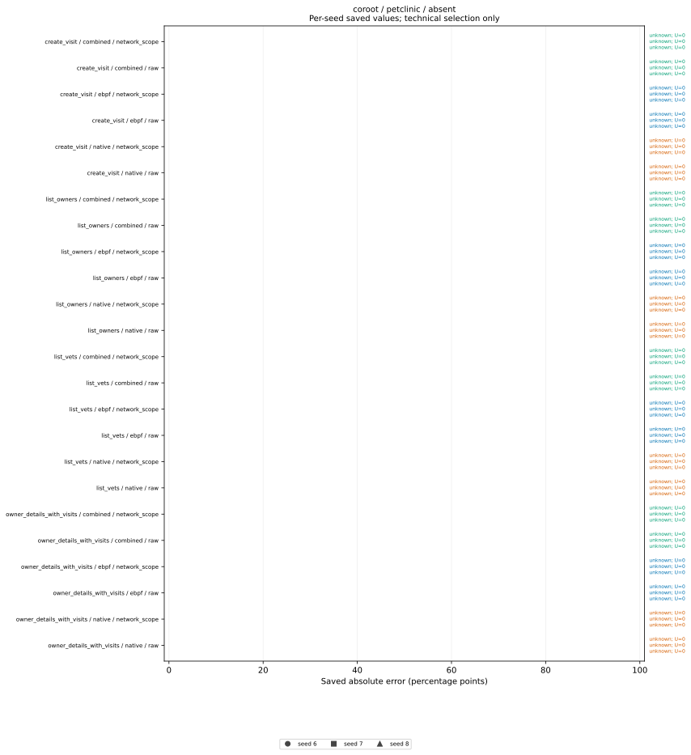
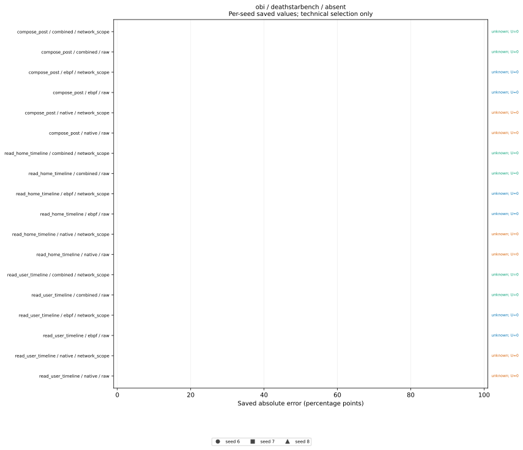
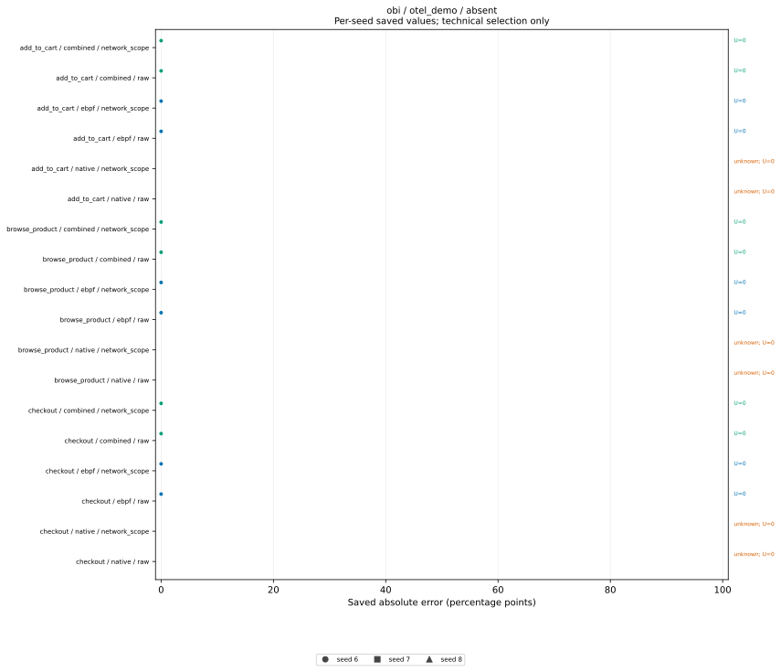
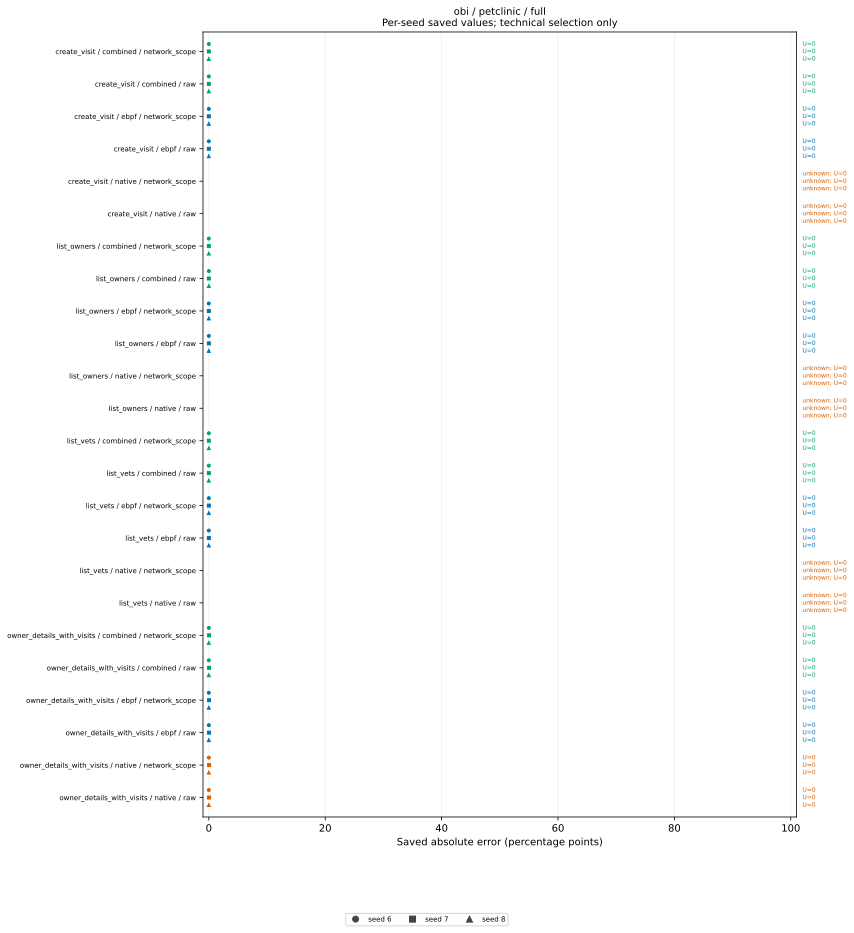
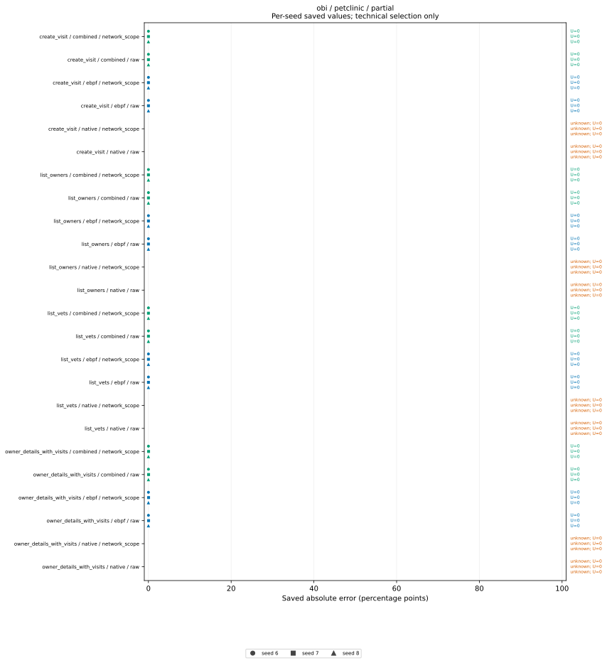

# Iteration-5 saved error figures

Points and horizontal ranges copy saved worst-end errors and error ranges, converted from fractions to percentage points. Ranges are not confidence intervals. Unavailable errors stay unknown. U is the saved number of unknown external outcomes. An absent seed row means no technically selected cell, not zero error; see the fixed grid. Technical selection is not independent admission. Predictive error alone does not establish a utility or effort advantage; the equally informed direct baseline shares the stated arithmetic. Different source/preparation revisions prevent attribution of cost differences solely to collectors. No averaging, refit or success threshold.

Exact copied values, source hashes, selection and independent-review status: [saved-values-v5.json](saved-values-v5.json).

## Fixed main grid

```json
{
  "blocked_main_cells": [
    [
      "newrelic",
      "deathstarbench",
      "absent",
      6,
      "No authorized existing New Relic license key or verified local collector codec; no replacement or synthesized credentials."
    ],
    [
      "newrelic",
      "deathstarbench",
      "absent",
      7,
      "No authorized existing New Relic license key or verified local collector codec; no replacement or synthesized credentials."
    ],
    [
      "newrelic",
      "deathstarbench",
      "absent",
      8,
      "No authorized existing New Relic license key or verified local collector codec; no replacement or synthesized credentials."
    ],
    [
      "newrelic",
      "deathstarbench",
      "full",
      6,
      "No authorized existing New Relic license key or verified local collector codec; no replacement or synthesized credentials."
    ],
    [
      "newrelic",
      "deathstarbench",
      "full",
      7,
      "No authorized existing New Relic license key or verified local collector codec; no replacement or synthesized credentials."
    ],
    [
      "newrelic",
      "deathstarbench",
      "full",
      8,
      "No authorized existing New Relic license key or verified local collector codec; no replacement or synthesized credentials."
    ],
    [
      "newrelic",
      "deathstarbench",
      "partial",
      6,
      "No authorized existing New Relic license key or verified local collector codec; no replacement or synthesized credentials."
    ],
    [
      "newrelic",
      "deathstarbench",
      "partial",
      7,
      "No authorized existing New Relic license key or verified local collector codec; no replacement or synthesized credentials."
    ],
    [
      "newrelic",
      "deathstarbench",
      "partial",
      8,
      "No authorized existing New Relic license key or verified local collector codec; no replacement or synthesized credentials."
    ],
    [
      "newrelic",
      "otel_demo",
      "absent",
      6,
      "No authorized existing New Relic license key or verified local collector codec; no replacement or synthesized credentials."
    ],
    [
      "newrelic",
      "otel_demo",
      "absent",
      7,
      "No authorized existing New Relic license key or verified local collector codec; no replacement or synthesized credentials."
    ],
    [
      "newrelic",
      "otel_demo",
      "absent",
      8,
      "No authorized existing New Relic license key or verified local collector codec; no replacement or synthesized credentials."
    ],
    [
      "newrelic",
      "otel_demo",
      "full",
      6,
      "No authorized existing New Relic license key or verified local collector codec; no replacement or synthesized credentials."
    ],
    [
      "newrelic",
      "otel_demo",
      "full",
      7,
      "No authorized existing New Relic license key or verified local collector codec; no replacement or synthesized credentials."
    ],
    [
      "newrelic",
      "otel_demo",
      "full",
      8,
      "No authorized existing New Relic license key or verified local collector codec; no replacement or synthesized credentials."
    ],
    [
      "newrelic",
      "otel_demo",
      "partial",
      6,
      "No authorized existing New Relic license key or verified local collector codec; no replacement or synthesized credentials."
    ],
    [
      "newrelic",
      "otel_demo",
      "partial",
      7,
      "No authorized existing New Relic license key or verified local collector codec; no replacement or synthesized credentials."
    ],
    [
      "newrelic",
      "otel_demo",
      "partial",
      8,
      "No authorized existing New Relic license key or verified local collector codec; no replacement or synthesized credentials."
    ],
    [
      "newrelic",
      "petclinic",
      "absent",
      6,
      "No authorized existing New Relic license key or verified local collector codec; no replacement or synthesized credentials."
    ],
    [
      "newrelic",
      "petclinic",
      "absent",
      7,
      "No authorized existing New Relic license key or verified local collector codec; no replacement or synthesized credentials."
    ],
    [
      "newrelic",
      "petclinic",
      "absent",
      8,
      "No authorized existing New Relic license key or verified local collector codec; no replacement or synthesized credentials."
    ],
    [
      "newrelic",
      "petclinic",
      "full",
      6,
      "No authorized existing New Relic license key or verified local collector codec; no replacement or synthesized credentials."
    ],
    [
      "newrelic",
      "petclinic",
      "full",
      7,
      "No authorized existing New Relic license key or verified local collector codec; no replacement or synthesized credentials."
    ],
    [
      "newrelic",
      "petclinic",
      "full",
      8,
      "No authorized existing New Relic license key or verified local collector codec; no replacement or synthesized credentials."
    ],
    [
      "newrelic",
      "petclinic",
      "partial",
      6,
      "No authorized existing New Relic license key or verified local collector codec; no replacement or synthesized credentials."
    ],
    [
      "newrelic",
      "petclinic",
      "partial",
      7,
      "No authorized existing New Relic license key or verified local collector codec; no replacement or synthesized credentials."
    ],
    [
      "newrelic",
      "petclinic",
      "partial",
      8,
      "No authorized existing New Relic license key or verified local collector codec; no replacement or synthesized credentials."
    ]
  ],
  "declared_main_cells": 108,
  "incomplete_or_missing_main_cells": [
    [
      "coroot",
      "deathstarbench",
      "absent",
      6
    ],
    [
      "coroot",
      "deathstarbench",
      "absent",
      7
    ],
    [
      "coroot",
      "deathstarbench",
      "absent",
      8
    ],
    [
      "coroot",
      "deathstarbench",
      "full",
      6
    ],
    [
      "coroot",
      "deathstarbench",
      "full",
      7
    ],
    [
      "coroot",
      "deathstarbench",
      "full",
      8
    ],
    [
      "coroot",
      "deathstarbench",
      "partial",
      6
    ],
    [
      "coroot",
      "deathstarbench",
      "partial",
      7
    ],
    [
      "coroot",
      "deathstarbench",
      "partial",
      8
    ],
    [
      "coroot",
      "otel_demo",
      "absent",
      6
    ],
    [
      "coroot",
      "otel_demo",
      "absent",
      7
    ],
    [
      "coroot",
      "otel_demo",
      "absent",
      8
    ],
    [
      "coroot",
      "otel_demo",
      "full",
      6
    ],
    [
      "coroot",
      "otel_demo",
      "full",
      7
    ],
    [
      "coroot",
      "otel_demo",
      "full",
      8
    ],
    [
      "coroot",
      "otel_demo",
      "partial",
      6
    ],
    [
      "coroot",
      "otel_demo",
      "partial",
      7
    ],
    [
      "coroot",
      "otel_demo",
      "partial",
      8
    ],
    [
      "coroot",
      "petclinic",
      "full",
      6
    ],
    [
      "coroot",
      "petclinic",
      "full",
      7
    ],
    [
      "coroot",
      "petclinic",
      "full",
      8
    ],
    [
      "coroot",
      "petclinic",
      "partial",
      6
    ],
    [
      "coroot",
      "petclinic",
      "partial",
      7
    ],
    [
      "coroot",
      "petclinic",
      "partial",
      8
    ],
    [
      "deepflow",
      "deathstarbench",
      "absent",
      6
    ],
    [
      "deepflow",
      "deathstarbench",
      "absent",
      7
    ],
    [
      "deepflow",
      "deathstarbench",
      "absent",
      8
    ],
    [
      "deepflow",
      "deathstarbench",
      "full",
      6
    ],
    [
      "deepflow",
      "deathstarbench",
      "full",
      7
    ],
    [
      "deepflow",
      "deathstarbench",
      "full",
      8
    ],
    [
      "deepflow",
      "deathstarbench",
      "partial",
      6
    ],
    [
      "deepflow",
      "deathstarbench",
      "partial",
      7
    ],
    [
      "deepflow",
      "deathstarbench",
      "partial",
      8
    ],
    [
      "deepflow",
      "otel_demo",
      "absent",
      6
    ],
    [
      "deepflow",
      "otel_demo",
      "absent",
      7
    ],
    [
      "deepflow",
      "otel_demo",
      "absent",
      8
    ],
    [
      "deepflow",
      "otel_demo",
      "full",
      6
    ],
    [
      "deepflow",
      "otel_demo",
      "full",
      7
    ],
    [
      "deepflow",
      "otel_demo",
      "full",
      8
    ],
    [
      "deepflow",
      "otel_demo",
      "partial",
      6
    ],
    [
      "deepflow",
      "otel_demo",
      "partial",
      7
    ],
    [
      "deepflow",
      "otel_demo",
      "partial",
      8
    ],
    [
      "deepflow",
      "petclinic",
      "absent",
      6
    ],
    [
      "deepflow",
      "petclinic",
      "absent",
      7
    ],
    [
      "deepflow",
      "petclinic",
      "absent",
      8
    ],
    [
      "deepflow",
      "petclinic",
      "full",
      6
    ],
    [
      "deepflow",
      "petclinic",
      "full",
      7
    ],
    [
      "deepflow",
      "petclinic",
      "full",
      8
    ],
    [
      "deepflow",
      "petclinic",
      "partial",
      6
    ],
    [
      "deepflow",
      "petclinic",
      "partial",
      7
    ],
    [
      "deepflow",
      "petclinic",
      "partial",
      8
    ],
    [
      "newrelic",
      "deathstarbench",
      "absent",
      6
    ],
    [
      "newrelic",
      "deathstarbench",
      "absent",
      7
    ],
    [
      "newrelic",
      "deathstarbench",
      "absent",
      8
    ],
    [
      "newrelic",
      "deathstarbench",
      "full",
      6
    ],
    [
      "newrelic",
      "deathstarbench",
      "full",
      7
    ],
    [
      "newrelic",
      "deathstarbench",
      "full",
      8
    ],
    [
      "newrelic",
      "deathstarbench",
      "partial",
      6
    ],
    [
      "newrelic",
      "deathstarbench",
      "partial",
      7
    ],
    [
      "newrelic",
      "deathstarbench",
      "partial",
      8
    ],
    [
      "newrelic",
      "otel_demo",
      "absent",
      6
    ],
    [
      "newrelic",
      "otel_demo",
      "absent",
      7
    ],
    [
      "newrelic",
      "otel_demo",
      "absent",
      8
    ],
    [
      "newrelic",
      "otel_demo",
      "full",
      6
    ],
    [
      "newrelic",
      "otel_demo",
      "full",
      7
    ],
    [
      "newrelic",
      "otel_demo",
      "full",
      8
    ],
    [
      "newrelic",
      "otel_demo",
      "partial",
      6
    ],
    [
      "newrelic",
      "otel_demo",
      "partial",
      7
    ],
    [
      "newrelic",
      "otel_demo",
      "partial",
      8
    ],
    [
      "newrelic",
      "petclinic",
      "absent",
      6
    ],
    [
      "newrelic",
      "petclinic",
      "absent",
      7
    ],
    [
      "newrelic",
      "petclinic",
      "absent",
      8
    ],
    [
      "newrelic",
      "petclinic",
      "full",
      6
    ],
    [
      "newrelic",
      "petclinic",
      "full",
      7
    ],
    [
      "newrelic",
      "petclinic",
      "full",
      8
    ],
    [
      "newrelic",
      "petclinic",
      "partial",
      6
    ],
    [
      "newrelic",
      "petclinic",
      "partial",
      7
    ],
    [
      "newrelic",
      "petclinic",
      "partial",
      8
    ],
    [
      "obi",
      "deathstarbench",
      "absent",
      6
    ],
    [
      "obi",
      "deathstarbench",
      "absent",
      8
    ],
    [
      "obi",
      "deathstarbench",
      "full",
      6
    ],
    [
      "obi",
      "deathstarbench",
      "full",
      7
    ],
    [
      "obi",
      "deathstarbench",
      "full",
      8
    ],
    [
      "obi",
      "deathstarbench",
      "partial",
      6
    ],
    [
      "obi",
      "deathstarbench",
      "partial",
      7
    ],
    [
      "obi",
      "deathstarbench",
      "partial",
      8
    ],
    [
      "obi",
      "otel_demo",
      "absent",
      7
    ],
    [
      "obi",
      "otel_demo",
      "absent",
      8
    ],
    [
      "obi",
      "otel_demo",
      "full",
      6
    ],
    [
      "obi",
      "otel_demo",
      "full",
      7
    ],
    [
      "obi",
      "otel_demo",
      "full",
      8
    ],
    [
      "obi",
      "otel_demo",
      "partial",
      6
    ],
    [
      "obi",
      "otel_demo",
      "partial",
      7
    ],
    [
      "obi",
      "otel_demo",
      "partial",
      8
    ]
  ],
  "smoke_attempts_excluded_from_main_coverage": true,
  "technically_complete_main_cells": 14
}
```

Blocked cells are listed separately within the incomplete/missing grid. A missing campaign is distinct from an available campaign with an unknown forecast.

## coroot / petclinic / absent



## obi / deathstarbench / absent



## obi / otel_demo / absent



## obi / petclinic / absent


## obi / petclinic / full



## obi / petclinic / partial



## Copied per-seed values

| Run | Collector | System | Mode | Seed | Operation | Source | Variant | Available | Saved error | Actual counts |
|---|---|---|---|---|---|---|---|---|---|---|
| 40947299209 | "coroot" | "petclinic" | "absent" | 6 | "create_visit" | "ebpf" | "raw" | false | {"range": null, "worst_end_error": null} | {"true": 2100, "false": 300, "none": 0} |
| 40947299209 | "coroot" | "petclinic" | "absent" | 6 | "create_visit" | "ebpf" | "network_scope" | false | {"range": null, "worst_end_error": null} | {"true": 2100, "false": 300, "none": 0} |
| 40947299209 | "coroot" | "petclinic" | "absent" | 6 | "create_visit" | "native" | "raw" | false | {"range": null, "worst_end_error": null} | {"true": 2100, "false": 300, "none": 0} |
| 40947299209 | "coroot" | "petclinic" | "absent" | 6 | "create_visit" | "native" | "network_scope" | false | {"range": null, "worst_end_error": null} | {"true": 2100, "false": 300, "none": 0} |
| 40947299209 | "coroot" | "petclinic" | "absent" | 6 | "create_visit" | "combined" | "raw" | false | {"range": null, "worst_end_error": null} | {"true": 2100, "false": 300, "none": 0} |
| 40947299209 | "coroot" | "petclinic" | "absent" | 6 | "create_visit" | "combined" | "network_scope" | false | {"range": null, "worst_end_error": null} | {"true": 2100, "false": 300, "none": 0} |
| 40947299209 | "coroot" | "petclinic" | "absent" | 6 | "list_owners" | "ebpf" | "raw" | false | {"range": null, "worst_end_error": null} | {"true": 2400, "false": 0, "none": 0} |
| 40947299209 | "coroot" | "petclinic" | "absent" | 6 | "list_owners" | "ebpf" | "network_scope" | false | {"range": null, "worst_end_error": null} | {"true": 2400, "false": 0, "none": 0} |
| 40947299209 | "coroot" | "petclinic" | "absent" | 6 | "list_owners" | "native" | "raw" | false | {"range": null, "worst_end_error": null} | {"true": 2400, "false": 0, "none": 0} |
| 40947299209 | "coroot" | "petclinic" | "absent" | 6 | "list_owners" | "native" | "network_scope" | false | {"range": null, "worst_end_error": null} | {"true": 2400, "false": 0, "none": 0} |
| 40947299209 | "coroot" | "petclinic" | "absent" | 6 | "list_owners" | "combined" | "raw" | false | {"range": null, "worst_end_error": null} | {"true": 2400, "false": 0, "none": 0} |
| 40947299209 | "coroot" | "petclinic" | "absent" | 6 | "list_owners" | "combined" | "network_scope" | false | {"range": null, "worst_end_error": null} | {"true": 2400, "false": 0, "none": 0} |
| 40947299209 | "coroot" | "petclinic" | "absent" | 6 | "list_vets" | "ebpf" | "raw" | false | {"range": null, "worst_end_error": null} | {"true": 2400, "false": 0, "none": 0} |
| 40947299209 | "coroot" | "petclinic" | "absent" | 6 | "list_vets" | "ebpf" | "network_scope" | false | {"range": null, "worst_end_error": null} | {"true": 2400, "false": 0, "none": 0} |
| 40947299209 | "coroot" | "petclinic" | "absent" | 6 | "list_vets" | "native" | "raw" | false | {"range": null, "worst_end_error": null} | {"true": 2400, "false": 0, "none": 0} |
| 40947299209 | "coroot" | "petclinic" | "absent" | 6 | "list_vets" | "native" | "network_scope" | false | {"range": null, "worst_end_error": null} | {"true": 2400, "false": 0, "none": 0} |
| 40947299209 | "coroot" | "petclinic" | "absent" | 6 | "list_vets" | "combined" | "raw" | false | {"range": null, "worst_end_error": null} | {"true": 2400, "false": 0, "none": 0} |
| 40947299209 | "coroot" | "petclinic" | "absent" | 6 | "list_vets" | "combined" | "network_scope" | false | {"range": null, "worst_end_error": null} | {"true": 2400, "false": 0, "none": 0} |
| 40947299209 | "coroot" | "petclinic" | "absent" | 6 | "owner_details_with_visits" | "ebpf" | "raw" | false | {"range": null, "worst_end_error": null} | {"true": 2100, "false": 300, "none": 0} |
| 40947299209 | "coroot" | "petclinic" | "absent" | 6 | "owner_details_with_visits" | "ebpf" | "network_scope" | false | {"range": null, "worst_end_error": null} | {"true": 2100, "false": 300, "none": 0} |
| 40947299209 | "coroot" | "petclinic" | "absent" | 6 | "owner_details_with_visits" | "native" | "raw" | false | {"range": null, "worst_end_error": null} | {"true": 2100, "false": 300, "none": 0} |
| 40947299209 | "coroot" | "petclinic" | "absent" | 6 | "owner_details_with_visits" | "native" | "network_scope" | false | {"range": null, "worst_end_error": null} | {"true": 2100, "false": 300, "none": 0} |
| 40947299209 | "coroot" | "petclinic" | "absent" | 6 | "owner_details_with_visits" | "combined" | "raw" | false | {"range": null, "worst_end_error": null} | {"true": 2100, "false": 300, "none": 0} |
| 40947299209 | "coroot" | "petclinic" | "absent" | 6 | "owner_details_with_visits" | "combined" | "network_scope" | false | {"range": null, "worst_end_error": null} | {"true": 2100, "false": 300, "none": 0} |
| 40947299209 | "coroot" | "petclinic" | "absent" | 7 | "create_visit" | "ebpf" | "raw" | false | {"range": null, "worst_end_error": null} | {"true": 2100, "false": 300, "none": 0} |
| 40947299209 | "coroot" | "petclinic" | "absent" | 7 | "create_visit" | "ebpf" | "network_scope" | false | {"range": null, "worst_end_error": null} | {"true": 2100, "false": 300, "none": 0} |
| 40947299209 | "coroot" | "petclinic" | "absent" | 7 | "create_visit" | "native" | "raw" | false | {"range": null, "worst_end_error": null} | {"true": 2100, "false": 300, "none": 0} |
| 40947299209 | "coroot" | "petclinic" | "absent" | 7 | "create_visit" | "native" | "network_scope" | false | {"range": null, "worst_end_error": null} | {"true": 2100, "false": 300, "none": 0} |
| 40947299209 | "coroot" | "petclinic" | "absent" | 7 | "create_visit" | "combined" | "raw" | false | {"range": null, "worst_end_error": null} | {"true": 2100, "false": 300, "none": 0} |
| 40947299209 | "coroot" | "petclinic" | "absent" | 7 | "create_visit" | "combined" | "network_scope" | false | {"range": null, "worst_end_error": null} | {"true": 2100, "false": 300, "none": 0} |
| 40947299209 | "coroot" | "petclinic" | "absent" | 7 | "list_owners" | "ebpf" | "raw" | false | {"range": null, "worst_end_error": null} | {"true": 2400, "false": 0, "none": 0} |
| 40947299209 | "coroot" | "petclinic" | "absent" | 7 | "list_owners" | "ebpf" | "network_scope" | false | {"range": null, "worst_end_error": null} | {"true": 2400, "false": 0, "none": 0} |
| 40947299209 | "coroot" | "petclinic" | "absent" | 7 | "list_owners" | "native" | "raw" | false | {"range": null, "worst_end_error": null} | {"true": 2400, "false": 0, "none": 0} |
| 40947299209 | "coroot" | "petclinic" | "absent" | 7 | "list_owners" | "native" | "network_scope" | false | {"range": null, "worst_end_error": null} | {"true": 2400, "false": 0, "none": 0} |
| 40947299209 | "coroot" | "petclinic" | "absent" | 7 | "list_owners" | "combined" | "raw" | false | {"range": null, "worst_end_error": null} | {"true": 2400, "false": 0, "none": 0} |
| 40947299209 | "coroot" | "petclinic" | "absent" | 7 | "list_owners" | "combined" | "network_scope" | false | {"range": null, "worst_end_error": null} | {"true": 2400, "false": 0, "none": 0} |
| 40947299209 | "coroot" | "petclinic" | "absent" | 7 | "list_vets" | "ebpf" | "raw" | false | {"range": null, "worst_end_error": null} | {"true": 2400, "false": 0, "none": 0} |
| 40947299209 | "coroot" | "petclinic" | "absent" | 7 | "list_vets" | "ebpf" | "network_scope" | false | {"range": null, "worst_end_error": null} | {"true": 2400, "false": 0, "none": 0} |
| 40947299209 | "coroot" | "petclinic" | "absent" | 7 | "list_vets" | "native" | "raw" | false | {"range": null, "worst_end_error": null} | {"true": 2400, "false": 0, "none": 0} |
| 40947299209 | "coroot" | "petclinic" | "absent" | 7 | "list_vets" | "native" | "network_scope" | false | {"range": null, "worst_end_error": null} | {"true": 2400, "false": 0, "none": 0} |
| 40947299209 | "coroot" | "petclinic" | "absent" | 7 | "list_vets" | "combined" | "raw" | false | {"range": null, "worst_end_error": null} | {"true": 2400, "false": 0, "none": 0} |
| 40947299209 | "coroot" | "petclinic" | "absent" | 7 | "list_vets" | "combined" | "network_scope" | false | {"range": null, "worst_end_error": null} | {"true": 2400, "false": 0, "none": 0} |
| 40947299209 | "coroot" | "petclinic" | "absent" | 7 | "owner_details_with_visits" | "ebpf" | "raw" | false | {"range": null, "worst_end_error": null} | {"true": 2100, "false": 300, "none": 0} |
| 40947299209 | "coroot" | "petclinic" | "absent" | 7 | "owner_details_with_visits" | "ebpf" | "network_scope" | false | {"range": null, "worst_end_error": null} | {"true": 2100, "false": 300, "none": 0} |
| 40947299209 | "coroot" | "petclinic" | "absent" | 7 | "owner_details_with_visits" | "native" | "raw" | false | {"range": null, "worst_end_error": null} | {"true": 2100, "false": 300, "none": 0} |
| 40947299209 | "coroot" | "petclinic" | "absent" | 7 | "owner_details_with_visits" | "native" | "network_scope" | false | {"range": null, "worst_end_error": null} | {"true": 2100, "false": 300, "none": 0} |
| 40947299209 | "coroot" | "petclinic" | "absent" | 7 | "owner_details_with_visits" | "combined" | "raw" | false | {"range": null, "worst_end_error": null} | {"true": 2100, "false": 300, "none": 0} |
| 40947299209 | "coroot" | "petclinic" | "absent" | 7 | "owner_details_with_visits" | "combined" | "network_scope" | false | {"range": null, "worst_end_error": null} | {"true": 2100, "false": 300, "none": 0} |
| 40947299209 | "coroot" | "petclinic" | "absent" | 8 | "create_visit" | "ebpf" | "raw" | false | {"range": null, "worst_end_error": null} | {"true": 2100, "false": 300, "none": 0} |
| 40947299209 | "coroot" | "petclinic" | "absent" | 8 | "create_visit" | "ebpf" | "network_scope" | false | {"range": null, "worst_end_error": null} | {"true": 2100, "false": 300, "none": 0} |
| 40947299209 | "coroot" | "petclinic" | "absent" | 8 | "create_visit" | "native" | "raw" | false | {"range": null, "worst_end_error": null} | {"true": 2100, "false": 300, "none": 0} |
| 40947299209 | "coroot" | "petclinic" | "absent" | 8 | "create_visit" | "native" | "network_scope" | false | {"range": null, "worst_end_error": null} | {"true": 2100, "false": 300, "none": 0} |
| 40947299209 | "coroot" | "petclinic" | "absent" | 8 | "create_visit" | "combined" | "raw" | false | {"range": null, "worst_end_error": null} | {"true": 2100, "false": 300, "none": 0} |
| 40947299209 | "coroot" | "petclinic" | "absent" | 8 | "create_visit" | "combined" | "network_scope" | false | {"range": null, "worst_end_error": null} | {"true": 2100, "false": 300, "none": 0} |
| 40947299209 | "coroot" | "petclinic" | "absent" | 8 | "list_owners" | "ebpf" | "raw" | false | {"range": null, "worst_end_error": null} | {"true": 2400, "false": 0, "none": 0} |
| 40947299209 | "coroot" | "petclinic" | "absent" | 8 | "list_owners" | "ebpf" | "network_scope" | false | {"range": null, "worst_end_error": null} | {"true": 2400, "false": 0, "none": 0} |
| 40947299209 | "coroot" | "petclinic" | "absent" | 8 | "list_owners" | "native" | "raw" | false | {"range": null, "worst_end_error": null} | {"true": 2400, "false": 0, "none": 0} |
| 40947299209 | "coroot" | "petclinic" | "absent" | 8 | "list_owners" | "native" | "network_scope" | false | {"range": null, "worst_end_error": null} | {"true": 2400, "false": 0, "none": 0} |
| 40947299209 | "coroot" | "petclinic" | "absent" | 8 | "list_owners" | "combined" | "raw" | false | {"range": null, "worst_end_error": null} | {"true": 2400, "false": 0, "none": 0} |
| 40947299209 | "coroot" | "petclinic" | "absent" | 8 | "list_owners" | "combined" | "network_scope" | false | {"range": null, "worst_end_error": null} | {"true": 2400, "false": 0, "none": 0} |
| 40947299209 | "coroot" | "petclinic" | "absent" | 8 | "list_vets" | "ebpf" | "raw" | false | {"range": null, "worst_end_error": null} | {"true": 2400, "false": 0, "none": 0} |
| 40947299209 | "coroot" | "petclinic" | "absent" | 8 | "list_vets" | "ebpf" | "network_scope" | false | {"range": null, "worst_end_error": null} | {"true": 2400, "false": 0, "none": 0} |
| 40947299209 | "coroot" | "petclinic" | "absent" | 8 | "list_vets" | "native" | "raw" | false | {"range": null, "worst_end_error": null} | {"true": 2400, "false": 0, "none": 0} |
| 40947299209 | "coroot" | "petclinic" | "absent" | 8 | "list_vets" | "native" | "network_scope" | false | {"range": null, "worst_end_error": null} | {"true": 2400, "false": 0, "none": 0} |
| 40947299209 | "coroot" | "petclinic" | "absent" | 8 | "list_vets" | "combined" | "raw" | false | {"range": null, "worst_end_error": null} | {"true": 2400, "false": 0, "none": 0} |
| 40947299209 | "coroot" | "petclinic" | "absent" | 8 | "list_vets" | "combined" | "network_scope" | false | {"range": null, "worst_end_error": null} | {"true": 2400, "false": 0, "none": 0} |
| 40947299209 | "coroot" | "petclinic" | "absent" | 8 | "owner_details_with_visits" | "ebpf" | "raw" | false | {"range": null, "worst_end_error": null} | {"true": 2100, "false": 300, "none": 0} |
| 40947299209 | "coroot" | "petclinic" | "absent" | 8 | "owner_details_with_visits" | "ebpf" | "network_scope" | false | {"range": null, "worst_end_error": null} | {"true": 2100, "false": 300, "none": 0} |
| 40947299209 | "coroot" | "petclinic" | "absent" | 8 | "owner_details_with_visits" | "native" | "raw" | false | {"range": null, "worst_end_error": null} | {"true": 2100, "false": 300, "none": 0} |
| 40947299209 | "coroot" | "petclinic" | "absent" | 8 | "owner_details_with_visits" | "native" | "network_scope" | false | {"range": null, "worst_end_error": null} | {"true": 2100, "false": 300, "none": 0} |
| 40947299209 | "coroot" | "petclinic" | "absent" | 8 | "owner_details_with_visits" | "combined" | "raw" | false | {"range": null, "worst_end_error": null} | {"true": 2100, "false": 300, "none": 0} |
| 40947299209 | "coroot" | "petclinic" | "absent" | 8 | "owner_details_with_visits" | "combined" | "network_scope" | false | {"range": null, "worst_end_error": null} | {"true": 2100, "false": 300, "none": 0} |
| 40942429097 | "obi" | "deathstarbench" | "absent" | 7 | "compose_post" | "ebpf" | "raw" | false | {"range": null, "worst_end_error": null} | {"true": 2800, "false": 400, "none": 0} |
| 40942429097 | "obi" | "deathstarbench" | "absent" | 7 | "compose_post" | "ebpf" | "network_scope" | false | {"range": null, "worst_end_error": null} | {"true": 2800, "false": 400, "none": 0} |
| 40942429097 | "obi" | "deathstarbench" | "absent" | 7 | "compose_post" | "native" | "raw" | false | {"range": null, "worst_end_error": null} | {"true": 2800, "false": 400, "none": 0} |
| 40942429097 | "obi" | "deathstarbench" | "absent" | 7 | "compose_post" | "native" | "network_scope" | false | {"range": null, "worst_end_error": null} | {"true": 2800, "false": 400, "none": 0} |
| 40942429097 | "obi" | "deathstarbench" | "absent" | 7 | "compose_post" | "combined" | "raw" | false | {"range": null, "worst_end_error": null} | {"true": 2800, "false": 400, "none": 0} |
| 40942429097 | "obi" | "deathstarbench" | "absent" | 7 | "compose_post" | "combined" | "network_scope" | false | {"range": null, "worst_end_error": null} | {"true": 2800, "false": 400, "none": 0} |
| 40942429097 | "obi" | "deathstarbench" | "absent" | 7 | "read_home_timeline" | "ebpf" | "raw" | false | {"range": null, "worst_end_error": null} | {"true": 3200, "false": 0, "none": 0} |
| 40942429097 | "obi" | "deathstarbench" | "absent" | 7 | "read_home_timeline" | "ebpf" | "network_scope" | false | {"range": null, "worst_end_error": null} | {"true": 3200, "false": 0, "none": 0} |
| 40942429097 | "obi" | "deathstarbench" | "absent" | 7 | "read_home_timeline" | "native" | "raw" | false | {"range": null, "worst_end_error": null} | {"true": 3200, "false": 0, "none": 0} |
| 40942429097 | "obi" | "deathstarbench" | "absent" | 7 | "read_home_timeline" | "native" | "network_scope" | false | {"range": null, "worst_end_error": null} | {"true": 3200, "false": 0, "none": 0} |
| 40942429097 | "obi" | "deathstarbench" | "absent" | 7 | "read_home_timeline" | "combined" | "raw" | false | {"range": null, "worst_end_error": null} | {"true": 3200, "false": 0, "none": 0} |
| 40942429097 | "obi" | "deathstarbench" | "absent" | 7 | "read_home_timeline" | "combined" | "network_scope" | false | {"range": null, "worst_end_error": null} | {"true": 3200, "false": 0, "none": 0} |
| 40942429097 | "obi" | "deathstarbench" | "absent" | 7 | "read_user_timeline" | "ebpf" | "raw" | false | {"range": null, "worst_end_error": null} | {"true": 2800, "false": 400, "none": 0} |
| 40942429097 | "obi" | "deathstarbench" | "absent" | 7 | "read_user_timeline" | "ebpf" | "network_scope" | false | {"range": null, "worst_end_error": null} | {"true": 2800, "false": 400, "none": 0} |
| 40942429097 | "obi" | "deathstarbench" | "absent" | 7 | "read_user_timeline" | "native" | "raw" | false | {"range": null, "worst_end_error": null} | {"true": 2800, "false": 400, "none": 0} |
| 40942429097 | "obi" | "deathstarbench" | "absent" | 7 | "read_user_timeline" | "native" | "network_scope" | false | {"range": null, "worst_end_error": null} | {"true": 2800, "false": 400, "none": 0} |
| 40942429097 | "obi" | "deathstarbench" | "absent" | 7 | "read_user_timeline" | "combined" | "raw" | false | {"range": null, "worst_end_error": null} | {"true": 2800, "false": 400, "none": 0} |
| 40942429097 | "obi" | "deathstarbench" | "absent" | 7 | "read_user_timeline" | "combined" | "network_scope" | false | {"range": null, "worst_end_error": null} | {"true": 2800, "false": 400, "none": 0} |
| 40930805848 | "obi" | "otel_demo" | "absent" | 6 | "add_to_cart" | "ebpf" | "raw" | true | {"range": [0.0, 0.0], "worst_end_error": 0.0} | {"true": 2800, "false": 400, "none": 0} |
| 40930805848 | "obi" | "otel_demo" | "absent" | 6 | "add_to_cart" | "ebpf" | "network_scope" | true | {"range": [0.0, 0.0], "worst_end_error": 0.0} | {"true": 2800, "false": 400, "none": 0} |
| 40930805848 | "obi" | "otel_demo" | "absent" | 6 | "add_to_cart" | "native" | "raw" | false | {"range": null, "worst_end_error": null} | {"true": 2800, "false": 400, "none": 0} |
| 40930805848 | "obi" | "otel_demo" | "absent" | 6 | "add_to_cart" | "native" | "network_scope" | false | {"range": null, "worst_end_error": null} | {"true": 2800, "false": 400, "none": 0} |
| 40930805848 | "obi" | "otel_demo" | "absent" | 6 | "add_to_cart" | "combined" | "raw" | true | {"range": [0.0, 0.0], "worst_end_error": 0.0} | {"true": 2800, "false": 400, "none": 0} |
| 40930805848 | "obi" | "otel_demo" | "absent" | 6 | "add_to_cart" | "combined" | "network_scope" | true | {"range": [0.0, 0.0], "worst_end_error": 0.0} | {"true": 2800, "false": 400, "none": 0} |
| 40930805848 | "obi" | "otel_demo" | "absent" | 6 | "browse_product" | "ebpf" | "raw" | true | {"range": [0.0, 0.0], "worst_end_error": 0.0} | {"true": 2800, "false": 400, "none": 0} |
| 40930805848 | "obi" | "otel_demo" | "absent" | 6 | "browse_product" | "ebpf" | "network_scope" | true | {"range": [0.0, 0.0], "worst_end_error": 0.0} | {"true": 2800, "false": 400, "none": 0} |
| 40930805848 | "obi" | "otel_demo" | "absent" | 6 | "browse_product" | "native" | "raw" | false | {"range": null, "worst_end_error": null} | {"true": 2800, "false": 400, "none": 0} |
| 40930805848 | "obi" | "otel_demo" | "absent" | 6 | "browse_product" | "native" | "network_scope" | false | {"range": null, "worst_end_error": null} | {"true": 2800, "false": 400, "none": 0} |
| 40930805848 | "obi" | "otel_demo" | "absent" | 6 | "browse_product" | "combined" | "raw" | true | {"range": [0.0, 0.0], "worst_end_error": 0.0} | {"true": 2800, "false": 400, "none": 0} |
| 40930805848 | "obi" | "otel_demo" | "absent" | 6 | "browse_product" | "combined" | "network_scope" | true | {"range": [0.0, 0.0], "worst_end_error": 0.0} | {"true": 2800, "false": 400, "none": 0} |
| 40930805848 | "obi" | "otel_demo" | "absent" | 6 | "checkout" | "ebpf" | "raw" | true | {"range": [0.0, 0.0], "worst_end_error": 0.0} | {"true": 2800, "false": 400, "none": 0} |
| 40930805848 | "obi" | "otel_demo" | "absent" | 6 | "checkout" | "ebpf" | "network_scope" | true | {"range": [0.0, 0.0], "worst_end_error": 0.0} | {"true": 2800, "false": 400, "none": 0} |
| 40930805848 | "obi" | "otel_demo" | "absent" | 6 | "checkout" | "native" | "raw" | false | {"range": null, "worst_end_error": null} | {"true": 2800, "false": 400, "none": 0} |
| 40930805848 | "obi" | "otel_demo" | "absent" | 6 | "checkout" | "native" | "network_scope" | false | {"range": null, "worst_end_error": null} | {"true": 2800, "false": 400, "none": 0} |
| 40930805848 | "obi" | "otel_demo" | "absent" | 6 | "checkout" | "combined" | "raw" | true | {"range": [0.0, 0.0], "worst_end_error": 0.0} | {"true": 2800, "false": 400, "none": 0} |
| 40930805848 | "obi" | "otel_demo" | "absent" | 6 | "checkout" | "combined" | "network_scope" | true | {"range": [0.0, 0.0], "worst_end_error": 0.0} | {"true": 2800, "false": 400, "none": 0} |
| 40910013685 | "obi" | "petclinic" | "absent" | 6 | "create_visit" | "ebpf" | "raw" | true | {"range": [0.0, 0.0], "worst_end_error": 0.0} | {"true": 2100, "false": 300, "none": 0} |
| 40910013685 | "obi" | "petclinic" | "absent" | 6 | "create_visit" | "ebpf" | "network_scope" | true | {"range": [0.0, 0.0], "worst_end_error": 0.0} | {"true": 2100, "false": 300, "none": 0} |
| 40910013685 | "obi" | "petclinic" | "absent" | 6 | "create_visit" | "native" | "raw" | false | {"range": null, "worst_end_error": null} | {"true": 2100, "false": 300, "none": 0} |
| 40910013685 | "obi" | "petclinic" | "absent" | 6 | "create_visit" | "native" | "network_scope" | false | {"range": null, "worst_end_error": null} | {"true": 2100, "false": 300, "none": 0} |
| 40910013685 | "obi" | "petclinic" | "absent" | 6 | "create_visit" | "combined" | "raw" | true | {"range": [0.0, 0.0], "worst_end_error": 0.0} | {"true": 2100, "false": 300, "none": 0} |
| 40910013685 | "obi" | "petclinic" | "absent" | 6 | "create_visit" | "combined" | "network_scope" | true | {"range": [0.0, 0.0], "worst_end_error": 0.0} | {"true": 2100, "false": 300, "none": 0} |
| 40910013685 | "obi" | "petclinic" | "absent" | 6 | "list_owners" | "ebpf" | "raw" | true | {"range": [0.0, 0.0], "worst_end_error": 0.0} | {"true": 2400, "false": 0, "none": 0} |
| 40910013685 | "obi" | "petclinic" | "absent" | 6 | "list_owners" | "ebpf" | "network_scope" | true | {"range": [0.0, 0.0], "worst_end_error": 0.0} | {"true": 2400, "false": 0, "none": 0} |
| 40910013685 | "obi" | "petclinic" | "absent" | 6 | "list_owners" | "native" | "raw" | false | {"range": null, "worst_end_error": null} | {"true": 2400, "false": 0, "none": 0} |
| 40910013685 | "obi" | "petclinic" | "absent" | 6 | "list_owners" | "native" | "network_scope" | false | {"range": null, "worst_end_error": null} | {"true": 2400, "false": 0, "none": 0} |
| 40910013685 | "obi" | "petclinic" | "absent" | 6 | "list_owners" | "combined" | "raw" | true | {"range": [0.0, 0.0], "worst_end_error": 0.0} | {"true": 2400, "false": 0, "none": 0} |
| 40910013685 | "obi" | "petclinic" | "absent" | 6 | "list_owners" | "combined" | "network_scope" | true | {"range": [0.0, 0.0], "worst_end_error": 0.0} | {"true": 2400, "false": 0, "none": 0} |
| 40910013685 | "obi" | "petclinic" | "absent" | 6 | "list_vets" | "ebpf" | "raw" | true | {"range": [0.0, 0.0], "worst_end_error": 0.0} | {"true": 2400, "false": 0, "none": 0} |
| 40910013685 | "obi" | "petclinic" | "absent" | 6 | "list_vets" | "ebpf" | "network_scope" | true | {"range": [0.0, 0.0], "worst_end_error": 0.0} | {"true": 2400, "false": 0, "none": 0} |
| 40910013685 | "obi" | "petclinic" | "absent" | 6 | "list_vets" | "native" | "raw" | false | {"range": null, "worst_end_error": null} | {"true": 2400, "false": 0, "none": 0} |
| 40910013685 | "obi" | "petclinic" | "absent" | 6 | "list_vets" | "native" | "network_scope" | false | {"range": null, "worst_end_error": null} | {"true": 2400, "false": 0, "none": 0} |
| 40910013685 | "obi" | "petclinic" | "absent" | 6 | "list_vets" | "combined" | "raw" | true | {"range": [0.0, 0.0], "worst_end_error": 0.0} | {"true": 2400, "false": 0, "none": 0} |
| 40910013685 | "obi" | "petclinic" | "absent" | 6 | "list_vets" | "combined" | "network_scope" | true | {"range": [0.0, 0.0], "worst_end_error": 0.0} | {"true": 2400, "false": 0, "none": 0} |
| 40910013685 | "obi" | "petclinic" | "absent" | 6 | "owner_details_with_visits" | "ebpf" | "raw" | true | {"range": [0.0, 0.0], "worst_end_error": 0.0} | {"true": 2100, "false": 300, "none": 0} |
| 40910013685 | "obi" | "petclinic" | "absent" | 6 | "owner_details_with_visits" | "ebpf" | "network_scope" | true | {"range": [0.0, 0.0], "worst_end_error": 0.0} | {"true": 2100, "false": 300, "none": 0} |
| 40910013685 | "obi" | "petclinic" | "absent" | 6 | "owner_details_with_visits" | "native" | "raw" | false | {"range": null, "worst_end_error": null} | {"true": 2100, "false": 300, "none": 0} |
| 40910013685 | "obi" | "petclinic" | "absent" | 6 | "owner_details_with_visits" | "native" | "network_scope" | false | {"range": null, "worst_end_error": null} | {"true": 2100, "false": 300, "none": 0} |
| 40910013685 | "obi" | "petclinic" | "absent" | 6 | "owner_details_with_visits" | "combined" | "raw" | true | {"range": [0.0, 0.0], "worst_end_error": 0.0} | {"true": 2100, "false": 300, "none": 0} |
| 40910013685 | "obi" | "petclinic" | "absent" | 6 | "owner_details_with_visits" | "combined" | "network_scope" | true | {"range": [0.0, 0.0], "worst_end_error": 0.0} | {"true": 2100, "false": 300, "none": 0} |
| 40910013685 | "obi" | "petclinic" | "absent" | 7 | "create_visit" | "ebpf" | "raw" | true | {"range": [0.0, 0.0], "worst_end_error": 0.0} | {"true": 2100, "false": 300, "none": 0} |
| 40910013685 | "obi" | "petclinic" | "absent" | 7 | "create_visit" | "ebpf" | "network_scope" | true | {"range": [0.0, 0.0], "worst_end_error": 0.0} | {"true": 2100, "false": 300, "none": 0} |
| 40910013685 | "obi" | "petclinic" | "absent" | 7 | "create_visit" | "native" | "raw" | false | {"range": null, "worst_end_error": null} | {"true": 2100, "false": 300, "none": 0} |
| 40910013685 | "obi" | "petclinic" | "absent" | 7 | "create_visit" | "native" | "network_scope" | false | {"range": null, "worst_end_error": null} | {"true": 2100, "false": 300, "none": 0} |
| 40910013685 | "obi" | "petclinic" | "absent" | 7 | "create_visit" | "combined" | "raw" | true | {"range": [0.0, 0.0], "worst_end_error": 0.0} | {"true": 2100, "false": 300, "none": 0} |
| 40910013685 | "obi" | "petclinic" | "absent" | 7 | "create_visit" | "combined" | "network_scope" | true | {"range": [0.0, 0.0], "worst_end_error": 0.0} | {"true": 2100, "false": 300, "none": 0} |
| 40910013685 | "obi" | "petclinic" | "absent" | 7 | "list_owners" | "ebpf" | "raw" | true | {"range": [0.0, 0.0], "worst_end_error": 0.0} | {"true": 2400, "false": 0, "none": 0} |
| 40910013685 | "obi" | "petclinic" | "absent" | 7 | "list_owners" | "ebpf" | "network_scope" | true | {"range": [0.0, 0.0], "worst_end_error": 0.0} | {"true": 2400, "false": 0, "none": 0} |
| 40910013685 | "obi" | "petclinic" | "absent" | 7 | "list_owners" | "native" | "raw" | false | {"range": null, "worst_end_error": null} | {"true": 2400, "false": 0, "none": 0} |
| 40910013685 | "obi" | "petclinic" | "absent" | 7 | "list_owners" | "native" | "network_scope" | false | {"range": null, "worst_end_error": null} | {"true": 2400, "false": 0, "none": 0} |
| 40910013685 | "obi" | "petclinic" | "absent" | 7 | "list_owners" | "combined" | "raw" | true | {"range": [0.0, 0.0], "worst_end_error": 0.0} | {"true": 2400, "false": 0, "none": 0} |
| 40910013685 | "obi" | "petclinic" | "absent" | 7 | "list_owners" | "combined" | "network_scope" | true | {"range": [0.0, 0.0], "worst_end_error": 0.0} | {"true": 2400, "false": 0, "none": 0} |
| 40910013685 | "obi" | "petclinic" | "absent" | 7 | "list_vets" | "ebpf" | "raw" | true | {"range": [0.0, 0.0], "worst_end_error": 0.0} | {"true": 2400, "false": 0, "none": 0} |
| 40910013685 | "obi" | "petclinic" | "absent" | 7 | "list_vets" | "ebpf" | "network_scope" | true | {"range": [0.0, 0.0], "worst_end_error": 0.0} | {"true": 2400, "false": 0, "none": 0} |
| 40910013685 | "obi" | "petclinic" | "absent" | 7 | "list_vets" | "native" | "raw" | false | {"range": null, "worst_end_error": null} | {"true": 2400, "false": 0, "none": 0} |
| 40910013685 | "obi" | "petclinic" | "absent" | 7 | "list_vets" | "native" | "network_scope" | false | {"range": null, "worst_end_error": null} | {"true": 2400, "false": 0, "none": 0} |
| 40910013685 | "obi" | "petclinic" | "absent" | 7 | "list_vets" | "combined" | "raw" | true | {"range": [0.0, 0.0], "worst_end_error": 0.0} | {"true": 2400, "false": 0, "none": 0} |
| 40910013685 | "obi" | "petclinic" | "absent" | 7 | "list_vets" | "combined" | "network_scope" | true | {"range": [0.0, 0.0], "worst_end_error": 0.0} | {"true": 2400, "false": 0, "none": 0} |
| 40910013685 | "obi" | "petclinic" | "absent" | 7 | "owner_details_with_visits" | "ebpf" | "raw" | true | {"range": [0.0, 0.0], "worst_end_error": 0.0} | {"true": 2100, "false": 300, "none": 0} |
| 40910013685 | "obi" | "petclinic" | "absent" | 7 | "owner_details_with_visits" | "ebpf" | "network_scope" | true | {"range": [0.0, 0.0], "worst_end_error": 0.0} | {"true": 2100, "false": 300, "none": 0} |
| 40910013685 | "obi" | "petclinic" | "absent" | 7 | "owner_details_with_visits" | "native" | "raw" | false | {"range": null, "worst_end_error": null} | {"true": 2100, "false": 300, "none": 0} |
| 40910013685 | "obi" | "petclinic" | "absent" | 7 | "owner_details_with_visits" | "native" | "network_scope" | false | {"range": null, "worst_end_error": null} | {"true": 2100, "false": 300, "none": 0} |
| 40910013685 | "obi" | "petclinic" | "absent" | 7 | "owner_details_with_visits" | "combined" | "raw" | true | {"range": [0.0, 0.0], "worst_end_error": 0.0} | {"true": 2100, "false": 300, "none": 0} |
| 40910013685 | "obi" | "petclinic" | "absent" | 7 | "owner_details_with_visits" | "combined" | "network_scope" | true | {"range": [0.0, 0.0], "worst_end_error": 0.0} | {"true": 2100, "false": 300, "none": 0} |
| 40910013685 | "obi" | "petclinic" | "absent" | 8 | "create_visit" | "ebpf" | "raw" | true | {"range": [0.0, 0.0], "worst_end_error": 0.0} | {"true": 2100, "false": 300, "none": 0} |
| 40910013685 | "obi" | "petclinic" | "absent" | 8 | "create_visit" | "ebpf" | "network_scope" | true | {"range": [0.0, 0.0], "worst_end_error": 0.0} | {"true": 2100, "false": 300, "none": 0} |
| 40910013685 | "obi" | "petclinic" | "absent" | 8 | "create_visit" | "native" | "raw" | false | {"range": null, "worst_end_error": null} | {"true": 2100, "false": 300, "none": 0} |
| 40910013685 | "obi" | "petclinic" | "absent" | 8 | "create_visit" | "native" | "network_scope" | false | {"range": null, "worst_end_error": null} | {"true": 2100, "false": 300, "none": 0} |
| 40910013685 | "obi" | "petclinic" | "absent" | 8 | "create_visit" | "combined" | "raw" | true | {"range": [0.0, 0.0], "worst_end_error": 0.0} | {"true": 2100, "false": 300, "none": 0} |
| 40910013685 | "obi" | "petclinic" | "absent" | 8 | "create_visit" | "combined" | "network_scope" | true | {"range": [0.0, 0.0], "worst_end_error": 0.0} | {"true": 2100, "false": 300, "none": 0} |
| 40910013685 | "obi" | "petclinic" | "absent" | 8 | "list_owners" | "ebpf" | "raw" | true | {"range": [0.0, 0.0], "worst_end_error": 0.0} | {"true": 2400, "false": 0, "none": 0} |
| 40910013685 | "obi" | "petclinic" | "absent" | 8 | "list_owners" | "ebpf" | "network_scope" | true | {"range": [0.0, 0.0], "worst_end_error": 0.0} | {"true": 2400, "false": 0, "none": 0} |
| 40910013685 | "obi" | "petclinic" | "absent" | 8 | "list_owners" | "native" | "raw" | false | {"range": null, "worst_end_error": null} | {"true": 2400, "false": 0, "none": 0} |
| 40910013685 | "obi" | "petclinic" | "absent" | 8 | "list_owners" | "native" | "network_scope" | false | {"range": null, "worst_end_error": null} | {"true": 2400, "false": 0, "none": 0} |
| 40910013685 | "obi" | "petclinic" | "absent" | 8 | "list_owners" | "combined" | "raw" | true | {"range": [0.0, 0.0], "worst_end_error": 0.0} | {"true": 2400, "false": 0, "none": 0} |
| 40910013685 | "obi" | "petclinic" | "absent" | 8 | "list_owners" | "combined" | "network_scope" | true | {"range": [0.0, 0.0], "worst_end_error": 0.0} | {"true": 2400, "false": 0, "none": 0} |
| 40910013685 | "obi" | "petclinic" | "absent" | 8 | "list_vets" | "ebpf" | "raw" | true | {"range": [0.0, 0.0], "worst_end_error": 0.0} | {"true": 2400, "false": 0, "none": 0} |
| 40910013685 | "obi" | "petclinic" | "absent" | 8 | "list_vets" | "ebpf" | "network_scope" | true | {"range": [0.0, 0.0], "worst_end_error": 0.0} | {"true": 2400, "false": 0, "none": 0} |
| 40910013685 | "obi" | "petclinic" | "absent" | 8 | "list_vets" | "native" | "raw" | false | {"range": null, "worst_end_error": null} | {"true": 2400, "false": 0, "none": 0} |
| 40910013685 | "obi" | "petclinic" | "absent" | 8 | "list_vets" | "native" | "network_scope" | false | {"range": null, "worst_end_error": null} | {"true": 2400, "false": 0, "none": 0} |
| 40910013685 | "obi" | "petclinic" | "absent" | 8 | "list_vets" | "combined" | "raw" | true | {"range": [0.0, 0.0], "worst_end_error": 0.0} | {"true": 2400, "false": 0, "none": 0} |
| 40910013685 | "obi" | "petclinic" | "absent" | 8 | "list_vets" | "combined" | "network_scope" | true | {"range": [0.0, 0.0], "worst_end_error": 0.0} | {"true": 2400, "false": 0, "none": 0} |
| 40910013685 | "obi" | "petclinic" | "absent" | 8 | "owner_details_with_visits" | "ebpf" | "raw" | true | {"range": [0.0, 0.0], "worst_end_error": 0.0} | {"true": 2100, "false": 300, "none": 0} |
| 40910013685 | "obi" | "petclinic" | "absent" | 8 | "owner_details_with_visits" | "ebpf" | "network_scope" | true | {"range": [0.0, 0.0], "worst_end_error": 0.0} | {"true": 2100, "false": 300, "none": 0} |
| 40910013685 | "obi" | "petclinic" | "absent" | 8 | "owner_details_with_visits" | "native" | "raw" | false | {"range": null, "worst_end_error": null} | {"true": 2100, "false": 300, "none": 0} |
| 40910013685 | "obi" | "petclinic" | "absent" | 8 | "owner_details_with_visits" | "native" | "network_scope" | false | {"range": null, "worst_end_error": null} | {"true": 2100, "false": 300, "none": 0} |
| 40910013685 | "obi" | "petclinic" | "absent" | 8 | "owner_details_with_visits" | "combined" | "raw" | true | {"range": [0.0, 0.0], "worst_end_error": 0.0} | {"true": 2100, "false": 300, "none": 0} |
| 40910013685 | "obi" | "petclinic" | "absent" | 8 | "owner_details_with_visits" | "combined" | "network_scope" | true | {"range": [0.0, 0.0], "worst_end_error": 0.0} | {"true": 2100, "false": 300, "none": 0} |
| 40924968145 | "obi" | "petclinic" | "full" | 6 | "create_visit" | "ebpf" | "raw" | true | {"range": [0.0, 0.0], "worst_end_error": 0.0} | {"true": 2100, "false": 300, "none": 0} |
| 40924968145 | "obi" | "petclinic" | "full" | 6 | "create_visit" | "ebpf" | "network_scope" | true | {"range": [0.0, 0.0], "worst_end_error": 0.0} | {"true": 2100, "false": 300, "none": 0} |
| 40924968145 | "obi" | "petclinic" | "full" | 6 | "create_visit" | "native" | "raw" | false | {"range": null, "worst_end_error": null} | {"true": 2100, "false": 300, "none": 0} |
| 40924968145 | "obi" | "petclinic" | "full" | 6 | "create_visit" | "native" | "network_scope" | false | {"range": null, "worst_end_error": null} | {"true": 2100, "false": 300, "none": 0} |
| 40924968145 | "obi" | "petclinic" | "full" | 6 | "create_visit" | "combined" | "raw" | true | {"range": [0.0, 0.0], "worst_end_error": 0.0} | {"true": 2100, "false": 300, "none": 0} |
| 40924968145 | "obi" | "petclinic" | "full" | 6 | "create_visit" | "combined" | "network_scope" | true | {"range": [0.0, 0.0], "worst_end_error": 0.0} | {"true": 2100, "false": 300, "none": 0} |
| 40924968145 | "obi" | "petclinic" | "full" | 6 | "list_owners" | "ebpf" | "raw" | true | {"range": [0.0, 0.0], "worst_end_error": 0.0} | {"true": 2400, "false": 0, "none": 0} |
| 40924968145 | "obi" | "petclinic" | "full" | 6 | "list_owners" | "ebpf" | "network_scope" | true | {"range": [0.0, 0.0], "worst_end_error": 0.0} | {"true": 2400, "false": 0, "none": 0} |
| 40924968145 | "obi" | "petclinic" | "full" | 6 | "list_owners" | "native" | "raw" | false | {"range": null, "worst_end_error": null} | {"true": 2400, "false": 0, "none": 0} |
| 40924968145 | "obi" | "petclinic" | "full" | 6 | "list_owners" | "native" | "network_scope" | false | {"range": null, "worst_end_error": null} | {"true": 2400, "false": 0, "none": 0} |
| 40924968145 | "obi" | "petclinic" | "full" | 6 | "list_owners" | "combined" | "raw" | true | {"range": [0.0, 0.0], "worst_end_error": 0.0} | {"true": 2400, "false": 0, "none": 0} |
| 40924968145 | "obi" | "petclinic" | "full" | 6 | "list_owners" | "combined" | "network_scope" | true | {"range": [0.0, 0.0], "worst_end_error": 0.0} | {"true": 2400, "false": 0, "none": 0} |
| 40924968145 | "obi" | "petclinic" | "full" | 6 | "list_vets" | "ebpf" | "raw" | true | {"range": [0.0, 0.0], "worst_end_error": 0.0} | {"true": 2400, "false": 0, "none": 0} |
| 40924968145 | "obi" | "petclinic" | "full" | 6 | "list_vets" | "ebpf" | "network_scope" | true | {"range": [0.0, 0.0], "worst_end_error": 0.0} | {"true": 2400, "false": 0, "none": 0} |
| 40924968145 | "obi" | "petclinic" | "full" | 6 | "list_vets" | "native" | "raw" | false | {"range": null, "worst_end_error": null} | {"true": 2400, "false": 0, "none": 0} |
| 40924968145 | "obi" | "petclinic" | "full" | 6 | "list_vets" | "native" | "network_scope" | false | {"range": null, "worst_end_error": null} | {"true": 2400, "false": 0, "none": 0} |
| 40924968145 | "obi" | "petclinic" | "full" | 6 | "list_vets" | "combined" | "raw" | true | {"range": [0.0, 0.0], "worst_end_error": 0.0} | {"true": 2400, "false": 0, "none": 0} |
| 40924968145 | "obi" | "petclinic" | "full" | 6 | "list_vets" | "combined" | "network_scope" | true | {"range": [0.0, 0.0], "worst_end_error": 0.0} | {"true": 2400, "false": 0, "none": 0} |
| 40924968145 | "obi" | "petclinic" | "full" | 6 | "owner_details_with_visits" | "ebpf" | "raw" | true | {"range": [0.0, 0.0], "worst_end_error": 0.0} | {"true": 2100, "false": 300, "none": 0} |
| 40924968145 | "obi" | "petclinic" | "full" | 6 | "owner_details_with_visits" | "ebpf" | "network_scope" | true | {"range": [0.0, 0.0], "worst_end_error": 0.0} | {"true": 2100, "false": 300, "none": 0} |
| 40924968145 | "obi" | "petclinic" | "full" | 6 | "owner_details_with_visits" | "native" | "raw" | true | {"range": [0.0, 0.0], "worst_end_error": 0.0} | {"true": 2100, "false": 300, "none": 0} |
| 40924968145 | "obi" | "petclinic" | "full" | 6 | "owner_details_with_visits" | "native" | "network_scope" | true | {"range": [0.0, 0.0], "worst_end_error": 0.0} | {"true": 2100, "false": 300, "none": 0} |
| 40924968145 | "obi" | "petclinic" | "full" | 6 | "owner_details_with_visits" | "combined" | "raw" | true | {"range": [0.0, 0.0], "worst_end_error": 0.0} | {"true": 2100, "false": 300, "none": 0} |
| 40924968145 | "obi" | "petclinic" | "full" | 6 | "owner_details_with_visits" | "combined" | "network_scope" | true | {"range": [0.0, 0.0], "worst_end_error": 0.0} | {"true": 2100, "false": 300, "none": 0} |
| 40924968145 | "obi" | "petclinic" | "full" | 7 | "create_visit" | "ebpf" | "raw" | true | {"range": [0.0, 0.0], "worst_end_error": 0.0} | {"true": 2100, "false": 300, "none": 0} |
| 40924968145 | "obi" | "petclinic" | "full" | 7 | "create_visit" | "ebpf" | "network_scope" | true | {"range": [0.0, 0.0], "worst_end_error": 0.0} | {"true": 2100, "false": 300, "none": 0} |
| 40924968145 | "obi" | "petclinic" | "full" | 7 | "create_visit" | "native" | "raw" | false | {"range": null, "worst_end_error": null} | {"true": 2100, "false": 300, "none": 0} |
| 40924968145 | "obi" | "petclinic" | "full" | 7 | "create_visit" | "native" | "network_scope" | false | {"range": null, "worst_end_error": null} | {"true": 2100, "false": 300, "none": 0} |
| 40924968145 | "obi" | "petclinic" | "full" | 7 | "create_visit" | "combined" | "raw" | true | {"range": [0.0, 0.0], "worst_end_error": 0.0} | {"true": 2100, "false": 300, "none": 0} |
| 40924968145 | "obi" | "petclinic" | "full" | 7 | "create_visit" | "combined" | "network_scope" | true | {"range": [0.0, 0.0], "worst_end_error": 0.0} | {"true": 2100, "false": 300, "none": 0} |
| 40924968145 | "obi" | "petclinic" | "full" | 7 | "list_owners" | "ebpf" | "raw" | true | {"range": [0.0, 0.0], "worst_end_error": 0.0} | {"true": 2400, "false": 0, "none": 0} |
| 40924968145 | "obi" | "petclinic" | "full" | 7 | "list_owners" | "ebpf" | "network_scope" | true | {"range": [0.0, 0.0], "worst_end_error": 0.0} | {"true": 2400, "false": 0, "none": 0} |
| 40924968145 | "obi" | "petclinic" | "full" | 7 | "list_owners" | "native" | "raw" | false | {"range": null, "worst_end_error": null} | {"true": 2400, "false": 0, "none": 0} |
| 40924968145 | "obi" | "petclinic" | "full" | 7 | "list_owners" | "native" | "network_scope" | false | {"range": null, "worst_end_error": null} | {"true": 2400, "false": 0, "none": 0} |
| 40924968145 | "obi" | "petclinic" | "full" | 7 | "list_owners" | "combined" | "raw" | true | {"range": [0.0, 0.0], "worst_end_error": 0.0} | {"true": 2400, "false": 0, "none": 0} |
| 40924968145 | "obi" | "petclinic" | "full" | 7 | "list_owners" | "combined" | "network_scope" | true | {"range": [0.0, 0.0], "worst_end_error": 0.0} | {"true": 2400, "false": 0, "none": 0} |
| 40924968145 | "obi" | "petclinic" | "full" | 7 | "list_vets" | "ebpf" | "raw" | true | {"range": [0.0, 0.0], "worst_end_error": 0.0} | {"true": 2400, "false": 0, "none": 0} |
| 40924968145 | "obi" | "petclinic" | "full" | 7 | "list_vets" | "ebpf" | "network_scope" | true | {"range": [0.0, 0.0], "worst_end_error": 0.0} | {"true": 2400, "false": 0, "none": 0} |
| 40924968145 | "obi" | "petclinic" | "full" | 7 | "list_vets" | "native" | "raw" | false | {"range": null, "worst_end_error": null} | {"true": 2400, "false": 0, "none": 0} |
| 40924968145 | "obi" | "petclinic" | "full" | 7 | "list_vets" | "native" | "network_scope" | false | {"range": null, "worst_end_error": null} | {"true": 2400, "false": 0, "none": 0} |
| 40924968145 | "obi" | "petclinic" | "full" | 7 | "list_vets" | "combined" | "raw" | true | {"range": [0.0, 0.0], "worst_end_error": 0.0} | {"true": 2400, "false": 0, "none": 0} |
| 40924968145 | "obi" | "petclinic" | "full" | 7 | "list_vets" | "combined" | "network_scope" | true | {"range": [0.0, 0.0], "worst_end_error": 0.0} | {"true": 2400, "false": 0, "none": 0} |
| 40924968145 | "obi" | "petclinic" | "full" | 7 | "owner_details_with_visits" | "ebpf" | "raw" | true | {"range": [0.0004166666666666208, 0.0004166666666666208], "worst_end_error": 0.0004166666666666208} | {"true": 2099, "false": 301, "none": 0} |
| 40924968145 | "obi" | "petclinic" | "full" | 7 | "owner_details_with_visits" | "ebpf" | "network_scope" | true | {"range": [0.0004166666666666208, 0.0004166666666666208], "worst_end_error": 0.0004166666666666208} | {"true": 2099, "false": 301, "none": 0} |
| 40924968145 | "obi" | "petclinic" | "full" | 7 | "owner_details_with_visits" | "native" | "raw" | true | {"range": [0.0004166666666666208, 0.0004166666666666208], "worst_end_error": 0.0004166666666666208} | {"true": 2099, "false": 301, "none": 0} |
| 40924968145 | "obi" | "petclinic" | "full" | 7 | "owner_details_with_visits" | "native" | "network_scope" | true | {"range": [0.0004166666666666208, 0.0004166666666666208], "worst_end_error": 0.0004166666666666208} | {"true": 2099, "false": 301, "none": 0} |
| 40924968145 | "obi" | "petclinic" | "full" | 7 | "owner_details_with_visits" | "combined" | "raw" | true | {"range": [0.0004166666666666208, 0.0004166666666666208], "worst_end_error": 0.0004166666666666208} | {"true": 2099, "false": 301, "none": 0} |
| 40924968145 | "obi" | "petclinic" | "full" | 7 | "owner_details_with_visits" | "combined" | "network_scope" | true | {"range": [0.0004166666666666208, 0.0004166666666666208], "worst_end_error": 0.0004166666666666208} | {"true": 2099, "false": 301, "none": 0} |
| 40924968145 | "obi" | "petclinic" | "full" | 8 | "create_visit" | "ebpf" | "raw" | true | {"range": [0.0, 0.0], "worst_end_error": 0.0} | {"true": 2100, "false": 300, "none": 0} |
| 40924968145 | "obi" | "petclinic" | "full" | 8 | "create_visit" | "ebpf" | "network_scope" | true | {"range": [0.0, 0.0], "worst_end_error": 0.0} | {"true": 2100, "false": 300, "none": 0} |
| 40924968145 | "obi" | "petclinic" | "full" | 8 | "create_visit" | "native" | "raw" | false | {"range": null, "worst_end_error": null} | {"true": 2100, "false": 300, "none": 0} |
| 40924968145 | "obi" | "petclinic" | "full" | 8 | "create_visit" | "native" | "network_scope" | false | {"range": null, "worst_end_error": null} | {"true": 2100, "false": 300, "none": 0} |
| 40924968145 | "obi" | "petclinic" | "full" | 8 | "create_visit" | "combined" | "raw" | true | {"range": [0.0, 0.0], "worst_end_error": 0.0} | {"true": 2100, "false": 300, "none": 0} |
| 40924968145 | "obi" | "petclinic" | "full" | 8 | "create_visit" | "combined" | "network_scope" | true | {"range": [0.0, 0.0], "worst_end_error": 0.0} | {"true": 2100, "false": 300, "none": 0} |
| 40924968145 | "obi" | "petclinic" | "full" | 8 | "list_owners" | "ebpf" | "raw" | true | {"range": [0.0, 0.0], "worst_end_error": 0.0} | {"true": 2400, "false": 0, "none": 0} |
| 40924968145 | "obi" | "petclinic" | "full" | 8 | "list_owners" | "ebpf" | "network_scope" | true | {"range": [0.0, 0.0], "worst_end_error": 0.0} | {"true": 2400, "false": 0, "none": 0} |
| 40924968145 | "obi" | "petclinic" | "full" | 8 | "list_owners" | "native" | "raw" | false | {"range": null, "worst_end_error": null} | {"true": 2400, "false": 0, "none": 0} |
| 40924968145 | "obi" | "petclinic" | "full" | 8 | "list_owners" | "native" | "network_scope" | false | {"range": null, "worst_end_error": null} | {"true": 2400, "false": 0, "none": 0} |
| 40924968145 | "obi" | "petclinic" | "full" | 8 | "list_owners" | "combined" | "raw" | true | {"range": [0.0, 0.0], "worst_end_error": 0.0} | {"true": 2400, "false": 0, "none": 0} |
| 40924968145 | "obi" | "petclinic" | "full" | 8 | "list_owners" | "combined" | "network_scope" | true | {"range": [0.0, 0.0], "worst_end_error": 0.0} | {"true": 2400, "false": 0, "none": 0} |
| 40924968145 | "obi" | "petclinic" | "full" | 8 | "list_vets" | "ebpf" | "raw" | true | {"range": [0.0, 0.0], "worst_end_error": 0.0} | {"true": 2400, "false": 0, "none": 0} |
| 40924968145 | "obi" | "petclinic" | "full" | 8 | "list_vets" | "ebpf" | "network_scope" | true | {"range": [0.0, 0.0], "worst_end_error": 0.0} | {"true": 2400, "false": 0, "none": 0} |
| 40924968145 | "obi" | "petclinic" | "full" | 8 | "list_vets" | "native" | "raw" | false | {"range": null, "worst_end_error": null} | {"true": 2400, "false": 0, "none": 0} |
| 40924968145 | "obi" | "petclinic" | "full" | 8 | "list_vets" | "native" | "network_scope" | false | {"range": null, "worst_end_error": null} | {"true": 2400, "false": 0, "none": 0} |
| 40924968145 | "obi" | "petclinic" | "full" | 8 | "list_vets" | "combined" | "raw" | true | {"range": [0.0, 0.0], "worst_end_error": 0.0} | {"true": 2400, "false": 0, "none": 0} |
| 40924968145 | "obi" | "petclinic" | "full" | 8 | "list_vets" | "combined" | "network_scope" | true | {"range": [0.0, 0.0], "worst_end_error": 0.0} | {"true": 2400, "false": 0, "none": 0} |
| 40924968145 | "obi" | "petclinic" | "full" | 8 | "owner_details_with_visits" | "ebpf" | "raw" | true | {"range": [0.0, 0.0], "worst_end_error": 0.0} | {"true": 2100, "false": 300, "none": 0} |
| 40924968145 | "obi" | "petclinic" | "full" | 8 | "owner_details_with_visits" | "ebpf" | "network_scope" | true | {"range": [0.0, 0.0], "worst_end_error": 0.0} | {"true": 2100, "false": 300, "none": 0} |
| 40924968145 | "obi" | "petclinic" | "full" | 8 | "owner_details_with_visits" | "native" | "raw" | true | {"range": [0.0, 0.0], "worst_end_error": 0.0} | {"true": 2100, "false": 300, "none": 0} |
| 40924968145 | "obi" | "petclinic" | "full" | 8 | "owner_details_with_visits" | "native" | "network_scope" | true | {"range": [0.0, 0.0], "worst_end_error": 0.0} | {"true": 2100, "false": 300, "none": 0} |
| 40924968145 | "obi" | "petclinic" | "full" | 8 | "owner_details_with_visits" | "combined" | "raw" | true | {"range": [0.0, 0.0], "worst_end_error": 0.0} | {"true": 2100, "false": 300, "none": 0} |
| 40924968145 | "obi" | "petclinic" | "full" | 8 | "owner_details_with_visits" | "combined" | "network_scope" | true | {"range": [0.0, 0.0], "worst_end_error": 0.0} | {"true": 2100, "false": 300, "none": 0} |
| 40914709370 | "obi" | "petclinic" | "partial" | 6 | "create_visit" | "ebpf" | "raw" | true | {"range": [0.0, 0.0], "worst_end_error": 0.0} | {"true": 2100, "false": 300, "none": 0} |
| 40914709370 | "obi" | "petclinic" | "partial" | 6 | "create_visit" | "ebpf" | "network_scope" | true | {"range": [0.0, 0.0], "worst_end_error": 0.0} | {"true": 2100, "false": 300, "none": 0} |
| 40914709370 | "obi" | "petclinic" | "partial" | 6 | "create_visit" | "native" | "raw" | false | {"range": null, "worst_end_error": null} | {"true": 2100, "false": 300, "none": 0} |
| 40914709370 | "obi" | "petclinic" | "partial" | 6 | "create_visit" | "native" | "network_scope" | false | {"range": null, "worst_end_error": null} | {"true": 2100, "false": 300, "none": 0} |
| 40914709370 | "obi" | "petclinic" | "partial" | 6 | "create_visit" | "combined" | "raw" | true | {"range": [0.0, 0.0], "worst_end_error": 0.0} | {"true": 2100, "false": 300, "none": 0} |
| 40914709370 | "obi" | "petclinic" | "partial" | 6 | "create_visit" | "combined" | "network_scope" | true | {"range": [0.0, 0.0], "worst_end_error": 0.0} | {"true": 2100, "false": 300, "none": 0} |
| 40914709370 | "obi" | "petclinic" | "partial" | 6 | "list_owners" | "ebpf" | "raw" | true | {"range": [0.0, 0.0], "worst_end_error": 0.0} | {"true": 2400, "false": 0, "none": 0} |
| 40914709370 | "obi" | "petclinic" | "partial" | 6 | "list_owners" | "ebpf" | "network_scope" | true | {"range": [0.0, 0.0], "worst_end_error": 0.0} | {"true": 2400, "false": 0, "none": 0} |
| 40914709370 | "obi" | "petclinic" | "partial" | 6 | "list_owners" | "native" | "raw" | false | {"range": null, "worst_end_error": null} | {"true": 2400, "false": 0, "none": 0} |
| 40914709370 | "obi" | "petclinic" | "partial" | 6 | "list_owners" | "native" | "network_scope" | false | {"range": null, "worst_end_error": null} | {"true": 2400, "false": 0, "none": 0} |
| 40914709370 | "obi" | "petclinic" | "partial" | 6 | "list_owners" | "combined" | "raw" | true | {"range": [0.0, 0.0], "worst_end_error": 0.0} | {"true": 2400, "false": 0, "none": 0} |
| 40914709370 | "obi" | "petclinic" | "partial" | 6 | "list_owners" | "combined" | "network_scope" | true | {"range": [0.0, 0.0], "worst_end_error": 0.0} | {"true": 2400, "false": 0, "none": 0} |
| 40914709370 | "obi" | "petclinic" | "partial" | 6 | "list_vets" | "ebpf" | "raw" | true | {"range": [0.0, 0.0], "worst_end_error": 0.0} | {"true": 2400, "false": 0, "none": 0} |
| 40914709370 | "obi" | "petclinic" | "partial" | 6 | "list_vets" | "ebpf" | "network_scope" | true | {"range": [0.0, 0.0], "worst_end_error": 0.0} | {"true": 2400, "false": 0, "none": 0} |
| 40914709370 | "obi" | "petclinic" | "partial" | 6 | "list_vets" | "native" | "raw" | false | {"range": null, "worst_end_error": null} | {"true": 2400, "false": 0, "none": 0} |
| 40914709370 | "obi" | "petclinic" | "partial" | 6 | "list_vets" | "native" | "network_scope" | false | {"range": null, "worst_end_error": null} | {"true": 2400, "false": 0, "none": 0} |
| 40914709370 | "obi" | "petclinic" | "partial" | 6 | "list_vets" | "combined" | "raw" | true | {"range": [0.0, 0.0], "worst_end_error": 0.0} | {"true": 2400, "false": 0, "none": 0} |
| 40914709370 | "obi" | "petclinic" | "partial" | 6 | "list_vets" | "combined" | "network_scope" | true | {"range": [0.0, 0.0], "worst_end_error": 0.0} | {"true": 2400, "false": 0, "none": 0} |
| 40914709370 | "obi" | "petclinic" | "partial" | 6 | "owner_details_with_visits" | "ebpf" | "raw" | true | {"range": [0.0, 0.0], "worst_end_error": 0.0} | {"true": 2100, "false": 300, "none": 0} |
| 40914709370 | "obi" | "petclinic" | "partial" | 6 | "owner_details_with_visits" | "ebpf" | "network_scope" | true | {"range": [0.0, 0.0], "worst_end_error": 0.0} | {"true": 2100, "false": 300, "none": 0} |
| 40914709370 | "obi" | "petclinic" | "partial" | 6 | "owner_details_with_visits" | "native" | "raw" | false | {"range": null, "worst_end_error": null} | {"true": 2100, "false": 300, "none": 0} |
| 40914709370 | "obi" | "petclinic" | "partial" | 6 | "owner_details_with_visits" | "native" | "network_scope" | false | {"range": null, "worst_end_error": null} | {"true": 2100, "false": 300, "none": 0} |
| 40914709370 | "obi" | "petclinic" | "partial" | 6 | "owner_details_with_visits" | "combined" | "raw" | true | {"range": [0.0, 0.0], "worst_end_error": 0.0} | {"true": 2100, "false": 300, "none": 0} |
| 40914709370 | "obi" | "petclinic" | "partial" | 6 | "owner_details_with_visits" | "combined" | "network_scope" | true | {"range": [0.0, 0.0], "worst_end_error": 0.0} | {"true": 2100, "false": 300, "none": 0} |
| 40914709370 | "obi" | "petclinic" | "partial" | 7 | "create_visit" | "ebpf" | "raw" | true | {"range": [0.0, 0.0], "worst_end_error": 0.0} | {"true": 2100, "false": 300, "none": 0} |
| 40914709370 | "obi" | "petclinic" | "partial" | 7 | "create_visit" | "ebpf" | "network_scope" | true | {"range": [0.0, 0.0], "worst_end_error": 0.0} | {"true": 2100, "false": 300, "none": 0} |
| 40914709370 | "obi" | "petclinic" | "partial" | 7 | "create_visit" | "native" | "raw" | false | {"range": null, "worst_end_error": null} | {"true": 2100, "false": 300, "none": 0} |
| 40914709370 | "obi" | "petclinic" | "partial" | 7 | "create_visit" | "native" | "network_scope" | false | {"range": null, "worst_end_error": null} | {"true": 2100, "false": 300, "none": 0} |
| 40914709370 | "obi" | "petclinic" | "partial" | 7 | "create_visit" | "combined" | "raw" | true | {"range": [0.0, 0.0], "worst_end_error": 0.0} | {"true": 2100, "false": 300, "none": 0} |
| 40914709370 | "obi" | "petclinic" | "partial" | 7 | "create_visit" | "combined" | "network_scope" | true | {"range": [0.0, 0.0], "worst_end_error": 0.0} | {"true": 2100, "false": 300, "none": 0} |
| 40914709370 | "obi" | "petclinic" | "partial" | 7 | "list_owners" | "ebpf" | "raw" | true | {"range": [0.0, 0.0], "worst_end_error": 0.0} | {"true": 2400, "false": 0, "none": 0} |
| 40914709370 | "obi" | "petclinic" | "partial" | 7 | "list_owners" | "ebpf" | "network_scope" | true | {"range": [0.0, 0.0], "worst_end_error": 0.0} | {"true": 2400, "false": 0, "none": 0} |
| 40914709370 | "obi" | "petclinic" | "partial" | 7 | "list_owners" | "native" | "raw" | false | {"range": null, "worst_end_error": null} | {"true": 2400, "false": 0, "none": 0} |
| 40914709370 | "obi" | "petclinic" | "partial" | 7 | "list_owners" | "native" | "network_scope" | false | {"range": null, "worst_end_error": null} | {"true": 2400, "false": 0, "none": 0} |
| 40914709370 | "obi" | "petclinic" | "partial" | 7 | "list_owners" | "combined" | "raw" | true | {"range": [0.0, 0.0], "worst_end_error": 0.0} | {"true": 2400, "false": 0, "none": 0} |
| 40914709370 | "obi" | "petclinic" | "partial" | 7 | "list_owners" | "combined" | "network_scope" | true | {"range": [0.0, 0.0], "worst_end_error": 0.0} | {"true": 2400, "false": 0, "none": 0} |
| 40914709370 | "obi" | "petclinic" | "partial" | 7 | "list_vets" | "ebpf" | "raw" | true | {"range": [0.0, 0.0], "worst_end_error": 0.0} | {"true": 2400, "false": 0, "none": 0} |
| 40914709370 | "obi" | "petclinic" | "partial" | 7 | "list_vets" | "ebpf" | "network_scope" | true | {"range": [0.0, 0.0], "worst_end_error": 0.0} | {"true": 2400, "false": 0, "none": 0} |
| 40914709370 | "obi" | "petclinic" | "partial" | 7 | "list_vets" | "native" | "raw" | false | {"range": null, "worst_end_error": null} | {"true": 2400, "false": 0, "none": 0} |
| 40914709370 | "obi" | "petclinic" | "partial" | 7 | "list_vets" | "native" | "network_scope" | false | {"range": null, "worst_end_error": null} | {"true": 2400, "false": 0, "none": 0} |
| 40914709370 | "obi" | "petclinic" | "partial" | 7 | "list_vets" | "combined" | "raw" | true | {"range": [0.0, 0.0], "worst_end_error": 0.0} | {"true": 2400, "false": 0, "none": 0} |
| 40914709370 | "obi" | "petclinic" | "partial" | 7 | "list_vets" | "combined" | "network_scope" | true | {"range": [0.0, 0.0], "worst_end_error": 0.0} | {"true": 2400, "false": 0, "none": 0} |
| 40914709370 | "obi" | "petclinic" | "partial" | 7 | "owner_details_with_visits" | "ebpf" | "raw" | true | {"range": [0.0004166666666666208, 0.0004166666666666208], "worst_end_error": 0.0004166666666666208} | {"true": 2099, "false": 301, "none": 0} |
| 40914709370 | "obi" | "petclinic" | "partial" | 7 | "owner_details_with_visits" | "ebpf" | "network_scope" | true | {"range": [0.0004166666666666208, 0.0004166666666666208], "worst_end_error": 0.0004166666666666208} | {"true": 2099, "false": 301, "none": 0} |
| 40914709370 | "obi" | "petclinic" | "partial" | 7 | "owner_details_with_visits" | "native" | "raw" | false | {"range": null, "worst_end_error": null} | {"true": 2099, "false": 301, "none": 0} |
| 40914709370 | "obi" | "petclinic" | "partial" | 7 | "owner_details_with_visits" | "native" | "network_scope" | false | {"range": null, "worst_end_error": null} | {"true": 2099, "false": 301, "none": 0} |
| 40914709370 | "obi" | "petclinic" | "partial" | 7 | "owner_details_with_visits" | "combined" | "raw" | true | {"range": [0.0004166666666666208, 0.0004166666666666208], "worst_end_error": 0.0004166666666666208} | {"true": 2099, "false": 301, "none": 0} |
| 40914709370 | "obi" | "petclinic" | "partial" | 7 | "owner_details_with_visits" | "combined" | "network_scope" | true | {"range": [0.0004166666666666208, 0.0004166666666666208], "worst_end_error": 0.0004166666666666208} | {"true": 2099, "false": 301, "none": 0} |
| 40914709370 | "obi" | "petclinic" | "partial" | 8 | "create_visit" | "ebpf" | "raw" | true | {"range": [0.0, 0.0], "worst_end_error": 0.0} | {"true": 2100, "false": 300, "none": 0} |
| 40914709370 | "obi" | "petclinic" | "partial" | 8 | "create_visit" | "ebpf" | "network_scope" | true | {"range": [0.0, 0.0], "worst_end_error": 0.0} | {"true": 2100, "false": 300, "none": 0} |
| 40914709370 | "obi" | "petclinic" | "partial" | 8 | "create_visit" | "native" | "raw" | false | {"range": null, "worst_end_error": null} | {"true": 2100, "false": 300, "none": 0} |
| 40914709370 | "obi" | "petclinic" | "partial" | 8 | "create_visit" | "native" | "network_scope" | false | {"range": null, "worst_end_error": null} | {"true": 2100, "false": 300, "none": 0} |
| 40914709370 | "obi" | "petclinic" | "partial" | 8 | "create_visit" | "combined" | "raw" | true | {"range": [0.0, 0.0], "worst_end_error": 0.0} | {"true": 2100, "false": 300, "none": 0} |
| 40914709370 | "obi" | "petclinic" | "partial" | 8 | "create_visit" | "combined" | "network_scope" | true | {"range": [0.0, 0.0], "worst_end_error": 0.0} | {"true": 2100, "false": 300, "none": 0} |
| 40914709370 | "obi" | "petclinic" | "partial" | 8 | "list_owners" | "ebpf" | "raw" | true | {"range": [0.0, 0.0], "worst_end_error": 0.0} | {"true": 2400, "false": 0, "none": 0} |
| 40914709370 | "obi" | "petclinic" | "partial" | 8 | "list_owners" | "ebpf" | "network_scope" | true | {"range": [0.0, 0.0], "worst_end_error": 0.0} | {"true": 2400, "false": 0, "none": 0} |
| 40914709370 | "obi" | "petclinic" | "partial" | 8 | "list_owners" | "native" | "raw" | false | {"range": null, "worst_end_error": null} | {"true": 2400, "false": 0, "none": 0} |
| 40914709370 | "obi" | "petclinic" | "partial" | 8 | "list_owners" | "native" | "network_scope" | false | {"range": null, "worst_end_error": null} | {"true": 2400, "false": 0, "none": 0} |
| 40914709370 | "obi" | "petclinic" | "partial" | 8 | "list_owners" | "combined" | "raw" | true | {"range": [0.0, 0.0], "worst_end_error": 0.0} | {"true": 2400, "false": 0, "none": 0} |
| 40914709370 | "obi" | "petclinic" | "partial" | 8 | "list_owners" | "combined" | "network_scope" | true | {"range": [0.0, 0.0], "worst_end_error": 0.0} | {"true": 2400, "false": 0, "none": 0} |
| 40914709370 | "obi" | "petclinic" | "partial" | 8 | "list_vets" | "ebpf" | "raw" | true | {"range": [0.0, 0.0], "worst_end_error": 0.0} | {"true": 2400, "false": 0, "none": 0} |
| 40914709370 | "obi" | "petclinic" | "partial" | 8 | "list_vets" | "ebpf" | "network_scope" | true | {"range": [0.0, 0.0], "worst_end_error": 0.0} | {"true": 2400, "false": 0, "none": 0} |
| 40914709370 | "obi" | "petclinic" | "partial" | 8 | "list_vets" | "native" | "raw" | false | {"range": null, "worst_end_error": null} | {"true": 2400, "false": 0, "none": 0} |
| 40914709370 | "obi" | "petclinic" | "partial" | 8 | "list_vets" | "native" | "network_scope" | false | {"range": null, "worst_end_error": null} | {"true": 2400, "false": 0, "none": 0} |
| 40914709370 | "obi" | "petclinic" | "partial" | 8 | "list_vets" | "combined" | "raw" | true | {"range": [0.0, 0.0], "worst_end_error": 0.0} | {"true": 2400, "false": 0, "none": 0} |
| 40914709370 | "obi" | "petclinic" | "partial" | 8 | "list_vets" | "combined" | "network_scope" | true | {"range": [0.0, 0.0], "worst_end_error": 0.0} | {"true": 2400, "false": 0, "none": 0} |
| 40914709370 | "obi" | "petclinic" | "partial" | 8 | "owner_details_with_visits" | "ebpf" | "raw" | true | {"range": [0.0, 0.0], "worst_end_error": 0.0} | {"true": 2100, "false": 300, "none": 0} |
| 40914709370 | "obi" | "petclinic" | "partial" | 8 | "owner_details_with_visits" | "ebpf" | "network_scope" | true | {"range": [0.0, 0.0], "worst_end_error": 0.0} | {"true": 2100, "false": 300, "none": 0} |
| 40914709370 | "obi" | "petclinic" | "partial" | 8 | "owner_details_with_visits" | "native" | "raw" | false | {"range": null, "worst_end_error": null} | {"true": 2100, "false": 300, "none": 0} |
| 40914709370 | "obi" | "petclinic" | "partial" | 8 | "owner_details_with_visits" | "native" | "network_scope" | false | {"range": null, "worst_end_error": null} | {"true": 2100, "false": 300, "none": 0} |
| 40914709370 | "obi" | "petclinic" | "partial" | 8 | "owner_details_with_visits" | "combined" | "raw" | true | {"range": [0.0, 0.0], "worst_end_error": 0.0} | {"true": 2100, "false": 300, "none": 0} |
| 40914709370 | "obi" | "petclinic" | "partial" | 8 | "owner_details_with_visits" | "combined" | "network_scope" | true | {"range": [0.0, 0.0], "worst_end_error": 0.0} | {"true": 2100, "false": 300, "none": 0} |
